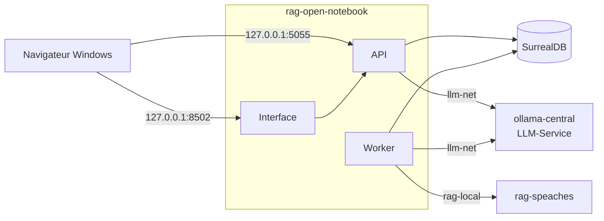

# Open Notebook — banc d'essai et manuels vérifiés

**Interroger ses propres documents avec une IA qui cite ses sources, sur sa machine, sans service en ligne : Open Notebook installé, mesuré sur 38 questions et documenté en 13 manuels.**


Open Notebook 1.15.1 branché sur un service de modèles local (LLM-Service), un
corpus d'entreprise fictive avec ses pièges (scan, tableaux, audio, document en
anglais), un banc de 38 questions dont les réponses sont connues, et des manuels
écrits à partir de ce qui a réellement tourné. Chaque commande a été exécutée,
chaque chiffre renvoie à un résultat brut dans `outils/resultats/`.

Premier banc d'une série : RAGFlow, Kotaemon, AnythingLLM, Open WebUI et
SurfSense passeront le même corpus et les mêmes questions.

## Sommaire

- [Architecture](#architecture)
- [Démarrage](#démarrage)
- [Configuration](#configuration)
- [API / Endpoints](#api--endpoints)
- [Tests](#tests)
- [Structure du projet](#structure-du-projet)
- [Licences & composants](#licences--composants)
- [Le parcours](#le-parcours)
- [Commandes utiles](#commandes-utiles)
- [Données du banc](#données-du-banc)
- [Les pièges que ce banc documente](#les-pièges-que-ce-banc-documente)
- [Résultats](#résultats)
- [Versions](#versions)
- [Ressources](#ressources)

## Architecture

Open Notebook ne contient aucun modèle : il appelle un service de modèles séparé,
partagé avec les autres applications.

| Service | Conteneur | Image | Rôle |
|---|---|---|---|
| Open Notebook | `rag-open-notebook` | `lfnovo/open_notebook:1.15.1` | interface (Next.js), API (FastAPI), worker des tâches de fond |
| Base de données | `rag-open-notebook-surrealdb` | `surrealdb/surrealdb:v2.7.0` | carnets, sources, passages, vecteurs |
| Modèles | `ollama-central` | `ollama/ollama` 0.30.7 | chat et embedding, servis par [LLM-Service](https://github.com/floSa/llm-service) (dépôt séparé) |
| Voix | `rag-speaches` | `ghcr.io/speaches-ai/speaches:0.8.3-cpu` | synthèse vocale (podcasts) et transcription (sources audio) |



Deux réseaux Docker : `llm-net` relie toutes les applications au service de
modèles ; `rag-local` relie Open Notebook à sa base et au serveur de voix.
Tous les ports sont publiés sur `127.0.0.1` uniquement.

## Démarrage

**Prérequis :** Windows 11 avec WSL2 (Ubuntu 24.04) et Docker Desktop ; 16 Go
de RAM, 8 cœurs, 20 Go de disque ; [LLM-Service](https://github.com/floSa/llm-service)
cloné dans `~/Projets/Projet-IA/LLM-Service`, branche `service-ollama`. Aucune
carte graphique n'est nécessaire.

> **Sous Windows :** travailler depuis un terminal WSL, avec le dépôt dans le
> système de fichiers Linux (`~/Projets/...`), pas sous `/mnt/c`.

```bash
uv venv .venv && uv pip install -p .venv reportlab python-docx python-pptx openpyxl pillow pymupdf
outils/open-notebook/installer.sh     # secrets, service de modèles, voix, conteneurs, configuration
```

| Service | URL | Note |
|---|---|---|
| Interface Open Notebook | http://127.0.0.1:8502 | mot de passe dans `donnees/IDENTIFIANTS-LOCAUX.txt` |
| API REST | http://127.0.0.1:5055 | documentation sur `/docs` ; en-tête `Authorization: Bearer <mot de passe>` |
| Service de modèles | http://127.0.0.1:11434 | Ollama de LLM-Service |
| Serveur de voix | http://127.0.0.1:8969 | API compatible OpenAI |

Puis lire la [présentation d'Open Notebook](docs/open-notebook/presentation.md)
et suivre la [prise en main](docs/open-notebook/02-prise-en-main.md).

## Configuration

`installer.sh` génère `donnees/open-notebook/.env` (jamais versionné) :

| Variable | Valeur | Effet |
|---|---|---|
| `OPEN_NOTEBOOK_PASSWORD` | générée | mot de passe de l'interface et de l'API |
| `OPEN_NOTEBOOK_ENCRYPTION_KEY` | générée | chiffre les clés de fournisseurs enregistrées ; à sauvegarder avec les données |
| `SURREAL_USER` / `SURREAL_PASSWORD` | `rag` / générée | accès à la base, non publiée |
| `OPEN_NOTEBOOK_ENABLE_DOCLING` | `true` | extraction des tableaux (6 Go installés au premier démarrage) |

Écarts au compose officiel, dans [outils/open-notebook/compose.override.yml](outils/open-notebook/compose.override.yml) :
noms `rag-`, ports sur `127.0.0.1`, images figées par empreinte, réseaux
`llm-net` et `rag-local`, délais allongés pour le CPU, variables de voix.

Réglages de LLM-Service pour ce banc (`.env` local de son dépôt) :

| Variable | Valeur | Pourquoi |
|---|---|---|
| `OLLAMA_CONTEXT_LENGTH` | `16384` | même taille de contexte pour toutes les applications : sinon le modèle est rechargé à chaque alternance |
| `OLLAMA_NUM_PARALLEL` | `1` | une requête à la fois, toute la mémoire de contexte pour elle |
| `PRELOAD_MODELS` | `qwen3:4b-instruct bge-m3` | modèles du banc |
| `LLAMA_ARG_THREADS` | `8` | sans ce réglage, 16 fils de calcul sur ce processeur hybride et 0,4 jeton/s au lieu de 13,3 |

## API / Endpoints

Routes de l'API d'Open Notebook utilisées par les scripts et les exemples
(client minimal : [outils/open-notebook/client.py](outils/open-notebook/client.py)) :

| Méthode | Route | Rôle |
|---|---|---|
| `GET` | `/health` | état de l'API, sans mot de passe |
| `POST` | `/api/notebooks` | créer un carnet |
| `POST` | `/api/sources` | ajouter un fichier (formulaire multipart) |
| `GET` | `/api/sources/{id}/status` | suivre l'extraction et l'indexation |
| `POST` | `/api/chat/sessions`, `/api/chat/context`, `/api/chat/execute` | poser une question avec les documents choisis |
| `POST` | `/api/search` | recherche plein texte ou vectorielle |
| `POST` | `/api/podcasts/generate` | générer un épisode |

Détail : [manuel 08, API REST et MCP](docs/open-notebook/08-api-et-mcp.md).

## Tests

```bash
python3 outils/communs/verifier_docs.py                     # manuels : liens, images, ancres, en-têtes, ton
.venv/bin/python outils/communs/banc/tests/test_commun.py   # notation du banc
.venv/bin/python outils/open-notebook/verif_minimale.py     # carnet, document, question, citation
.venv/bin/python outils/open-notebook/banc.py --etiquette essai   # banc complet, 38 questions
```

```
0 point(s) sur 21 fichier(s)
notation du banc : 16 contrôles OK
```

## Structure du projet

```text
Open-Notebook-Test-Bench/
├── README.md, REPRISE.md, RAPPORT-open-notebook.md, JOURNAL.md
├── docs/
│   ├── README.md                 # index général et comparatif des solutions
│   ├── glossaire.md
│   └── open-notebook/            # présentation, 13 manuels, captures d'écran
├── exemples/open-notebook/       # 6 exemples d'API et de MCP, sorties vérifiées
├── corpus/                       # 9 documents fictifs, empreintes, 38 questions
├── outils/
│   ├── communs/                  # diagnostic, LLM-Service, voix, corpus, banc, vérificateur
│   ├── open-notebook/            # installation, configuration, essais, banc, sauvegarde
│   └── resultats/                # résultats bruts : JSON, journaux, mesures
├── kit/                          # consigne de mission et fiches des six solutions
└── donnees/                      # volumes et identifiants locaux (non versionné)
```

## Licences & composants

| Composant | Rôle | Licence |
|---|---|---|
| Open Notebook | application testée | MIT |
| SurrealDB | base de données d'Open Notebook | Business Source License 1.1 |
| Ollama | service de modèles | MIT |
| Speaches | serveur de voix | MIT |
| Docling | extraction des tableaux | MIT |
| qwen3:4b-instruct, qwen3:4b | modèles de réponse | Apache License 2.0 |
| ministral-3:3b | modèle de réponse (comparaison) | Apache License 2.0 |
| bge-m3 | modèle d'embedding | MIT |
| Kokoro-82M | synthèse vocale | Apache License 2.0 |
| faster-whisper-small | transcription | MIT |
| Playwright | captures d'écran | Apache License 2.0 |
| **Ce projet** | manuels, scripts, corpus, banc | MIT — Copyright (c) 2026 floSa |

## Le parcours

| | Manuel | Ce qu'on saura faire |
|---|---|---|
| – | [Open Notebook en bref](docs/open-notebook/presentation.md) | savoir ce que fait l'outil, pour qui, sur quel matériel |
| 00 | [Notions fondamentales](docs/open-notebook/00-notions-fondamentales.md) | comprendre le RAG et l'architecture |
| 01 | [Installation](docs/open-notebook/01-installation.md) | installer, brancher les modèles, désinstaller |
| 02 | [Prise en main](docs/open-notebook/02-prise-en-main.md) | obtenir une première réponse citée |
| 03 | [Carnets, sources et formats](docs/open-notebook/03-carnets-sources-formats.md) | savoir ce qui est lu dans chaque format |
| 04 | [Chat et citations](docs/open-notebook/04-chat-et-citations.md) | choisir les documents envoyés, vérifier une citation |
| 05 | [Notes et transformations](docs/open-notebook/05-notes-et-transformations.md) | garder des réponses, produire des fiches |
| 06 | [Recherche](docs/open-notebook/06-recherche.md) | chercher par mots ou par le sens |
| 07 | [Podcasts](docs/open-notebook/07-podcasts.md) | générer un épisode à deux voix |
| 08 | [API REST et MCP](docs/open-notebook/08-api-et-mcp.md) | tout automatiser |
| 09 | [Recettes](docs/open-notebook/09-recettes.md) | dérouler trois cas d'usage complets |
| 10 | [Qualité et performances](docs/open-notebook/10-qualite-performances.md) | lire le banc, choisir les réglages et le matériel |
| 11 | [Exploitation](docs/open-notebook/11-exploitation.md) | sauvegarder, restaurer, mettre à jour, sécuriser |
| 12 | [Dépannage](docs/open-notebook/12-depannage.md) | résoudre les erreurs rencontrées |

**Parcours conseillés**

- *Découvrir* (30 min) : présentation → 02 → 09
- *Installer et exploiter* : 01 → 11 → 12
- *Comparer les solutions* : présentation → 10 → [comparatif](docs/README.md)
- *Automatiser* : 04 → 08

## Commandes utiles

```
Cycle de vie
  outils/open-notebook/demarrer.sh       démarre LLM-Service, la voix et l'application
  outils/open-notebook/etat.sh           conteneurs, santé, mémoire, modèles chargés
  outils/open-notebook/arreter.sh        arrête l'application (données conservées)
  outils/open-notebook/arreter.sh --voix arrête aussi le serveur de voix
  outils/communs/nettoyer.sh open-notebook  supprime l'application et ses données
Données
  outils/open-notebook/sauvegarder.sh    sauvegarde à froid dans donnees/sauvegardes/
  outils/open-notebook/restaurer.sh <archive>
Service de modèles
  outils/communs/llm_service.sh          démarre LLM-Service et vérifie les modèles
Exemples
  bash exemples/open-notebook/01_etat_api.sh
```

LLM-Service n'est jamais arrêté ni supprimé par ces scripts : d'autres
applications l'utilisent.

## Données du banc

Entreprise fictive Vélanor (vélos électriques), générée par
[outils/communs/generer_corpus.py](outils/communs/generer_corpus.py) avec une
graine fixe ; empreintes SHA-256 dans [corpus/MANIFEST.json](corpus/MANIFEST.json).

```
rapport-annuel-2025.pdf          10 pages, 6 tableaux de chiffres
contrat-batterix-scan.pdf        2 pages scannées (image seule)
procedure-batteries.docx         procédure avec un tableau
strategie-2026.pptx              5 diapositives
stocks-octobre-2025.xlsx         2 feuilles
faq-sav.html, cse-2025-10-14.md  page web, compte rendu
supplier-audit-batterix-en.pdf   audit en anglais
message-vocal-production.mp3     19 s d'audio
```

38 questions de référence ([corpus/questions.json](corpus/questions.json)) :
13 faits simples, 10 tableaux, 4 sur le scan, 3 multi-documents, 2 en anglais,
2 sur l'audio, et 4 pièges dont la réponse n'est pas dans les documents.
**Le scan et les pièges sont volontaires** : ils séparent un outil qui lit
vraiment de celui qui invente.

## Les pièges que ce banc documente

Tous rencontrés pendant les essais, chacun avec sa preuve dans `outils/resultats/`.

| # | Piège | Manuel |
|---|---|---|
| 1 | Sans Docling, les tableaux des fichiers Word disparaissent sans message | 03 |
| 2 | Avec Docling, l'OCR ne marche pas dans l'image 1.15.1 : un scan reste illisible | 03 |
| 3 | Transcription audio en échec tant que l'adresse du serveur de voix n'est pas passée par variable d'environnement | 03 |
| 4 | Le chat n'est pas une recherche : les documents cochés sont envoyés en entier, et au-delà du contexte la question échoue | 04 |
| 5 | Une source en mode « insights » n'est pas lue : le modèle répond « non mentionné » à tort | 04 |
| 6 | Deux tailles de contexte différentes sur le même modèle : Ollama le recharge à chaque question | 10 |
| 7 | Ollama sur processeur hybride : 16 fils de calcul, génération à 0,4 jeton/s | 12 |
| 8 | Un worker bloqué après une saturation mémoire laisse les podcasts en attente indéfiniment | 07 |
| 9 | Une citation valide peut couvrir un chiffre faux pris dans un autre document | 09 |
| 10 | Serveur MCP tiers : `create_source` en échec | 08 |

## Résultats

Chat de carnet, documents en entier, qwen3:4b-instruct sur CPU, contexte 16 384 jetons :

| Mesure | Résultat |
|---|---|
| Réponses justes | 28 / 34 (les 6 erreurs portent sur le scan) |
| Pièges refusés | 4 / 4 |
| Temps de réponse | 9 s en médiane, 24 s pour les plus lentes, 1 min 30 pour la première question |
| Indexation des 9 documents | 2 min |

Détail et comparaison des réglages : [manuel 10](docs/open-notebook/10-qualite-performances.md).
Bilan complet de la mission : [RAPPORT-open-notebook.md](RAPPORT-open-notebook.md).

## Versions

| Composant | Version |
|---|---|
| Open Notebook | 1.15.1 (publiée le 4 novembre 2026) |
| SurrealDB | 2.7.0 |
| Ollama | 0.30.7 |
| Speaches | 0.8.3-cpu |
| Docling | 2.130.0 |
| Docker / Compose | 29.9.2 / 5.6.1 |
| WSL / Ubuntu | 2.7.14 / 24.04.5 |

**Changer de version :** sauvegarder les données, modifier l'étiquette et
l'empreinte de l'image dans `compose.override.yml`, relancer `installer.sh`.
Depuis la 1.15.0, revenir à une version antérieure exige de restaurer une
sauvegarde ([manuel 11](docs/open-notebook/11-exploitation.md)).

## Ressources

- [Dépôt Open Notebook](https://github.com/lfnovo/open-notebook) et sa [documentation](https://github.com/lfnovo/open-notebook/tree/v1.15.1/docs)
- [LLM-Service](https://github.com/floSa/llm-service), le service de modèles partagé
- Documentation de l'API de l'instance : http://127.0.0.1:5055/docs
- Reprise du travail et suite de la série : [REPRISE.md](REPRISE.md)
