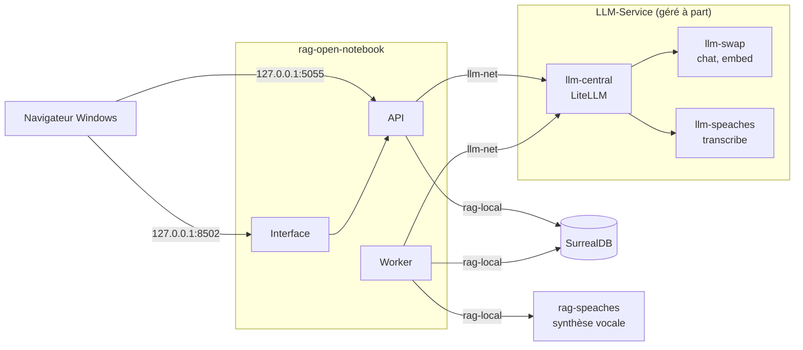

# Open Notebook — banc d'essai et manuels vérifiés

**Interroger ses propres documents avec une IA qui cite ses sources, sur sa machine, sans service en ligne : Open Notebook 1.15.1 installé, branché sur un service de modèles local, mesuré sur 38 questions et décrit dans un manuel utilisateur vérifié.**

**Le manuel commence ici : [docs/open-notebook/README.md](docs/open-notebook/README.md)** (partie 1 : manuel utilisateur en 13 chapitres, à lire dans l'ordre ; partie 2 : évaluation et compléments).


Open Notebook 1.15.1 branché sur le service LLM central (dépôt séparé
LLM-Service, qui sert tous les modèles sous des noms fixes), un corpus
d'entreprise fictive avec ses pièges (scan, tableaux, audio, document en
anglais), un banc de 38 questions dont les réponses sont connues, et un manuel
écrit à partir de ce qui a réellement tourné : chaque action de l'interface a
été faite à la souris par Playwright et capturée, chaque commande a été
exécutée, chaque chiffre renvoie à un résultat brut dans `outils/resultats/`.

Premier banc d'une série : RAGFlow, Kotaemon, AnythingLLM, Open WebUI et
SurfSense passeront le même corpus et les mêmes questions.

## Sommaire

- [Architecture](#architecture)
- [Démarrage](#démarrage)
- [Configuration](#configuration)
- [API / Endpoints](#api--endpoints)
- [Tests](#tests)
- [Structure du projet](#structure-du-projet)
- [Licences & composants](#licences--composants)
- [Le parcours](#le-parcours)
- [Commandes utiles](#commandes-utiles)
- [Données du banc](#données-du-banc)
- [Les pièges que ce banc documente](#les-pièges-que-ce-banc-documente)
- [Résultats](#résultats)
- [Versions](#versions)
- [Ressources](#ressources)

## Architecture

Open Notebook ne contient aucun modèle : il appelle le service LLM central,
un dépôt séparé ([LLM-Service](https://github.com/floSa/llm-service), branche
`service-llamacpp`) partagé avec les autres applications, géré à part. Ce dépôt
ne l'arrête ni ne le modifie jamais.

| Service | Conteneur | Image | Rôle |
|---|---|---|---|
| Open Notebook | `rag-open-notebook` | `lfnovo/open_notebook:1.15.1` | interface (Next.js), API (FastAPI), worker des tâches de fond, Docling |
| Base de données | `rag-open-notebook-surrealdb` | `surrealdb/surrealdb:v2.7.0` | carnets, sources, passages, vecteurs |
| Synthèse vocale | `rag-speaches` | `ghcr.io/speaches-ai/speaches:0.8.3-cpu` | voix des podcasts (Kokoro), seul modèle hors du service central |
| Service central : porte d'entrée | `llm-central` | `ghcr.io/berriai/litellm:v1.109.0` | LiteLLM, API compatible OpenAI, noms fixes `chat`, `embed`, `rerank`, `transcribe` (LLM-Service) |
| Service central : modèles | `llm-swap` | `ghcr.io/mostlygeek/llama-swap:v272-cuda-b12282` | llama.cpp : `chat` (Qwen3.5-4B) et `embed` (bge-m3) (LLM-Service) |
| Service central : transcription | `llm-speaches` | `ghcr.io/speaches-ai/speaches:0.8.3-cpu` | `transcribe` (faster-whisper-small) (LLM-Service) |

Images d'Open Notebook, de SurrealDB et de `rag-speaches` figées par empreinte ;
images du service central relevées par le
[diagnostic](outils/resultats/machine/diagnostic-2026-11-12.json).



Deux réseaux Docker externes : `llm-net` relie les applications au service
central (`http://llm-central:8080/v1`) ; `rag-local` relie Open Notebook à sa
base et au serveur de synthèse vocale. Tous les ports sont publiés sur
`127.0.0.1` uniquement ; SurrealDB n'est pas publié.

## Démarrage

**Prérequis :**

- Windows 11 avec WSL2 (Ubuntu 24.04) et Docker Desktop réglé sur le moteur
  WSL2, intégration de la distribution activée ; le dépôt dans le système de
  fichiers Linux (`~/mes_projets/...`), pas sous `/mnt/c`. Matériel conseillé,
  sans et avec carte graphique : [chapitre 01](docs/open-notebook/manuel/01-decouvrir-open-notebook.md)
  et [annexe A2](docs/open-notebook/annexes/A2-materiel-et-modeles.md).
- Le service LLM central démarré (dépôt LLM-Service, branche `service-llamacpp`).
- Un fichier `.env` à la racine, copie de [.env.example](.env.example), avec la
  clé `LLM_CENTRAL_KEY` du service (ignoré par git, jamais affiché).

```bash
cp .env.example .env                              # puis renseigner LLM_CENTRAL_KEY
outils/communs/llm_central_sante.sh --essai       # le service central répond-il ?
~/mes_projets/Projet-IA/LLM-Service/scripts/demarrer.sh   # seulement s'il ne répond pas (ajouter cpu sans carte NVIDIA)
uv venv --python 3.12 .venv && uv pip install -p .venv reportlab python-docx python-pptx openpyxl pillow pymupdf   # corpus et banc
outils/open-notebook/installer.sh                 # secrets, voix, conteneurs, branchement au service central
```

`installer.sh` est rejouable : il ne refait que ce qui manque. Sur la machine
d'essai, une réinstallation a pris 42 s
([journal](outils/resultats/open-notebook/installation-2026-11-12.log)).

| Service | URL | Note |
|---|---|---|
| Interface Open Notebook | http://127.0.0.1:8502 | mot de passe dans `donnees/IDENTIFIANTS-LOCAUX.txt` |
| API REST | http://127.0.0.1:5055 | documentation sur `/docs` ; en-tête `Authorization: Bearer <mot de passe>` |
| Service LLM central | http://127.0.0.1:8080/v1 | depuis l'hôte ; clé `LLM_CENTRAL_KEY` ; depuis un conteneur : `http://llm-central:8080/v1` |
| Serveur de synthèse vocale | http://127.0.0.1:8969 | `rag-speaches`, API compatible OpenAI |

Puis suivre le manuel dans l'ordre :
[02. Installer Open Notebook](docs/open-notebook/manuel/02-installer-open-notebook.md),
[03. Premiers pas](docs/open-notebook/manuel/03-premiers-pas.md),
[04. Première question en dix minutes](docs/open-notebook/manuel/04-premiere-question.md).

## Configuration

`installer.sh` génère `donnees/open-notebook/.env` (jamais versionné) :

| Variable | Valeur | Effet |
|---|---|---|
| `OPEN_NOTEBOOK_PASSWORD` | générée | mot de passe de l'interface et de l'API |
| `OPEN_NOTEBOOK_ENCRYPTION_KEY` | générée | chiffre les clés de fournisseurs enregistrées ; à sauvegarder avec les données |
| `SURREAL_USER` / `SURREAL_PASSWORD` | `rag` / générée | accès à la base, non publiée |
| `OPEN_NOTEBOOK_ENABLE_DOCLING` | `true` | extraction des tableaux (6 Go installés au premier démarrage) |
| `DONNEES` | `donnees/open-notebook` (chemin relatif) | volumes de la base et de l'application |

Toutes les commandes Docker passent par
[outils/open-notebook/compose.sh](outils/open-notebook/compose.sh), qui lit deux
fichiers de variables : `donnees/open-notebook/.env` (secrets locaux), puis le
`.env` du dépôt (clé du service central, jamais recopiée dans `donnees/`).

**Écarts au compose officiel**, dans
[outils/open-notebook/compose.override.yml](outils/open-notebook/compose.override.yml)
(détail : [annexe A5](docs/open-notebook/annexes/A5-fonctionnement-interne.md)) :

| Réglage | Compose officiel | Override du dépôt |
|---|---|---|
| Images | `v1-latest` et `surrealdb:v2`, retéléchargées | `1.15.1` et `v2.7.0` figées par empreinte |
| Ports | toutes interfaces ; SurrealDB sur `127.0.0.1:8000` | `127.0.0.1:8502` et `127.0.0.1:5055` ; SurrealDB non publié |
| Secrets | aucun mot de passe, clé de chiffrement d'exemple, `root` / `root` | générés localement |
| Tâches de fond simultanées | 5 | 1 (`OPEN_NOTEBOOK_WORKER_MAX_TASKS`), service central partagé |
| Délai d'un appel LLM | 180 s | 900 s (`ESPERANTO_LLM_TIMEOUT`), réflexion de `chat` ; embeddings 300 s |
| Découpage | défaut du code | 400 jetons, recouvrement 60 jetons, fixés explicitement |
| Transcription | non fixée | `OPENAI_COMPATIBLE_BASE_URL_STT=http://llm-central:8080/v1`, clé `LLM_CENTRAL_KEY` |
| Synthèse vocale | aucune | `OPENAI_COMPATIBLE_BASE_URL_TTS=http://rag-speaches:8000/v1` |
| Réseaux, données | réseau du projet, dossiers locaux | réseaux externes `rag-local` et `llm-net` ; `donnees/open-notebook/` |

**Branchement au service central** (fait par
[outils/open-notebook/configurer.py](outils/open-notebook/configurer.py), ou à la
main dans l'interface : [chapitre 03](docs/open-notebook/manuel/03-premiers-pas.md)) :

| Élément | Valeur |
|---|---|
| Fournisseur dans Open Notebook | « OpenAI Compatible », configuration `llm-central` (modalités language, embedding, speech_to_text) |
| Base URL | `http://llm-central:8080/v1` (réseau `llm-net`) |
| Clé | `LLM_CENTRAL_KEY`, lue dans le `.env` du dépôt (copie de `.env.example`) ; jamais affichée ni commitée |
| Synthèse vocale | configuration séparée `speaches-voix` (text_to_speech), vers `rag-speaches` |

| Nom fixe | Modèle réel | Usage dans Open Notebook |
|---|---|---|
| `chat` | Qwen3.5-4B, réflexion activée, 16 384 jetons par requête | chat, transformations, outils, large contexte |
| `embed` | bge-m3, 1 024 dimensions | embeddings des passages et des questions |
| `rerank` | bge-reranker-v2-m3 | aucun : Open Notebook 1.15.1 n'accepte pas de reranker (« out of scope #1087 ») |
| `transcribe` | faster-whisper-small | transcription des sources audio |

Configuration relevée : [configuration-2026-11-12.json](outils/resultats/open-notebook/configuration-2026-11-12.json).

## API / Endpoints

Routes de l'API d'Open Notebook utilisées par les scripts et les exemples
(client minimal : [outils/open-notebook/client.py](outils/open-notebook/client.py)) :

| Méthode | Route | Rôle |
|---|---|---|
| `GET` | `/health` | état de l'API, sans mot de passe |
| `POST` | `/api/notebooks` | créer un carnet |
| `POST` | `/api/sources` | ajouter un fichier (formulaire multipart) |
| `GET` | `/api/sources/{id}/status` | suivre l'extraction et l'indexation |
| `POST` | `/api/chat/sessions`, `/api/chat/context`, `/api/chat/execute` | poser une question avec les documents choisis |
| `POST` | `/api/search` | recherche plein texte ou vectorielle |
| `POST` | `/api/podcasts/generate` | générer un épisode |
| `GET`, `POST`, `PUT` | `/api/credentials`, `/api/credentials/{id}/test` | déclarer et tester un fournisseur de modèles |

Routes du service central appelées par
[outils/communs/llm_central_sante.sh](outils/communs/llm_central_sante.sh) :
`/v1/models`, `/v1/chat/completions`, `/v1/embeddings`, `/v1/rerank`,
`/v1/audio/transcriptions`.

Détail, exemples exécutés et serveur MCP : [annexe A3](docs/open-notebook/annexes/A3-api-et-mcp.md).

## Tests

```bash
outils/communs/llm_central_sante.sh --essai                    # service central : modèles et un essai par usage
uv run python outils/open-notebook/verif_minimale.py           # mot de passe, carnet, document, question, citation
outils/open-notebook/verifier_ports.sh                         # ports liés à 127.0.0.1 seulement
uv run python outils/open-notebook/banc.py --etiquette central-chat   # banc complet, 38 questions
uv run python outils/communs/banc/tests/test_commun.py         # notation du banc
python3 outils/communs/verifier_docs.py                        # manuels : liens, images, ancres, en-têtes, ton
```

Santé du service central (12 novembre 2026, extrait) :

```
== http://127.0.0.1:8080/v1/models
  chat (chat)
  embed (embedding)
  rerank (rerank)
  transcribe (audio_transcription)
  ...
== embed
  dimensions : 1024
== rerank
  doc 0 score 9.05
  doc 1 score -8.63
== transcribe (corpus/documents/message-vocal-production.mp3)
  Message vocale de Julien Moreau, directeur de production chez Vélanor, ...
```

Vérification minimale ([verif-minimale-2026-11-12.json](outils/resultats/open-notebook/verif-minimale-2026-11-12.json)) :
sans mot de passe, `401 {"detail":"Missing authorization header"}` ; document
indexé en 5,4 s ; réponse « la durée de garantie pour le cadre est de **7 ans** »
en 9,9 s, citation `[source:…]` présente.

Ports ([ports-2026-11-12.txt](outils/resultats/open-notebook/ports-2026-11-12.txt), extrait) :

```
port 8502 : 127.0.0.1 -> HTTP 307 ; 172.28.171.62 -> HTTP 000 (000 = refusé)
port 5055 : 127.0.0.1 -> HTTP 200 ; 172.28.171.62 -> HTTP 000 (000 = refusé)
port 8080 : 127.0.0.1 -> HTTP 200 ; 172.28.171.62 -> HTTP 000 (000 = refusé)
port 8969 : 127.0.0.1 -> HTTP 404 ; 172.28.171.62 -> HTTP 000 (000 = refusé)
-- écoute 0.0.0.0 côté hôte (doit être vide)
(aucune)
```

Banc ([journal](outils/resultats/open-notebook/essai-2026-11-12-banc-chat.log), dernière ligne) et auto-contrôle de la notation :

```
exactes 28/34, refus 4/4, bon document cité 29, p50 8.69 s, p95 27.92 s
notation du banc : 16 contrôles OK
```

## Structure du projet

```text
Open-Notebook-Test-Bench/
├── README.md, REPRISE.md, RAPPORT-open-notebook.md, JOURNAL.md, LICENSE
├── .env.example                  # modèle du .env (clé du service central) ; .env ignoré par git
├── docs/
│   ├── README.md                 # index général et comparatif des solutions
│   ├── glossaire.md
│   └── open-notebook/
│       ├── README.md             # page d'accueil du manuel
│       ├── presentation.md       # Open Notebook en une page
│       ├── manuel/               # partie 1 : manuel utilisateur, 13 chapitres
│       ├── annexes/              # partie 2 : A1 à A6, carte de l'interface
│       └── img/                  # captures annotées, par chapitre
├── exemples/open-notebook/       # 6 exemples d'API et de MCP, sorties vérifiées
├── corpus/                       # 9 documents fictifs, empreintes, 38 questions
├── outils/
│   ├── communs/                  # diagnostic, santé du service central, voix, corpus, banc, captures, vérificateur
│   ├── open-notebook/            # compose, installation, configuration, essais, banc, sauvegarde, captures
│   └── resultats/                # résultats bruts : JSON, journaux, mesures
├── kit/                          # consigne de mission et fiches des six solutions
└── donnees/                      # volumes et identifiants locaux (non versionné)
```

Rôle de chaque script : [outils/README.md](outils/README.md).

## Licences & composants

| Composant | Rôle | Licence |
|---|---|---|
| Open Notebook | application testée | MIT |
| SurrealDB | base de données d'Open Notebook | Business Source License 1.1 |
| Docling | extraction des tableaux | MIT |
| LiteLLM | porte d'entrée du service central (`llm-central`) | MIT (hors dossier `enterprise`) |
| llama.cpp, llama-swap | moteur et aiguillage des modèles du service central (`llm-swap`) | MIT |
| Speaches | transcription (`llm-speaches`) et synthèse vocale (`rag-speaches`) | MIT |
| Qwen3.5-4B | modèle de réponse (`chat`) | Apache License 2.0 |
| bge-m3 | modèle d'embedding (`embed`) | MIT |
| faster-whisper-small | transcription (`transcribe`) | MIT |
| Kokoro-82M | synthèse vocale | Apache License 2.0 |
| Playwright | actions à la souris et captures d'écran | Apache License 2.0 |
| Ollama, qwen3:4b-instruct | bancs antérieurs sur processeur | MIT ; Apache License 2.0 |
| vLLM, Gemma 4 E4B | bancs antérieurs sur carte graphique | Apache License 2.0 ; licence Gemma (Google, usage sous conditions) |
| **Ce projet** | manuels, scripts, corpus, banc | MIT — Copyright (c) 2026 floSa |

## Le parcours

Page d'accueil et sommaire complet : [docs/open-notebook/README.md](docs/open-notebook/README.md).

**Partie 1 — Manuel utilisateur** (à lire dans l'ordre)

| N° | Chapitre | Ce qu'on saura faire |
|---|---|---|
| 01 | [Découvrir Open Notebook](docs/open-notebook/manuel/01-decouvrir-open-notebook.md) | dire à quoi sert l'outil, pour qui, ce qu'il demande comme machine, et les mots de base |
| 02 | [Installer Open Notebook](docs/open-notebook/manuel/02-installer-open-notebook.md) | installer, démarrer, arrêter et désinstaller l'application sous Windows 11 + WSL2 |
| 03 | [Premiers pas](docs/open-notebook/manuel/03-premiers-pas.md) | se connecter, se repérer dans l'écran, déclarer les modèles d'IA |
| 04 | [Première question en dix minutes](docs/open-notebook/manuel/04-premiere-question.md) | créer un carnet, ajouter un document, poser une question et ouvrir la citation |
| 05 | [Ajouter et organiser ses sources](docs/open-notebook/manuel/05-ajouter-et-organiser-les-sources.md) | ajouter fichiers, liens et textes, suivre leur lecture, ranger et supprimer |
| 06 | [Discuter avec ses sources](docs/open-notebook/manuel/06-discuter-avec-les-sources.md) | choisir ce qui est envoyé au modèle, lire les citations, gérer plusieurs conversations |
| 07 | [Prendre des notes et transformer les sources](docs/open-notebook/manuel/07-notes-et-transformations.md) | garder des notes, appliquer et créer une transformation |
| 08 | [Rechercher et demander](docs/open-notebook/manuel/08-rechercher-et-demander.md) | chercher par mots ou par le sens, poser une question à tous les carnets |
| 09 | [Créer un podcast](docs/open-notebook/manuel/09-creer-un-podcast.md) | régler les voix et le déroulé, générer un épisode et l'écouter |
| 10 | [Régler l'application](docs/open-notebook/manuel/10-regler-l-application.md) | régler la lecture des documents, les embeddings et les options avancées |
| 11 | [Cas pratiques](docs/open-notebook/manuel/11-cas-pratiques.md) | mener trois cas réels de bout en bout sur un dossier d'entreprise |
| 12 | [En cas de problème](docs/open-notebook/manuel/12-en-cas-de-probleme.md) | reconnaître les erreurs rencontrées, leur cause et leur remède |
| 13 | [Glossaire](docs/open-notebook/manuel/13-glossaire.md) | retrouver le sens des mots de l'interface |

**Partie 2 — Évaluation et compléments**

| N° | Annexe | Contenu |
|---|---|---|
| A1 | [Évaluation : qualité et performances](docs/open-notebook/annexes/A1-qualite-et-performances.md) | banc de 38 questions, réglages qui changent le résultat, préconisations |
| A2 | [Choisir son matériel et ses modèles](docs/open-notebook/annexes/A2-materiel-et-modeles.md) | configurations minimales sans et avec carte graphique, temps d'attente |
| A3 | [Automatiser par l'API et MCP](docs/open-notebook/annexes/A3-api-et-mcp.md) | API REST, exemples exécutés, serveur MCP |
| A4 | [Exploitation](docs/open-notebook/annexes/A4-exploitation.md) | sauvegarde, restauration, mise à jour, journaux, sécurité |
| A5 | [Fonctionnement interne](docs/open-notebook/annexes/A5-fonctionnement-interne.md) | architecture, services, ports, override, service central |
| A6 | [Rapport d'essais](docs/open-notebook/annexes/A6-rapport-d-essais.md) | méthode, preuves, renvois aux résultats bruts |
| — | [Carte de l'interface](docs/open-notebook/annexes/carte-interface.md) | chaque page, menu et réglage, et le chapitre qui le couvre |

Une présentation d'une page reste disponible : [Open Notebook en bref](docs/open-notebook/presentation.md).

**Parcours conseillés**

| Objectif | Lire |
|---|---|
| Savoir si l'outil convient | 01, puis A1 et A2 |
| Installer et essayer | 01, 02, 03, 04 |
| Travailler sur ses documents au quotidien | 05, 06, 07, 08, puis 11 |
| Produire un podcast | 04, 09 |
| Automatiser | 04, puis A3 |
| Exploiter et dépanner | 12, A4, A5 |
| Comparer les solutions | A1, puis le [comparatif](docs/README.md) |

## Commandes utiles

```
Cycle de vie
  outils/open-notebook/installer.sh         installe ou répare (rejouable)
  outils/open-notebook/demarrer.sh          vérifie le service central, démarre la voix et l'application
  outils/open-notebook/etat.sh              conteneurs, santé de l'API, de l'interface et du service central, mémoire
  outils/open-notebook/arreter.sh           arrête l'application (données conservées)
  outils/open-notebook/arreter.sh --voix    arrête aussi le serveur de synthèse vocale
  outils/open-notebook/compose.sh ps|logs   docker compose avec les bons fichiers de variables
  outils/communs/nettoyer.sh open-notebook  supprime l'application et ses données
Configuration
  python3 outils/open-notebook/configurer.py --voix   rebranche le service central et la synthèse vocale
  outils/open-notebook/verifier_ports.sh    contrôle des ports
Données
  outils/open-notebook/sauvegarder.sh       sauvegarde à froid dans donnees/sauvegardes/
  outils/open-notebook/restaurer.sh <archive>
Service LLM central (géré à part)
  outils/communs/llm_central_sante.sh --essai           santé, lecture seule
  ~/mes_projets/Projet-IA/LLM-Service/scripts/demarrer.sh   le lancer s'il ne répond pas
Exemples
  bash exemples/open-notebook/01_etat_api.sh
```

Le service LLM central n'est jamais arrêté, modifié ni supprimé par ces
scripts : d'autres applications l'utilisent.

## Données du banc

Entreprise fictive Vélanor (vélos électriques), générée par
[outils/communs/generer_corpus.py](outils/communs/generer_corpus.py) avec une
graine fixe ; empreintes SHA-256 dans [corpus/MANIFEST.json](corpus/MANIFEST.json).

```
rapport-annuel-2025.pdf          10 pages, 6 tableaux de chiffres
contrat-batterix-scan.pdf        2 pages scannées (image seule)
procedure-batteries.docx         procédure avec un tableau
strategie-2026.pptx              5 diapositives
stocks-octobre-2025.xlsx         2 feuilles
faq-sav.html, cse-2025-10-14.md  page web, compte rendu
supplier-audit-batterix-en.pdf   audit en anglais
message-vocal-production.mp3     19 s d'audio
```

38 questions de référence ([corpus/questions.json](corpus/questions.json)) :
13 faits simples, 10 tableaux, 4 sur le scan, 3 multi-documents, 2 en anglais,
2 sur l'audio, et 4 pièges dont la réponse n'est pas dans les documents.
**Le scan et les pièges sont volontaires** : ils séparent un outil qui lit
vraiment de celui qui invente.

## Les pièges que ce banc documente

Tous rencontrés pendant les essais, chacun avec sa preuve dans `outils/resultats/`.

| # | Piège | Où le lire |
|---|---|---|
| 1 | Un nouveau document part au modèle par son seul aperçu tant qu'il n'est pas passé en « contenu complet » : le modèle peut répondre « non mentionné » à tort | [06](docs/open-notebook/manuel/06-discuter-avec-les-sources.md) |
| 2 | Le chat n'est pas une recherche : les documents choisis sont envoyés en entier, et au-delà de 16 384 jetons la question échoue | [06](docs/open-notebook/manuel/06-discuter-avec-les-sources.md) |
| 3 | Choisir un autre modèle d'embedding ouvre la confirmation « Changement de modèle d'embedding » : les index de recherche sont à reconstruire | [03](docs/open-notebook/manuel/03-premiers-pas.md) |
| 4 | « Attribution automatique des défauts » répond « déjà configurés » quand l'ancien modèle par défaut a été supprimé : les cases sont à remplir à la main | [03](docs/open-notebook/manuel/03-premiers-pas.md) |
| 5 | La transcription audio ignore la Base URL enregistrée pour « OpenAI Compatible » et lit `OPENAI_COMPATIBLE_BASE_URL_STT` : sans cette variable, source audio en échec | [A5](docs/open-notebook/annexes/A5-fonctionnement-interne.md) |
| 6 | Pas de reranker : Open Notebook 1.15.1 refuse ce type de modèle (« Reranking is out of scope (#1087) »), `rerank` du service central reste inutilisé | [A1](docs/open-notebook/annexes/A1-qualite-et-performances.md) |
| 7 | La réflexion de `chat` n'est pas réglable dans Open Notebook : certaines réponses dépassent 20 s | [A1](docs/open-notebook/annexes/A1-qualite-et-performances.md) |
| 8 | OCR des scans inopérant dans l'image 1.15.1, même avec Docling : le contrat scanné reste illisible et la source en échec garde le titre « Processing... » | [05](docs/open-notebook/manuel/05-ajouter-et-organiser-les-sources.md) |
| 9 | Sans Docling, les tableaux des fichiers Word disparaissent sans message | [10](docs/open-notebook/manuel/10-regler-l-application.md) |
| 10 | Un worker bloqué après une saturation mémoire laisse les podcasts en attente indéfiniment | [09](docs/open-notebook/manuel/09-creer-un-podcast.md) |
| 11 | Une citation valide peut couvrir un chiffre faux pris dans un autre document | [11](docs/open-notebook/manuel/11-cas-pratiques.md) |
| 12 | Serveur MCP tiers : `create_source` en échec | [A3](docs/open-notebook/annexes/A3-api-et-mcp.md) |

## Résultats

Banc du 12 novembre 2026 : chat de carnet, documents en contenu complet, `chat`
du service central (Qwen3.5-4B, réflexion activée, 16 384 jetons), Docling
actif, carte RTX 4060 Ti 16 Go
([JSON](outils/resultats/open-notebook/banc-2026-11-12-central-chat.json),
[tableau](outils/resultats/open-notebook/banc-2026-11-12-central-chat.md)) :

| Mesure | Résultat |
|---|---|
| Réponses justes | 28 / 34 (les 6 erreurs viennent du contrat scanné : 4 questions sur le scan, 2 multi-documents qui en dépendent) |
| Pièges refusés | 4 / 4 |
| Bon document cité | 29 |
| Par type | tableaux 10/10, faits simples 13/13, anglais 2/2, audio 2/2, multi-documents 1/3, scan 0/4 |
| Temps de réponse | 8,7 s en médiane, 27,9 s au 95e centile |
| Indexation des 9 documents | 65 s |
| Mémoire | pic de 4,7 Go pour l'application (Docling) ; carte graphique 8,4 Go sur 16 Go |

Bancs antérieurs, sur l'ancienne pile et avec d'autres modèles (non comparables
tels quels) : Ollama sur processeur (qwen3:4b-instruct), 28/34, médiane 7,4 s ;
vLLM sur carte graphique (Gemma 4 E4B), 28/34, médiane 1,9 s.

Détail et comparaison des réglages : [annexe A1](docs/open-notebook/annexes/A1-qualite-et-performances.md).
Méthode et preuves : [annexe A6](docs/open-notebook/annexes/A6-rapport-d-essais.md).
Bilan complet de la mission : [RAPPORT-open-notebook.md](RAPPORT-open-notebook.md).

## Versions

Relevé du 12 novembre 2026 ([versions](outils/resultats/open-notebook/versions-2026-11-12.json),
[diagnostic de la machine](outils/resultats/machine/diagnostic-2026-11-12.json),
[identité du dépôt](outils/resultats/open-notebook/identite-github-2026-11-12.json)) :

| Composant | Version |
|---|---|
| Open Notebook | 1.15.1, dernière stable (publiée le 4 novembre 2026) |
| SurrealDB | 2.7.0, imposée par le compose officiel (`surrealdb:v2`) ; dernière stable 4.0.1, non essayée |
| Speaches (`rag-speaches`) | 0.8.3-cpu |
| Docling | 2.130.0 |
| Service central | LiteLLM v1.109.0, llama-swap v272-cuda-b12282, Speaches 0.8.3-cpu ; LLM-Service branche `service-llamacpp`, profil `gpu` |
| Docker / Compose | 29.9.3 / 5.7.0 |
| WSL / Ubuntu | 3.0.5.0 / 24.04.5 |
| Machine d'essai | Ryzen 5 9600X, 32 Go, RTX 4060 Ti 16 Go, Windows 11 + WSL2 |

**Changer de version :** sauvegarder les données, modifier l'étiquette et
l'empreinte de l'image dans `compose.override.yml`, relancer `installer.sh`.
Depuis la 1.15.0, revenir à une version antérieure exige de restaurer une
sauvegarde ([annexe A4](docs/open-notebook/annexes/A4-exploitation.md)).

## Ressources

- [Dépôt Open Notebook](https://github.com/lfnovo/open-notebook) et sa [documentation](https://github.com/lfnovo/open-notebook/tree/v1.15.1/docs)
- [LLM-Service](https://github.com/floSa/llm-service), le service de modèles partagé (branche `service-llamacpp`)
- Documentation de l'API de l'instance : http://127.0.0.1:5055/docs
- Manuel : [docs/open-notebook/README.md](docs/open-notebook/README.md) ; glossaire de la série : [docs/glossaire.md](docs/glossaire.md)
- Rôle des scripts : [outils/README.md](outils/README.md)
- Reprise du travail et suite de la série : [REPRISE.md](REPRISE.md)
