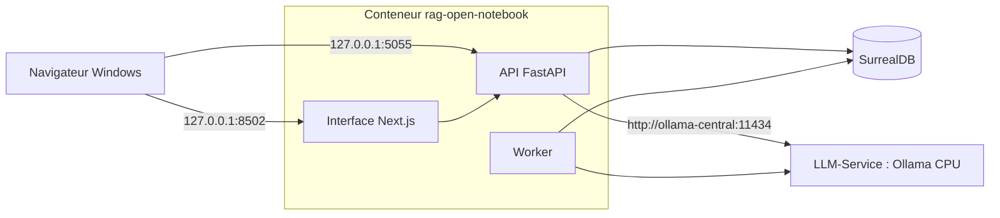

# 00. Notions fondamentales

> **Objet** : comprendre le RAG (génération augmentée par récupération) et la façon dont Open Notebook l'applique ; connaître les services et les ports de l'installation.
> **Prérequis** : aucun.
> **Version décrite** : Open Notebook 1.15.1 (image `lfnovo/open_notebook:1.15.1`), SurrealDB 2.7.0, Ollama 0.40.15 (essais du 8 novembre faits sur 0.30.7 ; banc de référence rejoué sur 0.40.15) sur CPU, modèles qwen3:4b-instruct et bge-m3 ; Windows 11, WSL2 Ubuntu 24.04.
> **Statut des informations** : [Vérifié] observé ou mesuré le 2026-11-08 sur la machine d'essai (Intel Core Ultra 7 255H, 15,3 Go de RAM dans WSL, sans GPU NVIDIA) ; [Source] documentation officielle ou code source au tag v1.15.1 ; [Estimation] calcul non mesuré ; [À tester] non documenté et non essayé.
> **Précautions** : données fictives uniquement (corpus Vélanor) ; le code source a été relu avant installation ([relecture](../../outils/resultats/open-notebook/relecture.md)).

## Sommaire

1. [Le RAG en bref](#1-le-rag-en-bref)
2. [Les briques d'un RAG](#2-les-briques-dun-rag)
3. [Ce qu'Open Notebook fait autrement](#3-ce-quopen-notebook-fait-autrement)
4. [Architecture de l'installation](#4-architecture-de-linstallation)
5. [Vocabulaire de l'interface](#5-vocabulaire-de-linterface)
6. [Dépannage](#dépannage)
7. [Sources](#sources)

## 1. Le RAG en bref

### Essentiel

Un modèle de langage ne connaît pas les documents d'une entreprise. Le RAG les lui fournit au moment de la question : l'outil retrouve les passages utiles, les place dans le prompt, puis le modèle répond à partir d'eux et cite d'où vient l'information.

Trois étapes :

1. **Indexation** : chaque document est converti en texte, découpé en passages, puis chaque passage reçoit un embedding (un vecteur qui résume son sens).
2. **Récupération** : la question reçoit elle aussi un embedding ; l'outil cherche les passages les plus proches.
3. **Génération** : le modèle reçoit la question et les passages, et rédige la réponse.

### Pour aller plus loin

La qualité finale dépend surtout des deux premières étapes : un texte mal extrait (scan sans OCR, tableau aplati) ou un passage non retrouvé ne peut pas être rattrapé par le modèle.

## 2. Les briques d'un RAG

### Essentiel

| Brique | Rôle | Réglage typique |
|---|---|---|
| Extraction | Transformer PDF, DOCX, PPTX, XLSX, HTML en texte | moteur d'extraction, OCR pour les scans |
| Découpage | Couper le texte en passages | taille (en jetons) et recouvrement |
| Embedding | Représenter chaque passage par un vecteur | modèle multilingue, par exemple bge-m3 |
| Recherche vectorielle | Retrouver les passages proches par le sens | nombre de résultats (top-k), score minimal |
| Recherche plein texte | Retrouver les passages qui contiennent les mots | algorithme BM25 |
| Recherche hybride | Combiner les deux recherches | pondération |
| Reranking | Reclasser les passages retrouvés avec un modèle dédié | nombre de passages gardés |
| Génération | Rédiger la réponse avec citations | modèle, taille de contexte |

### Pour aller plus loin

Le **budget de contexte** limite tout le reste : consignes, passages, historique et réponse doivent tenir dans la taille de contexte du modèle (`num_ctx` dans Ollama). Sur la machine d'essai, sans GPU, la lecture du prompt est lente : de 24 à 67 jetons par seconde avec qwen3:4b-instruct selon `num_ctx` (36 jetons par seconde au réglage retenu, 16384) [Vérifié] ([mesures du socle](../../outils/resultats/socle/)). Un prompt de 4 000 jetons demande donc une à deux minutes avant le premier mot de la réponse.

## 3. Ce qu'Open Notebook fait autrement

### Essentiel

Open Notebook reprend le principe de NotebookLM : des **carnets** (notebooks) qui regroupent des **sources**, des **notes** et des **conversations**.

- Le **chat d'un carnet** ne fait pas de recherche top-k : l'utilisateur choisit, source par source, ce qui est envoyé au modèle (« not in », « insights » ou « full content »), et le texte choisi est placé en entier dans le prompt [Source] (`open_notebook/utils/context_builder.py`, `prompts/chat/system.jinja`).
- La **recherche vectorielle** et la fonction **Ask** utilisent, elles, les passages découpés et leurs embeddings : Ask lance jusqu'à 5 recherches de 10 résultats chacune [Source] (`open_notebook/graphs/ask.py`).
- Les **citations** sont des identifiants placés dans le texte de la réponse, par exemple `[source:abc123]`, sans numéro de page [Source] (`prompts/chat/system.jinja`).

### Pour aller plus loin

Conséquence pratique : avec beaucoup de sources en « full content », le prompt dépasse vite le contexte du modèle. Dans le chat d'Open Notebook, la question échoue alors avec une erreur explicite (« exceeds the available context size ») [Vérifié] ([banc à 4096](../../outils/resultats/open-notebook/banc-2026-11-08-docling-qwen-fullcontent-ctx4096.json)), alors qu'un appel direct à Ollama tronque le prompt sans erreur ; le comportement est mesuré dans [Chat et citations](04-chat-et-citations.md) et dans [Qualité et performances](10-qualite-performances.md).

Il n'y a ni reranker ni recherche hybride réglable dans Open Notebook 1.15.1 [Source] ([synthèse du code](../../outils/resultats/open-notebook/cadrage-source.md)).

## 4. Architecture de l'installation

### Essentiel

| Service | Conteneur | Port publié | Rôle |
|---|---|---|---|
| Interface | `rag-open-notebook` | `127.0.0.1:8502` | pages web |
| API REST | `rag-open-notebook` | `127.0.0.1:5055` (documentation sur `/docs`) | tout le fonctionnement, aussi utilisé par l'interface |
| Worker | `rag-open-notebook` | aucun | tâches de fond : extraction, embeddings, transformations, podcasts |
| Base de données | `rag-open-notebook-surrealdb` | aucun | carnets, sources, passages, vecteurs |
| Modèles | `ollama-central` (LLM-Service, dépôt séparé, partagé avec d'autres applications) | `127.0.0.1:11434` | chat et embeddings |

Les trois processus de l'application tournent dans le même conteneur, lancés par supervisord [Source] (`supervisord.conf`). Open Notebook rejoint deux réseaux Docker : `llm-net` pour les modèles (LLM-Service) et `rag-local` pour la base et la voix.

### Pour aller plus loin

Le socle prévu par la série est vLLM sur GPU NVIDIA. La machine d'essai n'en a pas : le socle est Ollama sur CPU, repli prévu par la fiche de la solution. Ce choix figure dans les décisions en attente ([index](README.md#ce-qui-reste-ouvert)).

## 5. Vocabulaire de l'interface

### Essentiel

L'interface suit la langue du navigateur (bouton **Langue** en bas à gauche) ; elle est en français sur la machine d'essai et les libellés sont cités tels qu'affichés, avec le libellé anglais entre parenthèses [Vérifié]. Les termes sont définis dans le [glossaire](../glossaire.md).

| Libellé | Sens |
|---|---|
| Carnets (Notebooks) | carnets |
| Sources (Sources) | documents, pages web, textes ajoutés |
| Notes (Notes) | notes manuelles ou issues du chat |
| DISCUTER AVEC LE CARNET (Chat) | conversation dans un carnet |
| Transformations (Transformations) | consignes appliquées à une source (résumé, points clés) |
| Podcasts (Podcasts) | épisodes audio générés |
| Modèles (Models) | fournisseurs et modèles |
| Demander et rechercher | recherche et questions sur toutes les sources |

### Pour aller plus loin

Les libellés exacts relevés sur la version 1.15.1 figurent dans les captures du manuel [Prise en main](02-prise-en-main.md).

## Dépannage

| Symptôme | Cause probable | Action |
|---|---|---|
| « AI service error … exceeds the available context size » | prompt plus long que `num_ctx` | réduire les sources en « full content » ou augmenter `num_ctx` ([04](04-chat-et-citations.md)) |
| Citation sans page | comportement normal : Open Notebook cite la source, pas la page | ouvrir la source citée |

## Sources

- Dépôt officiel : https://github.com/lfnovo/open-notebook (tag v1.15.1) ; documentation : https://github.com/lfnovo/open-notebook/tree/v1.15.1/docs
- [Synthèse du code source](../../outils/resultats/open-notebook/cadrage-source.md) et [relecture](../../outils/resultats/open-notebook/relecture.md)
- [Diagnostic de la machine](../../outils/resultats/machine/diagnostic-2026-11-08.json)
