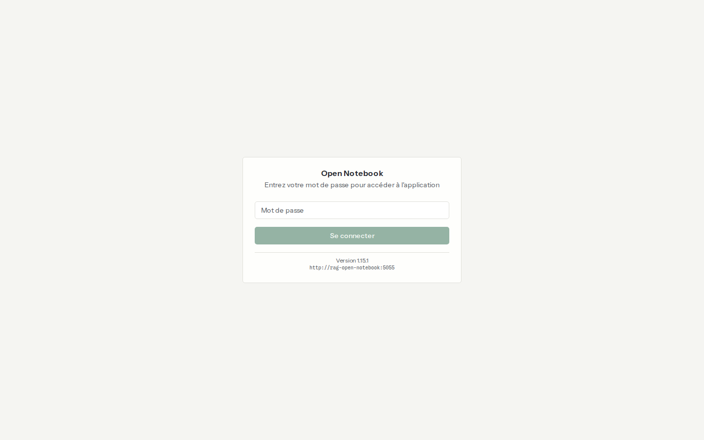
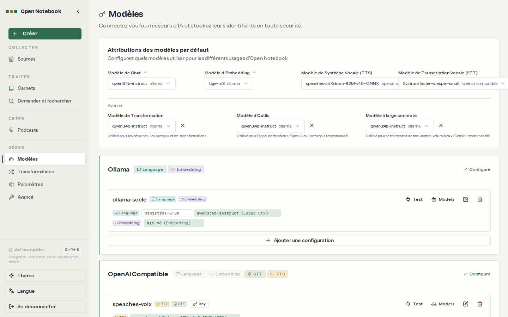

# 01. Installation sous Windows et WSL2

> **Objet** : installer Open Notebook 1.15.1 sous Windows 11 avec WSL2 et Docker Desktop, le brancher à un socle de modèles local, vérifier qu'il n'est joignable que depuis la machine, mesurer la mémoire consommée, mettre à jour et désinstaller.
> **Prérequis** : [00. Notions fondamentales](00-notions-fondamentales.md).
> **Version décrite** : Open Notebook 1.15.1 (`lfnovo/open_notebook:1.15.1@sha256:e4e18f12…95812`), SurrealDB 2.7.0 (`sha256:e5d7387e…45723`), Ollama 0.30.7 sur CPU (`sha256:46399ef0…11e3a`), Speaches 0.8.3-cpu ; modèles qwen3:4b-instruct, ministral-3:3b, bge-m3, Kokoro-82M, faster-whisper-small ; `num_ctx` 16384 ; Windows 11 (10.0.26300), WSL 2.7.14, Ubuntu 24.04.5, Docker 29.9.2, Compose 5.6.1.
> **Statut des informations** : [Vérifié] observé ou mesuré le 2026-11-08 sur la machine d'essai (Intel Core Ultra 7 255H, 16 fils, 15,3 Go de RAM dans WSL, aucun GPU NVIDIA) ; [Source] documentation officielle ou code source au tag v1.15.1 ; [Estimation] calcul non mesuré ; [À tester] non documenté et non essayé.
> **Précautions** : le compose officiel, le Dockerfile, le script d'entrée et le code d'authentification ont été relus avant installation ([relecture](../../outils/resultats/open-notebook/relecture.md)) ; secrets générés localement ; données fictives.

**Risques signalés.** Le compose officiel publie les ports 8502 et 5055 sur toutes les interfaces, sans mot de passe : n'importe quel appareil du réseau pourrait lire et modifier les carnets. L'installation décrite ici limite les ports à `127.0.0.1` et active le mot de passe ; ne pas reprendre le compose officiel tel quel [Source] (`docker-compose.yml:29-30`, `api/auth.py:37-38`). Par ailleurs, la version 1.15.0 a changé le chiffrement des clés enregistrées sans retour arrière possible vers une version plus ancienne [Source] (`CHANGELOG.md`, 1.15.0).

## Sommaire

1. [Prérequis mesurés](#1-prérequis-mesurés)
2. [Le service de modèles](#2-le-service-de-modèles)
3. [Installer Open Notebook](#3-installer-open-notebook)
4. [Ports et mot de passe](#4-ports-et-mot-de-passe)
5. [Brancher les modèles](#5-brancher-les-modèles)
6. [Mémoire et disque consommés](#6-mémoire-et-disque-consommés)
7. [Démarrer, arrêter, état](#7-démarrer-arrêter-état)
8. [Mettre à jour](#8-mettre-à-jour)
9. [Désinstaller complètement](#9-désinstaller-complètement)
10. [Dépannage](#dépannage)
11. [Sources](#sources)

## 1. Prérequis mesurés

### Essentiel

| Élément | Valeur sur la machine d'essai | Besoin minimal pour Open Notebook seul |
|---|---|---|
| Windows | 11, version 10.0.26300 | Windows 10 ou 11 avec WSL2 [Source] |
| WSL | 2.7.14, Ubuntu 24.04.5, noyau 6.18 | WSL2 |
| Docker | Docker Desktop, moteur 29.9.2, Compose 5.6.1 | Compose récent (balises `!override` et `!reset` utilisées dans l'override) |
| RAM visible dans WSL | 15,3 Go, swap 4 Go | environ 0,6 Go pour l'application, plus le modèle (voir section 6) |
| Disque libre | 619 Go | environ 3 Go d'images pour l'application, plus les modèles |
| GPU | Intel Arc 140T intégré, aucun GPU NVIDIA visible par Docker | aucun ; un GPU NVIDIA accélère fortement les modèles |

Valeurs [Vérifié] par `outils/communs/diagnostic.sh` ([résultat](../../outils/resultats/machine/diagnostic-2026-11-08.json)).

Préparation de Windows, à faire une seule fois avec des droits d'administrateur [Source] ([kit, LANCEMENT.md](../../kit/LANCEMENT.md)) : WSL2 et Ubuntu, mémoire allouée à WSL dans `%UserProfile%\.wslconfig`, Docker Desktop avec le moteur WSL2 et l'intégration de la distribution activée. Le dépôt doit être dans le système de fichiers de WSL (`~/…`), pas sous `/mnt/c`.

### Pour aller plus loin

Le diagnostic vérifie aussi l'accès aux registres d'images (Docker Hub, ghcr.io), à PyPI et à Hugging Face, et qu'un port publié sur `127.0.0.1` par Docker est joignable depuis WSL. Commande [Testée] :

```bash
outils/communs/diagnostic.sh
```

## 2. Le service de modèles

### Essentiel

Open Notebook ne contient aucun modèle : il appelle un service de modèles séparé, partagé avec les autres applications. Ce service est **LLM-Service**, un dépôt à part (`~/Projets/Projet-IA/LLM-Service`, branche `service-ollama`) : un seul Ollama, conteneur `ollama-central`, sert le chat et l'embedding à toutes les applications par le réseau Docker `llm-net`. Sur la machine d'essai, sans GPU NVIDIA, il tourne sur CPU grâce à un fichier local `docker-compose.override.yml` qui retire la réservation de GPU [Vérifié] ([migration](../../outils/resultats/socle/migration-llm-service-2026-11-08.txt)).

Démarrage et contrôle des modèles du banc [Testée] :

```bash
outils/communs/llm_service.sh
```

| Conteneur | Rôle | Port | Adresse vue par Open Notebook |
|---|---|---|---|
| `ollama-central` (LLM-Service) | chat (qwen3:4b-instruct, ministral-3:3b) et embedding (bge-m3) | `127.0.0.1:11434` | `http://ollama-central:11434` (réseau `llm-net`) |
| `rag-speaches` | synthèse vocale (Kokoro, voix `ff_siwis`) et transcription (faster-whisper-small) | `127.0.0.1:8969` | `http://rag-speaches:8000/v1` (réseau `rag-local`) |

Réglages du service (`.env` de LLM-Service) : `OLLAMA_CONTEXT_LENGTH=16384`, `OLLAMA_NUM_PARALLEL=1`, `OLLAMA_KEEP_ALIVE=30m`, `OLLAMA_FLASH_ATTENTION=1`, `OLLAMA_KV_CACHE_TYPE=q8_0`, `PRELOAD_MODELS=qwen3:4b-instruct bge-m3`. Toutes les applications branchées doivent demander la même taille de contexte (16384) : sinon Ollama recharge le modèle à chaque alternance ([Qualité et performances](10-qualite-performances.md#2-résultats)).

Les essais du 2026-11-08 (bancs, mesures) ont été faits avec un premier Ollama propre à la série (`rag-socle-ollama`), remplacé ensuite par LLM-Service avec les mêmes fichiers de modèles : mêmes poids, paramètres d'échantillonnage du registre mis à jour au passage ([migration](../../outils/resultats/socle/migration-llm-service-2026-11-08.txt)).

Le serveur de voix sert aux podcasts et aux sources audio ; il est installé par `outils/communs/voix.sh` [Testée] ([relecture préalable](../../outils/resultats/open-notebook/relecture-speaches.md)).

### Pour aller plus loin

Mesures du socle sur CPU [Vérifié] ([passe 1](../../outils/resultats/socle/mesures-2026-11-08-passe1.log), [passe 2](../../outils/resultats/socle/mesures-2026-11-08-passe2.json), script `outils/communs/mesure_modeles.py`) :

| Modèle | `num_ctx` | Génération (jetons/s) | Lecture du prompt (jetons/s) | Premier jeton, prompt d'un demi-contexte | RAM d'Ollama (2 requêtes simultanées) |
|---|---|---|---|---|---|
| qwen3:4b-instruct | 4096 | 17,3 | 67,4 | 39 s | 7,3 Go |
| qwen3:4b-instruct | 8192 | 16,3 | 53,2 | 98 s | 9,2 Go |
| qwen3:4b-instruct | 16384 | 14,7 | 36,0 | 290 s | 11,4 Go |
| qwen3:4b-instruct | 32768 | 17,9 | 23,9 | 873 s | 13,9 Go |
| ministral-3:3b | 4096 | 18,3 | 95,6 | 27 s | 6,3 Go |
| ministral-3:3b | 8192 | 17,3 | 61,8 | 76 s | 9,3 Go |

Le contexte de 32 768 jetons tient en mémoire mais n'est pas utilisable en pratique : près de 15 minutes avant le premier mot pour un prompt de 16 000 jetons. Le réglage retenu est 16 384, utilisé avec des prompts courts (le corpus d'essai entier tient en environ 3 000 jetons).

Le socle de référence de la série est vLLM sur GPU NVIDIA (`rag-vllm-chat` sur 8000, `rag-vllm-embed` sur 8001). Il n'a pas pu être installé ni mesuré sur cette machine ; avec vLLM, le fournisseur à choisir dans Open Notebook est « OpenAI Compatible » avec la Base URL `http://rag-vllm-chat:8000/v1` [À tester].

## 3. Installer Open Notebook

### Essentiel

Le script `outils/open-notebook/installer.sh` est rejouable : une seconde exécution ne change rien et dure 2 à 5 s [Vérifié]. Commande [Testée] :

```bash
outils/open-notebook/installer.sh
```

Il enchaîne :

1. vérification de l'empreinte du `docker-compose.yml` officiel (copie gardée dans `outils/open-notebook/officiel/`) ;
2. génération des secrets dans `donnees/open-notebook/.env` (clé de chiffrement de 256 bits, mot de passe, identifiants SurrealDB) et ajout des accès dans `donnees/IDENTIFIANTS-LOCAUX.txt` ;
3. démarrage du socle et du serveur de voix ;
4. démarrage d'Open Notebook avec le compose officiel et l'override `outils/open-notebook/compose.override.yml` ;
5. branchement des modèles par l'API (`outils/open-notebook/configurer.py --voix`).

Première installation : 146 s, dont 120 s perdues par une attente mal réglée (l'interface répond par une redirection 307, corrigé depuis) ; images déjà téléchargées [Vérifié] ([journal](../../outils/resultats/open-notebook/installation-2026-11-08.log)).

Ce que change l'override par rapport au compose officiel :

| Réglage | Compose officiel | Override du dépôt |
|---|---|---|
| Image de l'application | `lfnovo/open_notebook:v1-latest`, re-téléchargée à chaque démarrage | `1.15.1` figée par empreinte, `pull_policy: missing` |
| Image de la base | `surrealdb/surrealdb:v2` | `v2.7.0` figée par empreinte |
| Ports | `8502:8502`, `5055:5055` (toutes interfaces) | `127.0.0.1:8502`, `127.0.0.1:5055` |
| Port SurrealDB | `127.0.0.1:8000` | non publié |
| Mot de passe | aucun | `OPEN_NOTEBOOK_PASSWORD` aléatoire |
| Clé de chiffrement | `change-me-to-a-secret-string` | aléatoire, 64 caractères hexadécimaux |
| Identifiants SurrealDB | `root` / `root` | générés |
| Tâches de fond simultanées | 5 | 1 (`OPEN_NOTEBOOK_WORKER_MAX_TASKS`) |
| Délai d'un appel LLM | 180 s | 900 s (`ESPERANTO_LLM_TIMEOUT`), CPU lent |
| Données | `./surreal_data`, `./notebook_data` | `donnees/open-notebook/` |
| Réseau | réseau du projet | réseau externe `rag-local` |

### Pour aller plus loin

L'API attend la base de données au démarrage et applique les migrations de schéma elle-même [Source] (`api/main.py`). Le worker lit `SURREAL_NAMESPACE` et `SURREAL_DATABASE` avec un défaut `test`, différent de celui de l'API : sans ces deux variables, les tâches de fond ne sont jamais traitées [Source] (`open_notebook/database/repository.py:59-66`). Le compose officiel et l'override les fixent tous deux à `open_notebook`.

## 4. Ports et mot de passe

### Essentiel

| Adresse | Usage |
|---|---|
| `http://127.0.0.1:8502` | interface, à ouvrir dans le navigateur Windows |
| `http://127.0.0.1:5055` | API REST ; documentation interactive sur `http://127.0.0.1:5055/docs` |

Le mot de passe est dans `donnees/IDENTIFIANTS-LOCAUX.txt`. Écran de connexion [Vérifié] :



Test consigné [Vérifié] (`outils/open-notebook/verifier_ports.sh`, [résultat](../../outils/resultats/open-notebook/ports-2026-11-08.txt)) : chaque port répond sur `127.0.0.1` et refuse la connexion sur l'adresse réseau de WSL (172.26.195.23) ; aucun port n'écoute sur `0.0.0.0`. Sans en-tête d'authentification, l'API répond `401 {"detail":"Missing authorization header"}` [Vérifié] ([vérification minimale](../../outils/resultats/open-notebook/verif-minimale-2026-11-08.json)).

### Pour aller plus loin

Restent accessibles sans mot de passe : `/docs`, `/openapi.json`, `/health` et `/api/config` [Source] (`api/main.py:237-248`). Les limites de ce mot de passe unique sont décrites dans [Exploitation](11-exploitation.md).

## 5. Brancher les modèles

### Essentiel

Dans l'interface : **Modèles**, puis le fournisseur, **Ajouter une configuration**, puis les modèles, puis **Attributions des modèles par défaut**. Le script `configurer.py` fait la même chose par l'API, de façon rejouable [Testée].



| N° | Élément | Rôle |
|---|---|---|
| 1 | Attributions des modèles par défaut | Modèle de Chat et Modèle d'Embedding (obligatoires), TTS, STT ; puis Modèle de Transformation, Modèle d'Outils, Modèle à large contexte |
| 2 | Bloc « Ollama », configuration `llm-service` | Base URL `http://ollama-central:11434`, `num_ctx` 16384, modèles qwen3:4b-instruct, ministral-3:3b, bge-m3 |
| 3 | Bloc « OpenAI Compatible », configuration `speaches-voix` | Base URL `http://rag-speaches:8000/v1`, modèles TTS et STT |
| 4 | Boutons « Test » et « Models » | test de connexion et découverte des modèles du fournisseur |

Résultat du test de connexion [Vérifié] : « Connected. 3 models available: bge-m3:latest, ministral-3:3b, qwen3:4b-instruct » ([configuration](../../outils/resultats/open-notebook/configuration-2026-11-08.json)).

### Pour aller plus loin

- Le fournisseur « Ollama » ne propose que le langage et l'embedding ; la voix passe par « OpenAI Compatible » [Source] (`open_notebook/ai/provider_registry.py`).
- `num_ctx` se règle sur la configuration Ollama ; vide, il vaut 8192 [Source] (`open_notebook/domain/credential.py:79-83`).
- « Auto-assign » ne remplit que le chat et l'embedding, et prend le premier modèle par ordre alphabétique : ici, il aurait choisi ministral-3:3b. Le script fixe les modèles explicitement [Source] (`api/routers/models.py:752-850`).
- Défaut constaté : la transcription audio ignore la Base URL enregistrée pour « OpenAI Compatible » ; il faut aussi la variable `OPENAI_COMPATIBLE_BASE_URL_STT` ([Carnets, sources et formats](03-carnets-sources-formats.md)).

## 6. Mémoire et disque consommés

### Essentiel

Mémoire [Vérifié] (`docker stats`, [vérification minimale](../../outils/resultats/open-notebook/verif-minimale-2026-11-08.json)) :

| Conteneur | Au repos | Pendant une indexation | Ce qui consomme |
|---|---|---|---|
| `rag-open-notebook` | 378 Mo | 463 Mo | trois processus : interface Next.js, API FastAPI, worker |
| `rag-open-notebook-surrealdb` | 80 Mo | 84 Mo | base RocksDB |
| Application seule | 458 Mo | environ 550 Mo | |
| serveur de modèles (alors `rag-socle-ollama`) | 4,4 Go (qwen3 chargé) | 5,8 Go (qwen3 et bge-m3) | poids du modèle et mémoire de contexte (KV), proportionnelle à `num_ctx` et au nombre de requêtes simultanées |

L'essentiel de la mémoire va donc aux modèles, pas à l'application.

Disque [Vérifié] ([relevé](../../outils/resultats/open-notebook/disque-2026-11-08.txt)) :

| Élément | Taille |
|---|---|
| Image `lfnovo/open_notebook:1.15.1` | 2,46 Go |
| Image SurrealDB 2.7.0 | 118 Mo |
| Image Ollama 0.30.7 | 8,25 Go (image locale déjà présente) |
| Image Speaches 0.8.3-cpu | 3,04 Go |
| Modèles Ollama copiés (`donnees/socle/ollama`) | 6,2 Go |
| Données d'Open Notebook après installation | 0,4 Mo |

### Pour aller plus loin

Avec deux requêtes simultanées, la mémoire d'Ollama passe de 7,3 Go (`num_ctx` 4096) à 11,4 Go (16384) pour qwen3:4b-instruct [Vérifié]. Sur une machine de 16 Go, garder `num_ctx` à 16384 au plus, ou réduire `OLLAMA_NUM_PARALLEL` à 1 [Estimation] : la mémoire de contexte est alors divisée par deux environ.

## 7. Démarrer, arrêter, état

### Essentiel

Commandes [Testée] :

```bash
outils/open-notebook/demarrer.sh
```

```bash
outils/open-notebook/arreter.sh
```

```bash
outils/open-notebook/etat.sh
```

`arreter.sh --voix` arrête aussi le serveur de voix. LLM-Service n'est pas arrêté : il sert d'autres applications (`make down` dans son dépôt). Les données restent dans `donnees/open-notebook/`.

### Pour aller plus loin

Les conteneurs ont la politique `restart: unless-stopped` : ils redémarrent avec Docker Desktop, sauf s'ils ont été arrêtés à la main.

## 8. Mettre à jour

### Essentiel

Procédure [À tester] (non exécutée : une seule version était en jeu pendant les essais) :

1. sauvegarder `donnees/open-notebook/` ([Exploitation](11-exploitation.md)) ;
2. lire les notes de version ; la 1.15.0 interdit tout retour vers une version plus ancienne [Source] ;
3. remplacer l'étiquette et l'empreinte de l'image dans `compose.override.yml`, et la copie du compose officiel si elle a changé ;
4. relancer `outils/open-notebook/installer.sh` ; les migrations de schéma s'appliquent au démarrage de l'API [Source] (`api/main.py`).

### Pour aller plus loin

Ne pas activer de mise à jour automatique (Watchtower ou équivalent) : une mise à jour non relue peut changer le comportement ou le schéma de la base.

## 9. Désinstaller complètement

### Essentiel

Commande [Aide] (non lancée : la solution reste installée pour la démonstration) :

```bash
outils/communs/nettoyer.sh open-notebook
```

Elle supprime les conteneurs, volumes et réseau du projet `rag-open-notebook`, puis `donnees/open-notebook/`. Avec `--socle`, elle supprime aussi `rag-speaches`, le réseau `rag-local` et `donnees/socle/`. LLM-Service n'est jamais touché. Elle demande une confirmation, sauf avec `--oui`.

### Pour aller plus loin

Les images Docker ne sont pas supprimées par ce script. Les conteneurs d'autres projets dont le nom commence aussi par `rag-` (par exemple un ancien `rag-ollama` sur la machine d'essai) ne sont pas touchés : le script ne vise que des noms explicites.

## Dépannage

| Symptôme | Cause probable | Action |
|---|---|---|
| L'installateur attend deux minutes après « healthy » | l'interface répond 307 (redirection vers `/notebooks`), pas 200 | corrigé dans `installer.sh` : 200 ou 307 acceptés |
| `python3 -m venv` échoue (« ensurepip is not available ») | paquet `python3-venv` absent, installation impossible sans sudo | créer l'environnement avec `uv venv .venv` |
| `docker run --gpus all` : « no known GPU vendor found » | pas de GPU NVIDIA | socle Ollama sur CPU, ou machine équipée NVIDIA |
| API : `401 Missing authorization header` | mot de passe actif | en-tête `Authorization: Bearer <mot de passe>` |
| Les tâches de fond ne progressent jamais | namespace ou base SurrealDB différents entre API et worker [Source] | fixer `SURREAL_NAMESPACE` et `SURREAL_DATABASE` |

## Sources

- Compose officiel : https://github.com/lfnovo/open-notebook/blob/v1.15.1/docker-compose.yml ; référence des variables : https://github.com/lfnovo/open-notebook/blob/v1.15.1/docs/5-CONFIGURATION/environment-reference.md
- Images : `lfnovo/open_notebook:1.15.1`, `surrealdb/surrealdb:v2.7.0`, `ollama/ollama` 0.30.7, `ghcr.io/speaches-ai/speaches:0.8.3-cpu` (empreintes dans `compose.override.yml`, `voix.sh`, `voix.sh`)
- Scripts : `outils/communs/diagnostic.sh`, `llm_service.sh`, `voix.sh`, `mesure_modeles.py` ; `outils/open-notebook/installer.sh`, `configurer.py`, `verifier_ports.sh`, `verif_minimale.py`, `demarrer.sh`, `arreter.sh`, `etat.sh`
- Résultats : [installation](../../outils/resultats/open-notebook/installation-2026-11-08.log), [ports](../../outils/resultats/open-notebook/ports-2026-11-08.txt), [configuration](../../outils/resultats/open-notebook/configuration-2026-11-08.json), [disque](../../outils/resultats/open-notebook/disque-2026-11-08.txt), [relecture](../../outils/resultats/open-notebook/relecture.md)
