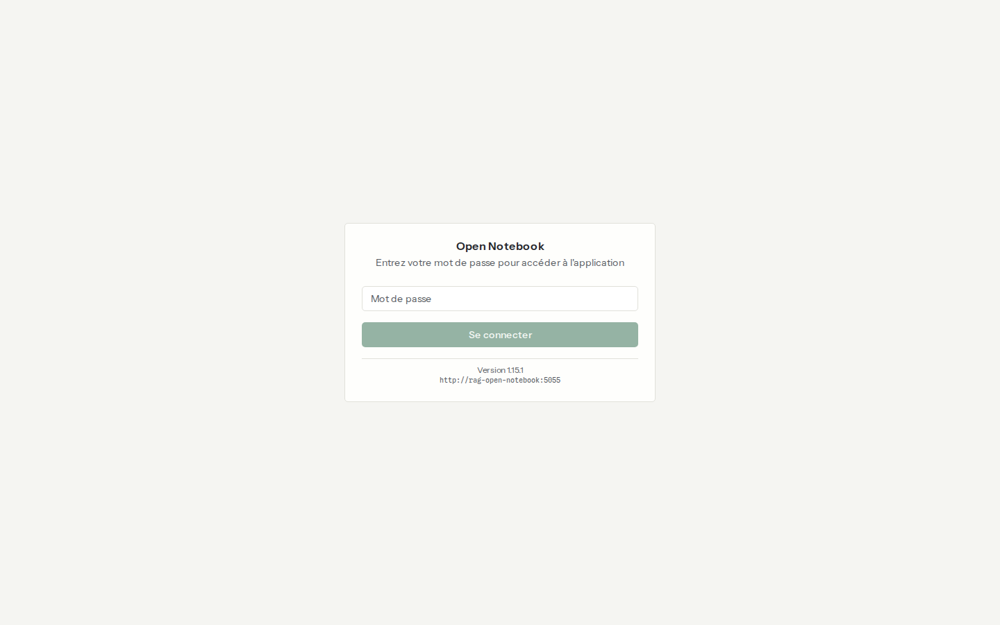
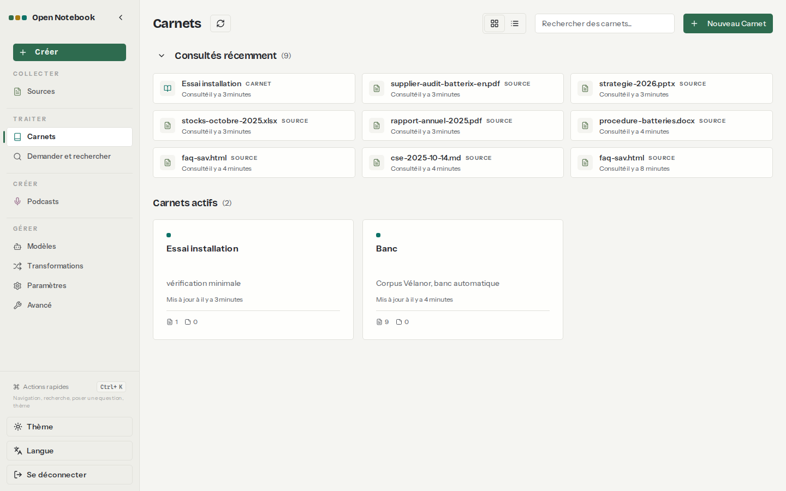
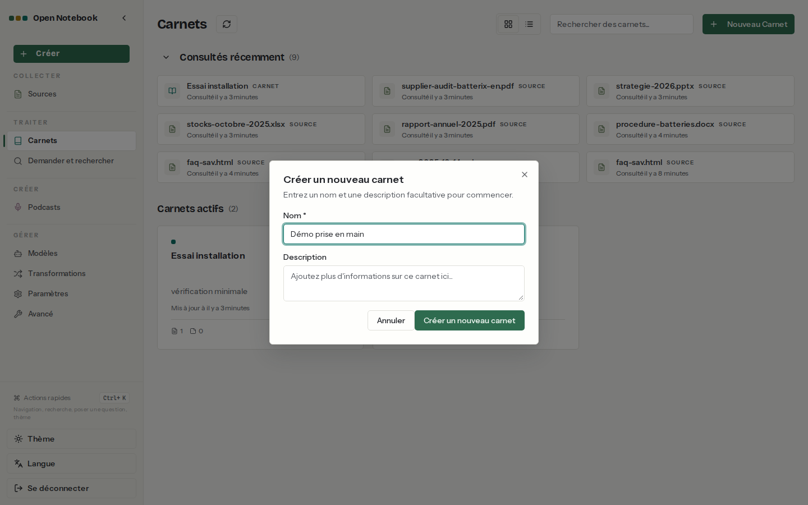
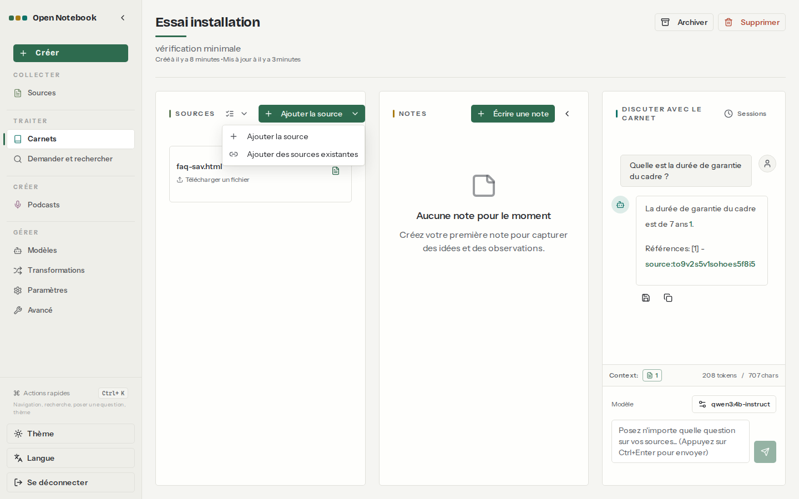
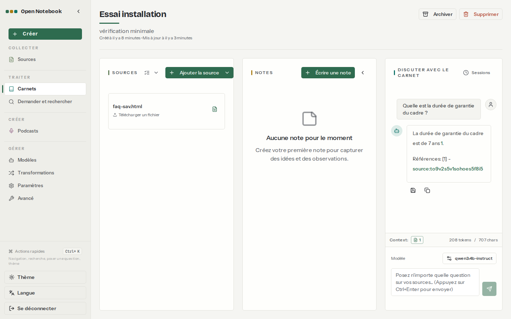
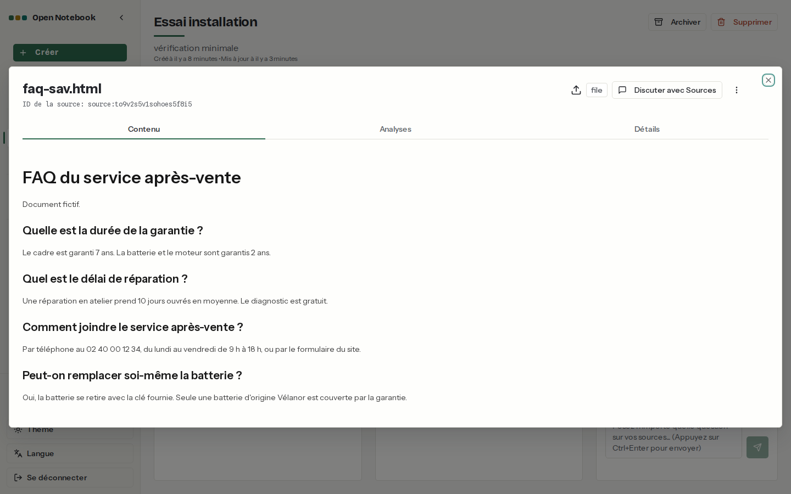

# 02. Prise en main

> **Objet** : du premier carnet à la première réponse citée, dans l'interface.
> **Prérequis** : [01. Installation](01-installation.md).
> **Version décrite** : Open Notebook 1.15.1, interface en français (langue du navigateur), Ollama 0.40.15 (essais du 8 novembre faits sur 0.30.7 ; banc de référence rejoué sur 0.40.15) sur CPU, qwen3:4b-instruct, bge-m3, `num_ctx` 16384.
> **Statut des informations** : [Vérifié] observé ou mesuré le 2026-11-08 sur la machine d'essai (Intel Core Ultra 7 255H, sans GPU NVIDIA) ; [Source] documentation officielle ou code source au tag v1.15.1 ; [Estimation] calcul non mesuré ; [À tester] non documenté et non essayé.
> **Précautions** : documents fictifs du corpus Vélanor ; carnet d'essai « Essai installation » créé par `outils/open-notebook/verif_minimale.py`.

## Sommaire

1. [Se connecter](#1-se-connecter)
2. [Créer un carnet](#2-créer-un-carnet)
3. [Ajouter une source](#3-ajouter-une-source)
4. [Poser une question](#4-poser-une-question)
5. [Lire la citation](#5-lire-la-citation)
6. [Dépannage](#dépannage)
7. [Sources](#sources)

## 1. Se connecter

### Essentiel

Ouvrir `http://127.0.0.1:8502` dans le navigateur Windows, saisir le mot de passe rangé dans `donnees/IDENTIFIANTS-LOCAUX.txt`, puis **Se connecter** [Vérifié].

### Pour aller plus loin

L'interface suit la langue du navigateur ; le bouton **Langue**, en bas à gauche, la change. Les libellés de ces manuels sont ceux de l'interface française [Vérifié]. L'adresse affichée sous la version (`http://rag-open-notebook:5055`) est celle de l'API vue par le navigateur de capture, branché sur le réseau Docker ; depuis Windows, elle vaut `http://127.0.0.1:5055`.

## 2. Créer un carnet

### Essentiel

Menu **Carnets**, bouton **Nouveau Carnet**, saisir un **Nom** (et une **Description** facultative), puis **Créer un nouveau carnet** [Vérifié].

| N° | Élément | Rôle |
|---|---|---|
| 1 | Menu de gauche | COLLECTER (Sources), TRAITER (Carnets, Demander et rechercher), CRÉER (Podcasts), GÉRER (Modèles, Transformations, Paramètres, Avancé) |
| 2 | Consultés récemment | carnets et sources ouverts récemment |
| 3 | Carnets actifs | carnets non archivés, avec le nombre de sources et de notes |
| 4 | Nouveau Carnet | ouvre la fenêtre « Créer un nouveau carnet » |

### Pour aller plus loin

Un carnet se range avec **Archiver** et se supprime avec **Supprimer**, en haut de sa page. La suppression peut emporter les sources qui n'appartiennent qu'à ce carnet [Source] (`api/routers/notebooks.py`, paramètre `delete_exclusive_sources`).

## 3. Ajouter une source

### Essentiel

Dans le carnet, colonne **SOURCES**, bouton **Ajouter la source**, puis choisir un fichier, un lien ou un texte. **Ajouter des sources existantes** réutilise une source déjà présente dans un autre carnet [Vérifié].

Le traitement se fait en tâche de fond : extraction du texte, puis découpage et embeddings. Sur la machine d'essai, la FAQ HTML du corpus (594 caractères) a été traitée en 11 s, embedding compris [Vérifié] ([vérification minimale](../../outils/resultats/open-notebook/verif-minimale-2026-11-08.json)).

### Pour aller plus loin

- L'option d'embedding par défaut est « Demander » dans **Paramètres** : l'interface propose de vectoriser chaque source. Sans embedding, la source reste utilisable dans le chat, mais pas dans la recherche vectorielle ni dans « Demander » [Source] (`open_notebook/domain/content_settings.py`).
- Les formats acceptés et ce qui est extrait de chacun sont détaillés dans [Carnets, sources et formats](03-carnets-sources-formats.md).

## 4. Poser une question

### Essentiel

Colonne **DISCUTER AVEC LE CARNET** : écrire la question dans le champ « Posez n'importe quelle question sur vos sources… », puis Ctrl+Entrée ou le bouton d'envoi [Vérifié].

| N° | Élément | Rôle |
|---|---|---|
| 1 | SOURCES | sources du carnet ; l'icône à droite de chaque source règle ce qui est envoyé au modèle |
| 2 | NOTES | notes du carnet (**Écrire une note**) |
| 3 | DISCUTER AVEC LE CARNET | conversation ; **Sessions** liste les conversations précédentes |
| 4 | Context | nombre de sources dans le contexte, jetons et caractères envoyés (ici 208 jetons, 707 caractères) |
| 5 | Modèle | modèle de la conversation (ici qwen3:4b-instruct), modifiable |
| 6 | Icônes sous la réponse | enregistrer la réponse comme note, copier |

Question « Quelle est la durée de garantie du cadre ? » : réponse « La durée de garantie du cadre est de 7 ans », en 28,7 s, premier chargement du modèle compris [Vérifié].

### Pour aller plus loin

Le chat n'interroge pas un index : il envoie au modèle le texte des sources choisies, en entier ou sous forme d'analyses. Le compteur **Context** montre ce que coûte ce choix. Voir [Chat et citations](04-chat-et-citations.md).

## 5. Lire la citation

### Essentiel

La réponse se termine par « Références : [1] - source:… ». Un clic sur l'identifiant ouvre la source, avec les onglets **Contenu**, **Analyses** et **Détails**, et le bouton **Discuter avec Sources** [Vérifié].

### Pour aller plus loin

La citation désigne la source, pas la page ni le passage [Source] (`prompts/chat/system.jinja`). Pour un long document, retrouver le passage demande de lire l'onglet **Contenu**.

## Dépannage

| Symptôme | Cause probable | Action |
|---|---|---|
| Première réponse lente (près de 30 s pour une question courte) | chargement du modèle en mémoire sur CPU | normal ; les questions suivantes sont plus rapides tant que le modèle reste chargé (30 minutes, `OLLAMA_KEEP_ALIVE`) |
| L'interface redemande le mot de passe | le mot de passe est conservé dans le navigateur ; il disparaît si les données du site sont effacées | se reconnecter |

## Sources

- Guide officiel : https://github.com/lfnovo/open-notebook/tree/v1.15.1/docs/3-USER-GUIDE
- Captures : `outils/open-notebook/captures/captures.py` (scénario `prise-en-main`), Playwright 1.64.1 dans `mcr.microsoft.com/playwright/python:v1.64.1-noble`
- Résultat : [vérification minimale](../../outils/resultats/open-notebook/verif-minimale-2026-11-08.json)
