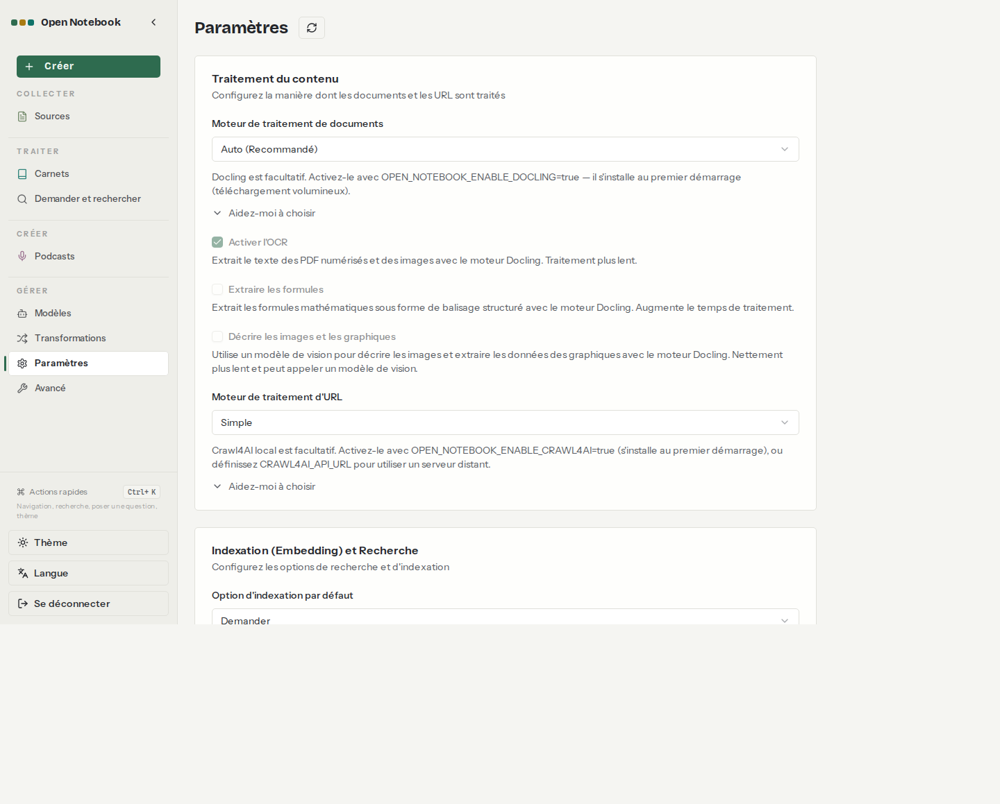

# 03. Carnets, sources et formats

> **Objet** : savoir ce qu'Open Notebook extrait de chaque format (PDF, scan, DOCX, PPTX, XLSX, HTML, Markdown, audio), avec et sans le moteur Docling, et ce qui se perd.
> **Prérequis** : [02. Prise en main](02-prise-en-main.md).
> **Version décrite** : Open Notebook 1.15.1 avec content-core (moteur « auto ») ; Docling 2.130.0 installé par `OPEN_NOTEBOOK_ENABLE_DOCLING=true` ; transcription par Speaches 0.8.3 et faster-whisper-small ; embeddings bge-m3 ; découpage de 400 jetons.
> **Statut des informations** : [Vérifié] observé ou mesuré le 2026-11-08 sur la machine d'essai (Intel Core Ultra 7 255H, sans GPU NVIDIA) ; [Source] documentation officielle ou code source au tag v1.15.1 ; [Estimation] calcul non mesuré ; [À tester] non documenté et non essayé.
> **Précautions** : corpus fictif Vélanor ([manifeste](../../corpus/MANIFEST.json)), généré par `outils/communs/generer_corpus.py` et `generer_audio.py`.

**Risques signalés.** Trois défauts de la version 1.15.1, constatés pendant les essais : (1) sans Docling, les tableaux des fichiers DOCX disparaissent sans message ; (2) avec Docling installé par l'image, l'OCR ne fonctionne pas (« No OCR engine found ») : un PDF scanné reste illisible ; (3) la transcription audio échoue tant que la variable `OPENAI_COMPATIBLE_BASE_URL_STT` n'est pas définie, même si le serveur de voix est configuré dans **Modèles**.

## Sommaire

1. [Formats acceptés](#1-formats-acceptés)
2. [Ce qui est extrait, format par format](#2-ce-qui-est-extrait-format-par-format)
3. [Docling : tableaux et OCR](#3-docling--tableaux-et-ocr)
4. [Audio et vidéo](#4-audio-et-vidéo)
5. [Découpage et embeddings](#5-découpage-et-embeddings)
6. [Dépannage](#dépannage)
7. [Sources](#sources)

## 1. Formats acceptés

### Essentiel

| Famille | Extensions | Condition |
|---|---|---|
| Documents | PDF, DOC, DOCX, PPT, PPTX, XLS, XLSX, ODT, ODS, ODP, EPUB, TXT, MD, HTML, HTM | aucune |
| Audio | MP3, WAV, M4A, AAC | modèle de transcription (STT) par défaut |
| Vidéo | MP4, AVI, MOV, WMV | modèle STT |
| Images | JPG, JPEG, PNG, TIFF | Docling |
| Web | lien (URL), vidéo YouTube | accès au site |
| Texte collé | texte libre | aucune |

Liste [Source] (`docs/3-USER-GUIDE/adding-sources.md`) ; formats essayés avec le corpus, ci-dessous : PDF texte, PDF scanné, DOCX, PPTX, XLSX, HTML, Markdown, MP3 [Vérifié].

### Pour aller plus loin

Le moteur d'extraction se règle dans **Paramètres** : moteur de documents (« Auto (Recommandé) », Docling ou Simple) et moteur d'URL. Sur l'installation d'essai, le moteur d'URL vaut déjà « Simple » par défaut, ce qui évite le repli vers un service tiers [Vérifié] ([configuration](../../outils/resultats/open-notebook/configuration-2026-11-08.json)).



## 2. Ce qui est extrait, format par format

### Essentiel

Valeurs témoins cherchées dans le texte extrait (par exemple « premier lundi », qui n'existe que dans le tableau du DOCX) [Vérifié] (`outils/open-notebook/essai_formats.py`, résultats [sans Docling](../../outils/resultats/open-notebook/formats-2026-11-08-sans-docling.json) et [avec Docling](../../outils/resultats/open-notebook/formats-2026-11-08-docling.json)) :

| Document | Sans Docling | Avec Docling |
|---|---|---|
| Rapport PDF texte, 10 pages, 6 tableaux | 4 704 caractères, 5 passages ; tableaux en texte puis en tableau Markdown avec « page N » ; tous les témoins | 4 319 caractères, 10 passages ; tableaux en Markdown, titres en `##` ; tous les témoins |
| PDF scanné (2 pages, image) | échec : « Could not extract any text content » | même message ; le journal indique « No OCR engine found » ([OCR](../../outils/resultats/open-notebook/essai-docling-ocr-2026-11-08.log)) |
| Procédure DOCX avec un tableau | 565 caractères ; **tableau perdu** (« premier lundi », « classe D » absents) | 1 085 caractères ; tableau en Markdown ; tous les témoins |
| Présentation PPTX, 5 diapositives | 565 caractères ; tous les témoins | 516 caractères ; tous les témoins |
| Classeur XLSX, 2 feuilles | 703 caractères ; feuilles en tableaux Markdown ; tous les témoins | 1 110 caractères ; tous les témoins |
| Page HTML | 594 caractères ; tous les témoins | identique |
| Note Markdown | 528 caractères ; tous les témoins | identique |
| PDF en anglais | 465 caractères ; tous les témoins | 430 caractères ; tous les témoins |
| Message audio MP3 (19 s) | échec de transcription (section 4) | transcrit, 351 caractères, avec erreurs (section 4) ; grâce au contournement STT appliqué en même temps que Docling, pas à Docling |

### Pour aller plus loin

- La perte du tableau DOCX est silencieuse : la source est « completed ». Conséquence mesurée sur le banc : la question sur la fréquence d'inspection du local B2 échoue sans Docling ([Qualité et performances](10-qualite-performances.md)).
- Le numéro de page n'est conservé que dans le texte extrait du PDF sans Docling (pied de page et marqueur « [Table 1 from page 4] ») ; il n'est pas exploité par les citations [Vérifié].

## 3. Docling : tableaux et OCR

### Essentiel

Docling s'active par une variable, puis un redémarrage ; l'installation se fait au premier démarrage du conteneur [Testée] :

```bash
echo 'OPEN_NOTEBOOK_ENABLE_DOCLING=true' >> donnees/open-notebook/.env
outils/open-notebook/installer.sh
```

Mesures [Vérifié] ([journal](../../outils/resultats/open-notebook/essai-2026-11-08-docling.log)) : API disponible 72 s après le redémarrage ; 65 paquets installés, dont des bibliothèques CUDA inutiles sur une machine sans GPU NVIDIA (cuBLAS, cuDNN…) ; `notebook_data` passe de 0,4 Mo à 5,7 Go ; mémoire du conteneur de l'application 2,1 Go juste après l'installation, contre 0,4 Go sans Docling.

### Pour aller plus loin

OCR : l'installation fournie par l'image n'apporte pas `onnxruntime`, dont dépend `rapidocr`, le moteur OCR installé ; ni EasyOCR ni Tesseract ne sont présents. Le journal du worker affiche « No OCR engine found » et le scan échoue [Vérifié] ([preuve](../../outils/resultats/open-notebook/essai-docling-ocr-2026-11-08.log)). Contournement possible [À tester] : installer `onnxruntime` dans l'environnement Python du conteneur, à refaire à chaque recréation du conteneur ; non essayé ici, car hors du périmètre autorisé pour ces essais (décision en attente, voir l'[index](README.md#ce-qui-reste-ouvert)). Autre contournement [À tester] : passer le PDF scanné dans un outil d'OCR avant import.

## 4. Audio et vidéo

### Essentiel

La transcription passe par le modèle STT par défaut (ici faster-whisper-small, servi par Speaches). Dans la 1.15.1, le worker ignore la Base URL de la configuration « OpenAI Compatible » enregistrée dans **Modèles** et la source échoue avec « Content extraction is not configured correctly » [Vérifié] ([formats sans Docling](../../outils/resultats/open-notebook/formats-2026-11-08-sans-docling.json)) ; le journal du worker indiquait alors « OpenAI-compatible base URL is required » (relevé pendant l'essai, extrait non conservé). Contournement appliqué dans `compose.override.yml` [Testée] :

```text
OPENAI_COMPATIBLE_BASE_URL_STT=http://rag-speaches:8000/v1
OPENAI_COMPATIBLE_API_KEY_STT=local
```

Après contournement, le message de 19 s est transcrit en 19,3 s [Vérifié].

### Pour aller plus loin

Qualité de la transcription de la voix de synthèse française par faster-whisper-small [Vérifié] :

| Prononcé | Transcrit |
|---|---|
| 2025 / 2026 | « VVTSEC » / « VVTSI » |
| le lundi 9 février | le 19 février |
| réunion de lancement | Réunion de l'Osement |
| sur la ligne 1 | sur la ligne. |

Les noms (Julien Moreau, Nantes, Erdre) et la plupart des chiffres sont justes. Un modèle plus gros (faster-whisper large) ferait mieux au prix d'un temps de calcul bien plus long sur CPU [Estimation]. Les vidéos n'ont pas été essayées [À tester].

## 5. Découpage et embeddings

### Essentiel

Chaque source est découpée en passages de 400 jetons, avec 60 jetons de recouvrement, puis chaque passage reçoit un embedding (bge-m3, 1 024 dimensions) [Source] (`open_notebook/utils/chunking.py`) [Vérifié] pour la dimension ([mesures du socle](../../outils/resultats/socle/mesures-2026-11-08-passe2.json)). Indexation du corpus complet (9 documents) : 70 s sans Docling ([banc](../../outils/resultats/open-notebook/banc-2026-11-08-defaut-qwen-fullcontent.json)), 126 s avec Docling ([banc](../../outils/resultats/open-notebook/banc-2026-11-08-docling-qwen-fullcontent.json)) [Vérifié]. Un second essai avec Docling a pris 105,7 s ([démonstration](../../outils/resultats/open-notebook/demo-2026-11-08.json)) : l'écart vient de la charge de la machine et du modèle d'embedding déjà chargé ou non [Estimation].

### Pour aller plus loin

La taille de découpage se règle par `OPEN_NOTEBOOK_CHUNK_SIZE` et `OPEN_NOTEBOOK_CHUNK_OVERLAP`, lus au démarrage ; les sources déjà indexées gardent leurs passages jusqu'à une reconstruction (`POST /api/embeddings/rebuild`) [Source]. Le découpage n'influence pas le chat de carnet, qui envoie les sources entières, mais seulement la recherche et « Demander » ([Recherche](06-recherche.md)).

## Dépannage

| Symptôme | Cause probable | Action |
|---|---|---|
| Source en échec : « Could not extract any text content » sur un PDF | PDF scanné sans OCR | OCR préalable ; l'OCR de Docling ne fonctionne pas dans l'image 1.15.1 |
| Journal : « No OCR engine found » | `onnxruntime` absent après l'installation de Docling | voir section 3 |
| Source audio en échec : « Content extraction is not configured correctly » | Base URL STT non transmise au worker | variables `OPENAI_COMPATIBLE_BASE_URL_STT` et `OPENAI_COMPATIBLE_API_KEY_STT` |
| Réponses fausses sur un tableau Word | tableau DOCX perdu par le moteur simple | activer Docling, réimporter la source |
| Démarrage long après activation de Docling | installation de 65 paquets au démarrage | attendre (72 s mesurées ici, une seule fois) |

## Sources

- https://github.com/lfnovo/open-notebook/blob/v1.15.1/docs/3-USER-GUIDE/adding-sources.md ; https://github.com/lfnovo/open-notebook/blob/v1.15.1/docs/3-USER-GUIDE/content-processing-engines.md
- Scripts : `outils/open-notebook/essai_formats.py`, `outils/open-notebook/file_essais.sh` (étape `docling`), `outils/communs/generer_corpus.py`, `generer_audio.py`
- Résultats : [formats sans Docling](../../outils/resultats/open-notebook/formats-2026-11-08-sans-docling.json), [formats avec Docling](../../outils/resultats/open-notebook/formats-2026-11-08-docling.json), [installation de Docling](../../outils/resultats/open-notebook/essai-2026-11-08-docling.log), [OCR](../../outils/resultats/open-notebook/essai-docling-ocr-2026-11-08.log), [audio](../../outils/resultats/open-notebook/essai-audio-scan-2026-11-08.log)
