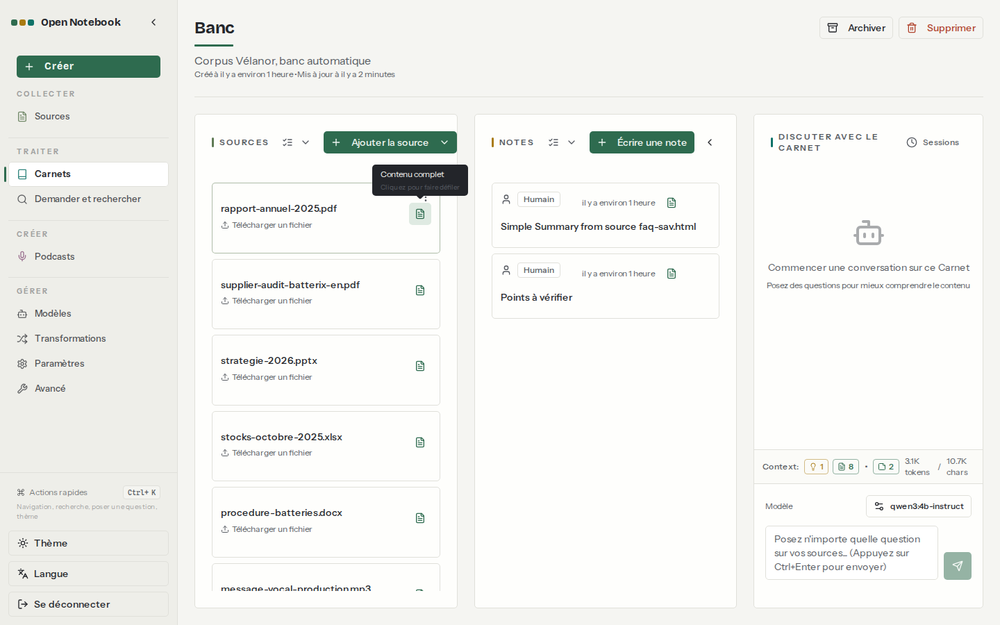

# 04. Chat et citations

> **Objet** : choisir ce que le chat envoie au modèle, source par source ; lire et vérifier les citations ; connaître les limites de contexte et l'effet d'un modèle de raisonnement.
> **Prérequis** : [02. Prise en main](02-prise-en-main.md), [03. Carnets, sources et formats](03-carnets-sources-formats.md).
> **Version décrite** : Open Notebook 1.15.1, Ollama 0.30.7 sur CPU ; qwen3:4b-instruct (modèle par défaut), ministral-3:3b, qwen3:4b (raisonnement) ; `num_ctx` 16384, 6144 et 4096 selon les essais ; Docling actif.
> **Statut des informations** : [Vérifié] observé ou mesuré le 2026-11-08 sur la machine d'essai (Intel Core Ultra 7 255H, sans GPU NVIDIA) ; [Source] documentation officielle ou code source au tag v1.15.1 ; [Estimation] calcul non mesuré ; [À tester] non documenté et non essayé.
> **Précautions** : carnet « Banc » (corpus fictif) ; scripts `outils/open-notebook/essai_chat.py` et `banc.py`.

**Risque signalé.** Une source réglée sur « Analyses » (insights) ou exclue du contexte n'est pas lue par le modèle, qui répond alors « non mentionné dans les documents », même si l'information existe dans le carnet [Vérifié]. Une réponse négative n'est donc fiable que si les bonnes sources sont en « Contenu complet ».

## Sommaire

1. [Ce que le chat envoie au modèle](#1-ce-que-le-chat-envoie-au-modèle)
2. [Citations](#2-citations)
3. [Taille de contexte](#3-taille-de-contexte)
4. [Choisir le modèle](#4-choisir-le-modèle)
5. [Dépannage](#dépannage)
6. [Sources](#sources)

## 1. Ce que le chat envoie au modèle

### Essentiel

Chaque source du carnet a un mode, affiché par l'icône à droite de sa carte ; un clic fait passer au mode suivant (« Cliquez pour faire défiler ») [Vérifié].

| Mode (API) | Ce qui est envoyé |
|---|---|
| `not in` | rien |
| `insights` | identifiant, titre et analyses (résultats de transformations) de la source |
| `full content` | identifiant, titre, analyses et texte intégral |

Modes [Source] (`open_notebook/domain/notebook.py:480-500`). Le bas de la colonne de chat affiche le total (« Context » : analyses, sources, notes, jetons, caractères) [Vérifié].

Coût mesuré sur le carnet « Banc » (9 sources) [Vérifié] ([résultat](../../outils/resultats/open-notebook/chat-2026-11-08.json)) :

| Mode de toutes les sources | Jetons envoyés | Caractères |
|---|---|---|
| not in | 0 | 0 |
| insights | 550 | 1 411 |
| full content | 3 084 | 10 677 |

### Pour aller plus loin

Même question (« Quel est le délai de livraison prévu par le contrat avec Batterix, et quel délai moyen est réellement constaté ? ») avec les deux modes [Vérifié] :

| Mode | Réponse |
|---|---|
| insights | « n'est pas indiqué dans les documents fournis » pour les deux délais : faux, le délai constaté (24 jours) est dans le classeur |
| full content | délai constaté de 24 jours, cité ; délai contractuel « non disponible » : exact, il n'est que dans le scan non lu ([03](03-carnets-sources-formats.md)) |

Il n'y a pas de recherche top-k dans le chat de carnet : tout ce qui est en « full content » est envoyé à chaque question [Source]. Pour interroger un grand ensemble de documents par similarité, passer par **Demander** ([Recherche](06-recherche.md)).

## 2. Citations

### Essentiel

Le modèle est invité à citer ses sources sous la forme `[source:identifiant]` ; l'interface les affiche sous « Références » et ouvre la source au clic ([02, section 5](02-prise-en-main.md#5-lire-la-citation)) [Vérifié]. Résultats du banc avec Docling, qwen3:4b-instruct [Vérifié] ([banc](../../outils/resultats/open-notebook/banc-2026-11-08-docling-qwen-fullcontent.json)) : sur les 34 questions qui ont une réponse dans le corpus, 28 réponses citent le bon document.

### Pour aller plus loin

- La citation désigne la source entière, sans page ni passage [Source] (`prompts/chat/system.jinja`).
- Le modèle cite parfois le nom du fichier au lieu de l'identifiant (par exemple « (source:contrat-batterix-scan.pdf) ») ; l'interface ne peut alors pas créer le lien [Vérifié] (réponse Q18 du [banc de référence](../../outils/resultats/open-notebook/banc-2026-11-08-defaut-qwen-fullcontent.json)).
- Une source dont l'extraction a échoué reste dans le carnet : le modèle sait qu'elle existe (titre) mais pas ce qu'elle contient, et le dit [Vérifié].

## 3. Taille de contexte

### Essentiel

Le prompt envoyé au modèle comprend les consignes, les sources choisies, l'historique de la conversation et la question. Il doit tenir dans le `num_ctx` réglé sur la configuration Ollama (page **Modèles**). Mesures avec le corpus entier en « full content » (environ 4 230 jetons de prompt) [Vérifié] :

| `num_ctx` | Résultat | Fichier |
|---|---|---|
| 16384 | 28/34 exactes, médiane 9,1 s par question | [banc](../../outils/resultats/open-notebook/banc-2026-11-08-docling-qwen-fullcontent.json) |
| 6144 | 28/34 exactes, aucune erreur de contexte ; latences du banc faussées par des rechargements du modèle ([Qualité et performances](10-qualite-performances.md#2-résultats)) | [banc](../../outils/resultats/open-notebook/banc-2026-11-08-docling-qwen-fullcontent-ctx6144.json) |
| 4096 | 38 erreurs sur 38 : « AI service error … request (4238 tokens) exceeds the available context size (4096 tokens) » (HTTP 502) | [banc](../../outils/resultats/open-notebook/banc-2026-11-08-docling-qwen-fullcontent-ctx4096.json) |

Dans le chat d'Open Notebook, un dépassement produit donc une erreur visible, pas une réponse tronquée [Vérifié] ; un appel direct à Ollama, lui, tronque sans erreur ([Exploitation](11-exploitation.md#4-journaux)).

### Pour aller plus loin

- L'historique de la conversation n'est jamais raccourci [Source] (`open_notebook/graphs/chat.py`) : une longue conversation finit par dépasser le contexte. Ouvrir une nouvelle session (**Sessions**) remet le compteur à zéro.
- Au-delà de 105 000 jetons, l'application bascule sur le « Modèle à large contexte » [Source] ; hors de portée sur cette machine.
- Sur CPU, la première question d'un contexte de 3 000 à 4 000 jetons coûte 80 à 100 s ; les suivantes, sur le même contexte, 6 à 25 s, car Ollama réutilise le début du prompt déjà lu (cache de préfixe : « cached n_tokens = 4329 » dans son journal) [Vérifié] ([banc](../../outils/resultats/open-notebook/banc-2026-11-08-defaut-qwen-fullcontent.log), [journal d'Ollama](../../outils/resultats/socle/ollama-journal-extrait-2026-11-08.log)). Changer de mode de source ou de modèle annule ce gain.

## 4. Choisir le modèle

### Essentiel

Le modèle de la conversation se change en bas de la colonne de chat (**Modèle**) ; par l'API, `model_override` sur la session [Vérifié].

| Modèle | Banc (34 questions avec réponse) | Médiane | p95 |
|---|---|---|---|
| qwen3:4b-instruct | 28 exactes | 9,1 s | 23,8 s |
| ministral-3:3b | 28 exactes | 10,0 s | 44,7 s |

Résultats [Vérifié] ([qwen](../../outils/resultats/open-notebook/banc-2026-11-08-docling-qwen-fullcontent.json), [ministral](../../outils/resultats/open-notebook/banc-2026-11-08-docling-ministral-fullcontent.json)).

### Pour aller plus loin

Modèle de raisonnement : qwen3:4b (mode « thinking » d'origine) sur la question des délais Batterix, en « full content » [Vérifié] ([résultat](../../outils/resultats/open-notebook/chat-2026-11-08.json)) : réponse juste et citée, aussi complète que celle de qwen3:4b-instruct, en 371 s. La réflexion intermédiaire n'apparaît pas dans la réponse affichée. Sur CPU, le raisonnement n'apporte rien sur ce type de question factuelle. Les durées de cet essai (127 à 465 s) sont plus longues que celles du banc, probablement parce que trois modèles alternaient en mémoire alors qu'Ollama n'en garde que deux à la fois (`OLLAMA_MAX_LOADED_MODELS=2`) [Estimation].

## Dépannage

| Symptôme | Cause probable | Action |
|---|---|---|
| « AI service error … exceeds the available context size » | prompt plus long que `num_ctx` | moins de sources en « Contenu complet », nouvelle session, ou `num_ctx` plus grand |
| « non mentionné dans les documents » alors que l'information existe | source en « insights » ou exclue | passer la source en « Contenu complet » |
| Citation affichée comme texte, sans lien | le modèle a cité le nom du fichier | ouvrir la source à la main ; reformuler |
| Réponse lente à chaque question | contexte modifié entre deux questions, ou changement de modèle | garder le même contexte et le même modèle |

## Sources

- https://github.com/lfnovo/open-notebook/blob/v1.15.1/docs/3-USER-GUIDE/chat-effectively.md ; https://github.com/lfnovo/open-notebook/blob/v1.15.1/docs/3-USER-GUIDE/citations.md
- Scripts : `outils/open-notebook/essai_chat.py`, `banc.py`, `suite_essais2.sh`
- Résultats : [chat](../../outils/resultats/open-notebook/chat-2026-11-08.json) ; bancs dans `outils/resultats/open-notebook/`
