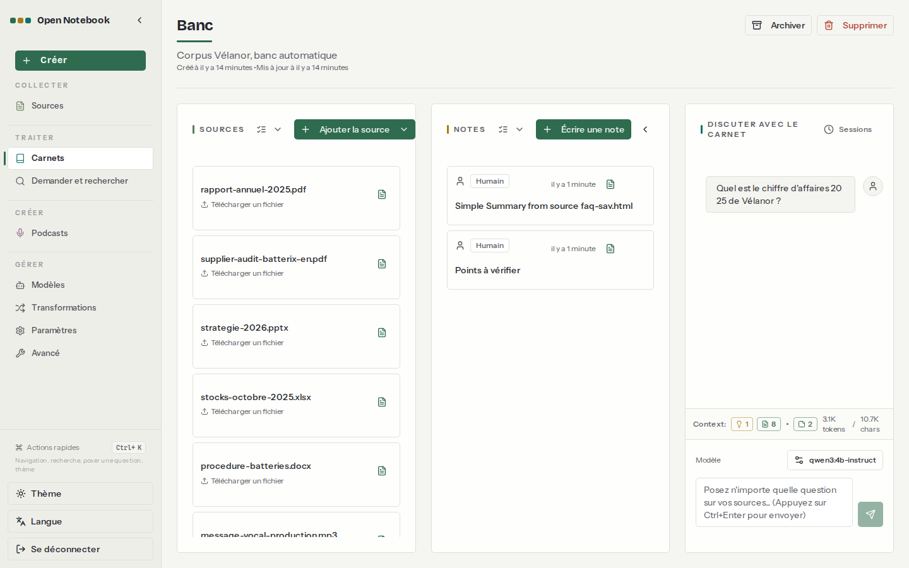
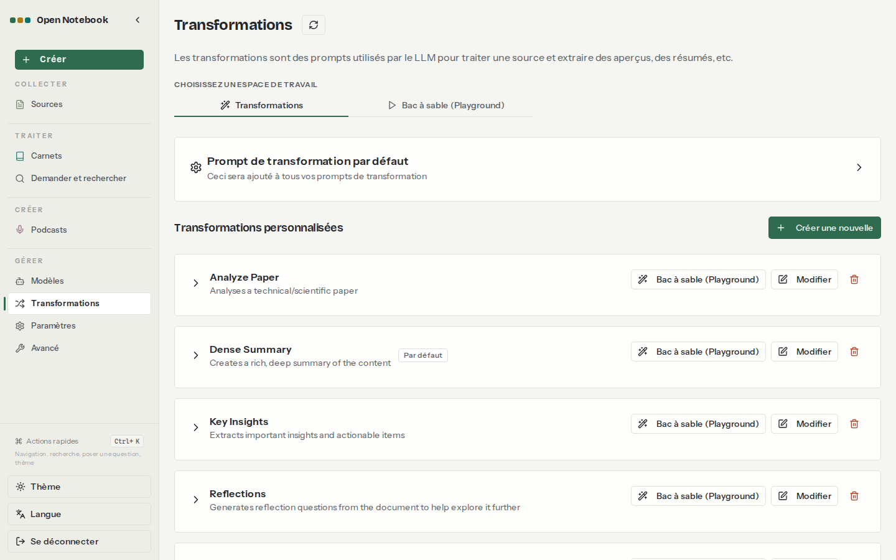

# 05. Notes et transformations

> **Objet** : prendre des notes dans un carnet, garder une réponse du chat, appliquer une transformation fournie ou personnalisée à une source.
> **Prérequis** : [02. Prise en main](02-prise-en-main.md).
> **Version décrite** : Open Notebook 1.15.1, Ollama 0.40.15 (essais du 8 novembre faits sur 0.30.7 ; banc de référence rejoué sur 0.40.15) sur CPU, qwen3:4b-instruct (modèle de transformation), `num_ctx` 16384.
> **Statut des informations** : [Vérifié] observé ou mesuré le 2026-11-08 sur la machine d'essai (Intel Core Ultra 7 255H, sans GPU NVIDIA) ; [Source] documentation officielle ou code source au tag v1.15.1 ; [Estimation] calcul non mesuré ; [À tester] non documenté et non essayé.
> **Précautions** : essais sur le carnet « Banc » (corpus fictif) ; script `outils/open-notebook/essai_transformations.py`.

## Sommaire

1. [Notes](#1-notes)
2. [Transformations fournies](#2-transformations-fournies)
3. [Transformation personnalisée en français](#3-transformation-personnalisée-en-français)
4. [Dépannage](#dépannage)
5. [Sources](#sources)

## 1. Notes

### Essentiel

Trois façons d'obtenir une note [Vérifié] :

| Façon | Où |
|---|---|
| Note manuelle | colonne **NOTES**, bouton **Écrire une note** |
| Réponse du chat gardée | icône d'enregistrement sous une réponse (voir [02, section 4](02-prise-en-main.md#4-poser-une-question)) |
| Résultat d'une transformation (« insight ») enregistré comme note | onglet **Analyses** de la source |



| N° | Élément | Rôle |
|---|---|---|
| 1 | Carte de note | type (« Humain »), date, titre ; un clic ouvre la note |
| 2 | Context (bas de la colonne de chat) | ici 1 analyse, 8 sources et 2 notes, 3,1 K jetons : les notes entrent dans le contexte du chat |

Par l'API, une note se crée par `POST /api/notes` ; un insight devient une note par `POST /api/insights/{id}/save-as-note` [Vérifié] ([résultat](../../outils/resultats/open-notebook/transformations-2026-11-08.json)).

### Pour aller plus loin

Une note enregistrée depuis un insight porte le titre « Simple Summary from source faq-sav.html » et apparaît comme « Humain » dans l'interface, alors qu'elle vient du modèle [Vérifié]. Les notes reçoivent un embedding et sont donc trouvées par la recherche [Source] (`api/routers/notes.py`).

## 2. Transformations fournies

### Essentiel

Menu **Transformations** : six transformations sont fournies, avec des consignes en anglais [Vérifié].



| Nom | Titre | Appliquée par défaut |
|---|---|---|
| Analyze Paper | Paper Analysis | non |
| Dense Summary | Dense Summary | oui |
| Key Insights | Key Insights | non |
| Reflections | Reflection Questions | non |
| Simple Summary | Simple Summary | non |
| Table of Contents | Table of Contents | non |

« Simple Summary » appliquée à la FAQ du corpus : résultat obtenu en 18,8 s, en français, mais **mis en forme en LaTeX** (`$$ \text{Garantie : 7 ans (cadre), 2 ans (batterie et moteur)} \\ …`) par le petit modèle [Vérifié]. Les faits sont justes ; la forme est inutilisable telle quelle.

### Pour aller plus loin

Une transformation sur une source tourne en tâche de fond (`POST /api/sources/{id}/insights`) ; le résultat apparaît dans l'onglet **Analyses** de la source [Vérifié]. Le **Prompt de transformation par défaut** de la page Transformations est ajouté à toutes les consignes ; y écrire « Réponds en français, en texte simple, sans LaTeX. » corrigerait probablement la forme [À tester].

## 3. Transformation personnalisée en français

### Essentiel

**Transformations**, **Créer une nouvelle** : nom, titre, description, consigne. Consigne essayée [Vérifié] :

```text
Réponds en français. À partir du document, dresse une liste à puces des chiffres clés
(au plus 8), chacun avec son unité et ce qu'il mesure. N'invente aucun chiffre.
```

Appliquée au texte du rapport annuel (4 319 caractères) : 37,6 s, liste de 8 chiffres, tous présents dans le rapport (48,6 M€, 3,1 M€, 61 800 vélos, 412 salariés, 27 %, 1,8 %, 3,4 GWh, 96 %) [Vérifié] ([résultat](../../outils/resultats/open-notebook/transformations-2026-11-08.json)).

### Pour aller plus loin

**Bac à sable (Playground)** permet d'essayer une transformation sur un texte collé avant de l'appliquer à des sources ; l'équivalent API est `POST /api/transformations/execute` [Vérifié]. Une consigne courte, en français, avec un format de sortie imposé, donne de meilleurs résultats qu'une consigne fournie en anglais avec ce modèle de 4 milliards de paramètres [Vérifié] sur ces deux essais seulement.

## Dépannage

| Symptôme | Cause probable | Action |
|---|---|---|
| Résumé en LaTeX (`$$ \text{…}`) | consigne fournie en anglais, petit modèle | transformation personnalisée en français avec format imposé |
| Transformation refusée sur une source | source sans texte (scan non lu) [Source] | voir [03](03-carnets-sources-formats.md) |
| Note issue du modèle marquée « Humain » | comportement de l'interface constaté | se fier au titre (« … from source … ») |

## Sources

- https://github.com/lfnovo/open-notebook/blob/v1.15.1/docs/3-USER-GUIDE/transformations.md
- Script : `outils/open-notebook/essai_transformations.py` ; résultat : [transformations-2026-11-08.json](../../outils/resultats/open-notebook/transformations-2026-11-08.json)
- Captures : `outils/open-notebook/captures/captures.py` (scénario `transformations`)
