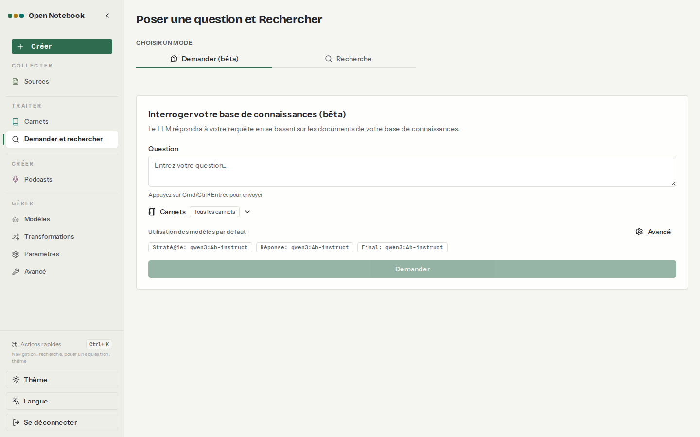
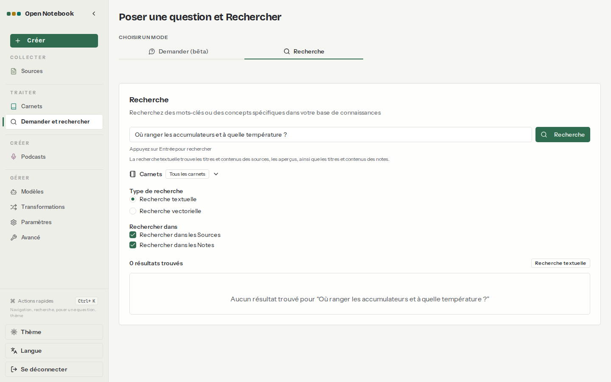
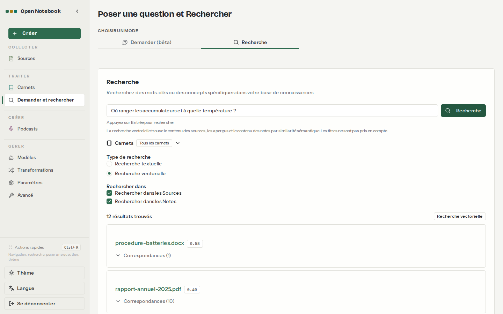

# 06. Recherche

> **Objet** : choisir entre recherche plein texte, recherche vectorielle et « Demander (bêta) », d'après des mesures sur le même corpus.
> **Prérequis** : [03. Carnets, sources et formats](03-carnets-sources-formats.md).
> **Version décrite** : Open Notebook 1.15.1, embeddings bge-m3 (1 024 dimensions) sur Ollama 0.40.15 (essais du 8 novembre faits sur 0.30.7 ; banc de référence rejoué sur 0.40.15) CPU, passages de 400 jetons, Docling actif, qwen3:4b-instruct pour « Demander ».
> **Statut des informations** : [Vérifié] observé ou mesuré le 2026-11-08 sur la machine d'essai (Intel Core Ultra 7 255H, sans GPU NVIDIA) ; [Source] documentation officielle ou code source au tag v1.15.1 ; [Estimation] calcul non mesuré ; [À tester] non documenté et non essayé.
> **Précautions** : requêtes sur le carnet « Banc » (corpus fictif) ; script `outils/open-notebook/essai_recherche.py`.

## Sommaire

1. [Les trois modes](#1-les-trois-modes)
2. [Plein texte et vectoriel : mesures](#2-plein-texte-et-vectoriel--mesures)
3. [Demander](#3-demander)
4. [Dépannage](#dépannage)
5. [Sources](#sources)

## 1. Les trois modes

### Essentiel

Menu **Demander et rechercher**, page « Poser une question et Rechercher » [Vérifié] :

| Mode | Libellé | Ce qu'il fait | Coût |
|---|---|---|---|
| Plein texte | **Recherche**, puis « Recherche textuelle » | mots exacts (BM25) dans les titres, textes, analyses et notes | 0,1 s, aucun modèle |
| Vectoriel | **Recherche**, puis « Recherche vectorielle » | proximité de sens entre la requête et les passages ; les titres ne comptent pas | un calcul d'embedding |
| Demander | **Demander (bêta)** | le modèle prépare jusqu'à 5 recherches vectorielles de 10 résultats, répond à chacune, puis rédige une synthèse | plusieurs appels au modèle |

Fonctionnement de « Demander » [Source] (`open_notebook/graphs/ask.py`) ; libellés et périmètres affichés [Vérifié].

### Pour aller plus loin

La portée se règle avec **Carnets** (« Tous les carnets » par défaut) et les cases « Rechercher dans les Sources » et « Rechercher dans les Notes ». Le seuil de score de la recherche vectorielle vaut 0,2 par défaut, réglable seulement par l'API (`minimum_score`) [Source].

## 2. Plein texte et vectoriel : mesures

### Essentiel

Dix requêtes, rang du document attendu dans chaque mode [Vérifié] ([résultat](../../outils/resultats/open-notebook/recherche-2026-11-08.json)) :

| Nature | Requête | Plein texte | Vectoriel (score du 1er) |
|---|---|---|---|
| référence exacte | BAT-48V-14Ah | 1er | 1er (0,61) |
| nom propre | Motodrive | 2e | 2e (0,42) |
| mots exacts | prime d'intéressement | 1er | 1er (0,57) |
| reformulation | Combien de temps le cadre est-il couvert en cas de défaut ? | aucun résultat | 1er (0,60) |
| synonyme | Où ranger les accumulateurs et à quelle température ? | aucun résultat | 1er (0,58) |
| paraphrase | nouvelle usine près de l'estuaire de la Loire | aucun résultat | 3e (0,49) |
| anglais | battery supplier audit score | aucun résultat | 1er (0,70) |
| français vers document anglais | score de l'audit du fournisseur de batteries | aucun résultat | 1er (0,68) |
| thème | chiffre d'affaires par trimestre | 1er | 1er (0,68) |
| absent du corpus | trottinette électrique | aucun résultat | 6 résultats sans rapport (0,46) |

À retenir : le plein texte ne sert qu'aux mots exacts (références, noms) ; le vectoriel retrouve les reformulations et passe d'une langue à l'autre ; mais il renvoie toujours quelque chose, même pour un sujet absent, avec un score proche de celui des vraies réponses (0,46 contre 0,42 à 0,70).

| N° | Élément | Rôle |
|---|---|---|
| 1 | Type de recherche | « Recherche textuelle » ou « Recherche vectorielle » |
| 2 | Résultat | document, score de similarité (ici 0,58), « Correspondances (N) » : passages trouvés dans ce document |

### Pour aller plus loin

- Les résultats vectoriels sont regroupés par document ; « Correspondances » liste les passages [Vérifié].
- Durées par requête, une fois bge-m3 chargé : 0,08 à 0,12 s en plein texte, 2,5 à 3,3 s en vectoriel, embedding de la requête compris [Vérifié] (champs `duree_s` du résultat).
- Il n'y a pas de recherche hybride (mélange des deux scores) ni de reranker dans la 1.15.1 [Source].

## 3. Demander

### Essentiel

**Demander (bêta)** répond à une question à partir de la recherche vectorielle, sur tous les carnets ou un seul. Résultats mesurés sur un échantillon du banc : voir [Qualité et performances](10-qualite-performances.md#3-réglages-qui-changent-le-résultat).

### Pour aller plus loin

Par l'API, `POST /api/search/ask/simple` exige trois identifiants de modèle (stratégie, réponses, synthèse) [Source] ; le banc les fixe tous trois à qwen3:4b-instruct (`outils/open-notebook/banc.py --mode ask`).

## Dépannage

| Symptôme | Cause probable | Action |
|---|---|---|
| « Aucun résultat trouvé » sur une question en langage courant | recherche textuelle : mots exacts seulement | passer en « Recherche vectorielle » |
| Résultats vectoriels sans rapport | aucun passage pertinent, mais le seuil (0,2) laisse passer | lire les scores ; ne pas conclure qu'une information existe parce qu'un résultat s'affiche |
| Erreur 400 en recherche vectorielle | aucun modèle d'embedding par défaut [Source] | **Modèles**, « Modèle d'Embedding » |
| Résultats incomplets après changement de modèle d'embedding | vecteurs de dimensions différentes ignorés [Source] | reconstruire les embeddings (`POST /api/embeddings/rebuild`) |

## Sources

- https://github.com/lfnovo/open-notebook/blob/v1.15.1/docs/3-USER-GUIDE/search.md
- Script : `outils/open-notebook/essai_recherche.py` ; résultat : [recherche-2026-11-08.json](../../outils/resultats/open-notebook/recherche-2026-11-08.json)
- Captures : `outils/open-notebook/captures/captures.py` (scénario `recherche`)
