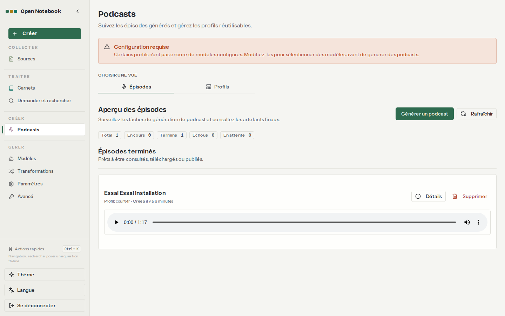
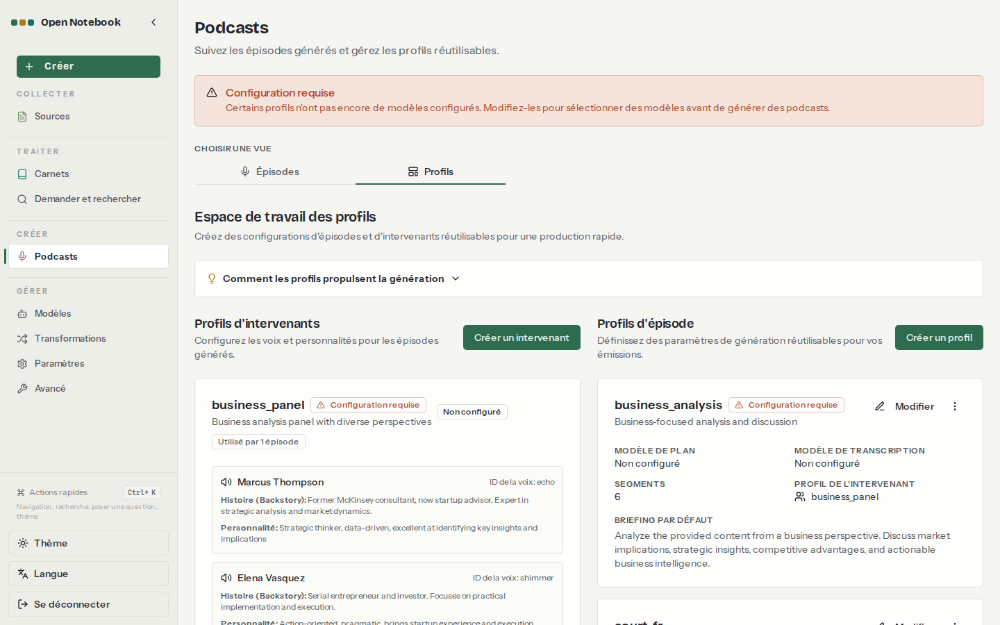

# 07. Podcasts

> **Objet** : générer un épisode audio à deux voix en français à partir d'un carnet, avec un serveur de voix local ; régler les profils d'intervenants et d'épisode ; connaître la qualité obtenue.
> **Prérequis** : [01. Installation](01-installation.md) (serveur de voix `rag-speaches`), [02. Prise en main](02-prise-en-main.md).
> **Version décrite** : Open Notebook 1.15.1, Speaches 0.8.3-cpu avec Kokoro-82M-v1.0-ONNX (synthèse) et faster-whisper-small (transcription de contrôle), Ollama 0.40.15 (essais du 8 novembre faits sur 0.30.7 ; banc de référence rejoué sur 0.40.15) sur CPU avec qwen3:4b-instruct.
> **Statut des informations** : [Vérifié] observé ou mesuré le 2026-11-08 sur la machine d'essai (Intel Core Ultra 7 255H, sans GPU NVIDIA) ; [Source] documentation officielle ou code source au tag v1.15.1 ; [Estimation] calcul non mesuré ; [À tester] non documenté et non essayé.
> **Précautions** : carnet « Essai installation » (une source fictive, la FAQ du service après-vente) ; script `outils/open-notebook/essai_podcast.py`, bilan par `bilan_podcast.py`.

**Risque signalé.** Kokoro n'a qu'une seule voix française (`ff_siwis`). Toute seconde voix est une voix étrangère qui lit le français avec un accent marqué : à l'écoute, les chiffres restent compréhensibles, mais une transcription automatique de l'épisode perd les répliques de cette voix [Vérifié].

## Sommaire

1. [Principe](#1-principe)
2. [Choisir les voix](#2-choisir-les-voix)
3. [Créer les profils](#3-créer-les-profils)
4. [Générer un épisode](#4-générer-un-épisode)
5. [Résultat mesuré](#5-résultat-mesuré)
6. [Dépannage](#dépannage)
7. [Sources](#sources)

## 1. Principe

### Essentiel

Un épisode se génère en trois étapes, exécutées par le worker en tâche de fond [Source] (`commands/podcast_commands.py`, bibliothèque `podcast-creator`) :

1. **plan** : le modèle de langage découpe le contenu du carnet en segments ;
2. **dialogue** : le modèle écrit les répliques de chaque intervenant ;
3. **audio** : chaque réplique est lue par le modèle de synthèse, puis les morceaux sont assemblés en un MP3.

La page **Podcasts** a deux onglets : « Épisodes » (suivi et écoute) et « Profils » (intervenants et épisodes) [Vérifié].



### Pour aller plus loin

Le fichier final et les morceaux sont écrits dans `donnees/open-notebook/notebook_data/podcasts/episodes/<identifiant>/` (`audio/` et `clips/`) [Vérifié]. Le bandeau « Configuration requise » reste affiché tant que des profils fournis en exemple (`business_panel`, `solo_expert`, `tech_experts`) n'ont pas de modèle de voix ; il n'empêche pas d'utiliser les profils configurés [Vérifié].

## 2. Choisir les voix

### Essentiel

Essai : une phrase de référence lue par six voix Kokoro, puis retranscrite par faster-whisper-small ; « mots retrouvés » est la part des mots de la phrase présents dans la transcription [Vérifié] ([résultat](../../outils/resultats/open-notebook/podcast-2026-11-08.json)).

Phrase : « Le chiffre d'affaires de l'entreprise a progressé de douze pour cent, et la nouvelle usine de Saint-Nazaire ouvrira en septembre avec soixante-dix embauches. »

| Voix | Langue d'origine | Mots retrouvés | Synthèse |
|---|---|---|---|
| `ff_siwis` | français | 0,70 | 12,2 s (premier appel, chargement du modèle) |
| `em_alex` | espagnol | 0,78 | 2,5 s |
| `im_nicola` | italien | 0,74 | 2,2 s |
| `pm_alex` | portugais | 0,85 | 2,1 s |
| `am_michael` | anglais américain | 0,93 | 2,7 s |
| `bm_george` | anglais britannique | 0,85 | 2,6 s |

`ff_siwis` obtient le score le plus bas sur cette phrase isolée parce que la transcription écrit les nombres en chiffres (« 12 % », « 70 ») et déforme « Saint-Nazaire » ; à l'écoute, c'est la seule voix sans accent étranger.

### Pour aller plus loin

Le score sur une phrase isolée ne prédit pas le résultat sur un épisode entier : `am_michael`, en tête ici, est la voix dont les répliques disparaissent de la transcription de l'épisode (section 5). Pour un épisode à une seule voix, `ff_siwis` seule évite le problème [Estimation].

## 3. Créer les profils

### Essentiel

Onglet « Profils » : **Créer un intervenant** (profil d'intervenants : modèle de voix, puis nom, identifiant de voix, histoire et personnalité de chaque intervenant) et **Créer un profil** (profil d'épisode : modèle de plan, modèle de transcription, langue, nombre de segments, briefing par défaut) [Vérifié].



Profils créés par le script d'essai [Vérifié] :

| Profil | Réglages |
|---|---|
| intervenants `duo-fr` | modèle de voix `speaches-ai/Kokoro-82M-v1.0-ONNX` (configuration `speaches-voix`) ; Camille, voix `ff_siwis`, animatrice ; Hugo, voix `am_michael`, analyste |
| épisode `court-fr` | plan et transcription : qwen3:4b-instruct ; langue `fr-FR` ; 3 segments ; briefing « Épisode court et factuel, en français, qui présente les informations principales des sources. » |

### Pour aller plus loin

Les mêmes profils se créent par l'API : `POST /api/speaker-profiles` et `POST /api/episode-profiles` [Vérifié] (`outils/open-notebook/essai_podcast.py`). L'identifiant de voix est celui du serveur de voix (`ff_siwis`), pas un nom affiché.

## 4. Générer un épisode

### Essentiel

Onglet « Épisodes », **Générer un podcast** : choisir le carnet (ou des sources), le profil d'épisode et un nom, puis lancer [À tester] (l'essai a lancé la génération par l'API). L'épisode apparaît « En cours », puis « Terminé » avec un lecteur audio ; **Rafraîchir** met la liste à jour.

Par l'API [Vérifié] :

```bash
curl -s -X POST http://127.0.0.1:5055/api/podcasts/generate \
  -H "Authorization: Bearer $OPEN_NOTEBOOK_PASSWORD" -H "Content-Type: application/json" \
  -d '{"episode_profile":"court-fr","speaker_profile":"duo-fr","episode_name":"Essai","notebook_id":"notebook:..."}'
```

Le profil d'épisode est désigné par son nom ; avec `notebook_id`, tout le carnet (texte intégral, analyses, notes) est envoyé [Source] (`api/podcast_service.py`). La réponse contient un `job_id` ; `GET /api/podcasts/jobs/<job_id>` donne l'état, `GET /api/podcasts/episodes` la liste des épisodes avec leur script.

### Pour aller plus loin

La génération est une tâche du worker, traitée une à une avec `OPEN_NOTEBOOK_WORKER_MAX_TASKS=1` (réglage de l'override) : un podcast lancé pendant une indexation attend la fin de celle-ci [Source] (`compose.override.yml`).

## 5. Résultat mesuré

### Essentiel

Épisode généré depuis le carnet « Essai installation » [Vérifié] ([résultat](../../outils/resultats/open-notebook/podcast-2026-11-08.json), [journal du worker](../../outils/resultats/open-notebook/essai-2026-11-08-podcast-worker.log)) :

| Mesure | Valeur |
|---|---|
| Durée totale de génération | 307 s |
| Plan (3 segments) | 105 s |
| Dialogue (14 répliques) | 166 s |
| Synthèse et assemblage | 34 s |
| Épisode | 77 s d'audio, MP3 de 1,2 Mo |

Le script est en français et fidèle à la source : garanties (cadre 7 ans, batterie et moteur 2 ans), pièces d'origine seules couvertes, téléphone du service après-vente, réparation en 10 jours ouvrés, diagnostic gratuit [Vérifié]. Il n'y a pas de citation dans un épisode.

### Pour aller plus loin

Transcription de contrôle de l'épisode entier par faster-whisper-small : seules les répliques de Camille (`ff_siwis`) sont retranscrites ; celles de Hugo (`am_michael`) manquent. Lues une à une, ses répliques donnent « Le Coder ESD guarantee 7 ANS. La batterie et le motor saunt guarantees 2 ANS. » [Vérifié]. L'accent anglais de la voix est donc fort, alors que le test sur une phrase isolée la plaçait en tête.

Une réplique du script contient « Vous pouvez contacter le service après-vente… » : le ton du dialogue suit le briefing, à préciser dans le profil d'épisode si besoin.

## Dépannage

| Symptôme | Cause probable | Action |
|---|---|---|
| Épisode « En attente » indéfiniment, aucun message dans le journal | worker bloqué, par exemple après une saturation mémoire (« timed out during opening handshake » vers SurrealDB) [Vérifié] | `docker restart rag-open-notebook` : la tâche en attente est reprise au démarrage (essai : 3 600 s d'attente, puis épisode produit en 307 s après redémarrage) |
| Bandeau « Configuration requise » | profils d'exemple sans modèle de voix | ignorer, ou les modifier ou les supprimer |
| « Speaker profile … has no voice model » dans le journal | même cause, avertissement sans effet sur les profils configurés [Vérifié] | aucune |
| Échec de la synthèse | serveur de voix arrêté ou base URL TTS absente | `docker ps` pour `rag-speaches` ; variables `OPENAI_COMPATIBLE_BASE_URL_TTS` de l'override ([Installation](01-installation.md)) |
| Seconde voix difficile à comprendre | Kokoro n'a qu'une voix française | épisode à une voix, ou autre modèle de synthèse [À tester] |

## Sources

- https://github.com/lfnovo/open-notebook/blob/v1.15.1/docs/5-CONFIGURATION/local-tts.md ; code : `api/routers/podcasts.py`, `api/podcast_service.py`, `open_notebook/podcasts/models.py` ([synthèse du code](../../outils/resultats/open-notebook/cadrage-source.md))
- Scripts : `outils/open-notebook/essai_podcast.py`, `bilan_podcast.py`, `outils/communs/voix.sh`
- Résultats : [podcast](../../outils/resultats/open-notebook/podcast-2026-11-08.json), [journal de l'essai](../../outils/resultats/open-notebook/essai-2026-11-08-podcast.log), [journal du worker](../../outils/resultats/open-notebook/essai-2026-11-08-podcast-worker.log)
