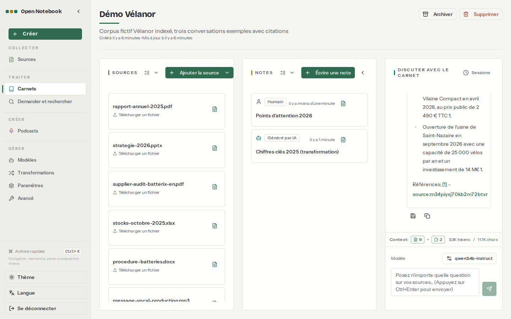
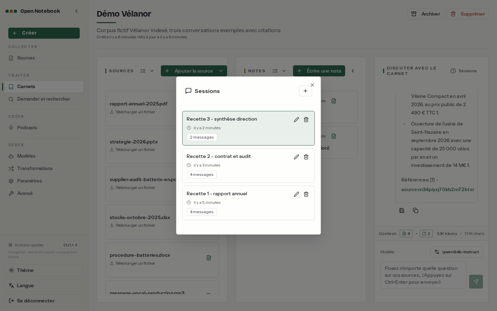

# 09. Recettes de bout en bout

> **Objet** : trois cas d'usage complets sur le corpus fictif Vélanor, du dépôt des documents à la note finale, avec les réponses réellement obtenues et leurs défauts.
> **Prérequis** : [02. Prise en main](02-prise-en-main.md), [04. Chat et citations](04-chat-et-citations.md), [05. Notes et transformations](05-notes-et-transformations.md).
> **Version décrite** : Open Notebook 1.15.1, Ollama 0.30.7 sur CPU, qwen3:4b-instruct (`num_ctx` 16384), bge-m3, Docling actif, transcription par Speaches 0.8.3 (faster-whisper-small).
> **Statut des informations** : [Vérifié] observé ou mesuré le 2026-11-08 sur la machine d'essai (Intel Core Ultra 7 255H, sans GPU NVIDIA) ; [Source] documentation officielle ou code source au tag v1.15.1 ; [Estimation] calcul non mesuré ; [À tester] non documenté et non essayé.
> **Précautions** : carnet « Démo Vélanor », laissé en place pour la démonstration ; script `outils/open-notebook/demo.py` (rejouable : il recrée le carnet).

**Risque signalé.** Une réponse citée n'est pas une réponse juste : dans la recette 3, une puce attribue à l'objectif 2026 un pourcentage qui appartient à 2025, avec une citation valide [Vérifié]. Les chiffres d'une synthèse destinée à la direction se relisent contre la source.

## Sommaire

1. [Préparer le carnet](#1-préparer-le-carnet)
2. [Recette 1 : analyser le rapport annuel](#2-recette-1--analyser-le-rapport-annuel)
3. [Recette 2 : confronter contrat, stocks et audit](#3-recette-2--confronter-contrat-stocks-et-audit)
4. [Recette 3 : synthèse pour la direction](#4-recette-3--synthèse-pour-la-direction)
5. [Dépannage](#dépannage)
6. [Sources](#sources)

## 1. Préparer le carnet

### Essentiel

Carnet « Démo Vélanor » : les neuf documents de `corpus/documents/` ajoutés un à un (**Ajouter la source**), puis toutes les sources en « Contenu complet » [Vérifié] ([résultat](../../outils/resultats/open-notebook/demo-2026-11-08.json)).

| Mesure | Valeur |
|---|---|
| Indexation des neuf documents (extraction, découpage, embeddings) | 105,7 s |
| Sources prêtes | 8 sur 9 |
| Source en échec | `contrat-batterix-scan.pdf` : « Could not extract any text content from this source » (scan sans OCR, voir [03](03-carnets-sources-formats.md)) |
| Message vocal (MP3) | transcrit, 351 caractères |
| Contexte envoyé à chaque question | 3,3 K jetons, 11,1 K caractères (bas de la colonne de chat) |

### Pour aller plus loin

Chaque recette a sa propre conversation (bouton **Sessions** de la colonne de chat), ce qui garde les historiques séparés et courts [Vérifié].

## 2. Recette 1 : analyser le rapport annuel

### Essentiel

Conversation « Recette 1 - rapport annuel » [Vérifié] :

| Question | Réponse obtenue (extrait) | Juste ? | Durée |
|---|---|---|---|
| Quel est le chiffre d'affaires 2025 et quel trimestre a été le plus élevé ? | « 48,6 M€ … Le trimestre le plus élevé a été le troisième trimestre (T3) de 2025, avec un chiffre d'affaires de 14,2 M€ », cite `rapport-annuel-2025.pdf` | oui | 100,1 s (première question : lecture complète du prompt) |
| Quel modèle est le plus vendu et quel est le plus cher ? | « Loire Urban, avec 24 300 unités … Erdre Cargo, avec un prix public TTC de 4 290 € » | oui | 11,7 s |

Puis la transformation personnalisée `fiche-chiffres-fr` ([05](05-notes-et-transformations.md)) est appliquée au rapport et son résultat enregistré comme note « Chiffres clés 2025 (transformation) » : huit chiffres en liste (48,6 M€, 3,1 M€, 61 800 vélos, 412 salariés, 27 %, 1,8 %, 3,4 GWh, 96 %), tous présents dans le rapport [Vérifié].

### Pour aller plus loin

Les tableaux du rapport sont lus correctement parce que Docling les extrait en tableaux Markdown ; sans Docling, le banc compte trois réponses exactes de moins (25 contre 28 sur 34) ([Qualité et performances](10-qualite-performances.md)).

## 3. Recette 2 : confronter contrat, stocks et audit

### Essentiel

Conversation « Recette 2 - contrat et audit » [Vérifié] :

| Question | Réponse obtenue (extrait) | Juste ? | Durée |
|---|---|---|---|
| Le délai de livraison réellement constaté chez Batterix respecte-t-il le délai prévu par le contrat ? | délai constaté de 24 jours, cité (`stocks-octobre-2025.xlsx`) ; « on ne peut pas affirmer … car aucune comparaison entre le délai contractuel et le délai observé n'est fournie » | juste sur ce que le carnet contient ; la comparaison est impossible car le contrat est un scan non lu | 28,1 s |
| Quelles non-conformités l'audit de Batterix a-t-il relevées ? | « Étiquetage incomplet des palettes » et absence d'équipement ESD à une station d'assemblage ; score de 87 sur 100 | oui (document source en anglais, réponse en français) | 24,5 s |

### Pour aller plus loin

Cette recette montre la limite la plus gênante de l'installation : la question multi-documents échoue faute d'OCR, et le modèle le dit au lieu d'inventer un délai contractuel [Vérifié]. Avec l'OCR de Docling opérationnel (décision en attente, [index](README.md#ce-qui-reste-ouvert)), la réponse serait complète [À tester].

## 4. Recette 3 : synthèse pour la direction

### Essentiel

Conversation « Recette 3 - synthèse direction », question : « Rédige en cinq puces les points d'attention pour la direction en 2026, avec les chiffres. » (28,4 s) [Vérifié]. Réponse, citée sur `strategie-2026.pptx`, puis enregistrée comme note « Points d'attention 2026 » :

| Puce | Contrôle contre la source |
|---|---|
| Chiffre d'affaires visé en 2026 : 55 M€ (+12,4 % par rapport à 2025) | 55 M€ juste ; « +12,4 % » faux : c'est la croissance de 2025 (rapport annuel), l'objectif représente +13,2 % [Estimation] |
| Part de l'export visée : 32 % (+5 points par rapport à 27 % en 2025) | juste (27 % vient du rapport, la citation ne nomme que la stratégie) |
| Marge nette visée : 7 % | juste |
| Vilaine Compact en avril 2026, 2 490 € TTC | juste |
| Usine de Saint-Nazaire en septembre 2026, 25 000 vélos par an, 14 M€ | juste |

### Pour aller plus loin

Le défaut type d'un petit modèle sur une synthèse : un chiffre exact déplacé d'un document à l'autre, sous une citation qui ne couvre qu'une partie de la phrase. Le bouton d'enregistrement en note, sous la réponse, conserve le texte tel quel ; la correction se fait dans la note [Vérifié].

## Dépannage

| Symptôme | Cause probable | Action |
|---|---|---|
| Une source reste en échec dans le carnet | scan sans texte | OCR préalable ([03](03-carnets-sources-formats.md)) |
| Première question d'une conversation très lente (100 s) | lecture complète du prompt sur CPU | normal ; les suivantes, sur le même contexte, sont rapides ([04](04-chat-et-citations.md)) |
| Chiffre faux sous une citation valide | mélange de deux documents par le modèle | relire la note contre la source ; poser une question par chiffre |

## Sources

- Script : `outils/open-notebook/demo.py` ; captures : `outils/open-notebook/captures/captures.py` (scénario `recettes`)
- Résultats : [démonstration](../../outils/resultats/open-notebook/demo-2026-11-08.json), [journal](../../outils/resultats/open-notebook/essai-2026-11-08-demo.log)
- Corpus : [questions et réponses attendues](../../corpus/questions.json)
