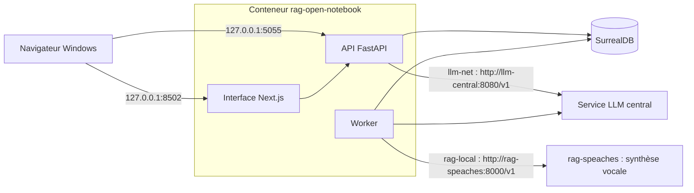

# A5. Fonctionnement interne

> **Objet** : comprendre le RAG (génération augmentée par récupération) et la façon dont Open Notebook l'applique ; connaître les conteneurs, images, réseaux, ports et dossiers de données de l'installation, et le service de modèles qu'elle utilise.
> **Prérequis** : aucun. Les termes techniques sont définis dans le [glossaire](../../glossaire.md).
> **Version décrite** : Open Notebook 1.15.1 (image `lfnovo/open_notebook:1.15.1`), SurrealDB v2.7.0 ; service LLM central du dépôt LLM-Service (noms fixes `chat`, `embed`, `transcribe`) depuis le 12 novembre 2026 ; synthèse vocale par Speaches 0.8.3 (`rag-speaches`, Kokoro). Les mesures du 8 novembre 2026 portent sur l'ancienne pile (Ollama sur CPU, qwen3:4b-instruct, bge-m3) : modèles différents.
> **Statut des informations** : [Vérifié] observé ou mesuré sur la machine d'essai, avec un renvoi au résultat brut (8 novembre 2026 : ancienne pile ; 12 novembre 2026 : service LLM central) ; [Source] documentation officielle, code source au tag v1.15.1 ou fichiers de configuration du dépôt ; [Estimation] calcul ou déduction non mesurés ; [À tester] non documenté et non essayé.
> **Précautions** : données fictives uniquement (corpus Vélanor) ; code source relu avant installation ([relecture](../../../outils/resultats/open-notebook/relecture.md)). Le service LLM central est géré à part : ce dépôt ne l'arrête ni ne le modifie jamais.

## Sommaire

1. [Le RAG en bref](#1-le-rag-en-bref)
2. [Les briques d'un RAG](#2-les-briques-dun-rag)
3. [Ce qu'Open Notebook fait autrement](#3-ce-quopen-notebook-fait-autrement)
4. [Architecture de l'installation](#4-architecture-de-linstallation)
5. [Le service de modèles](#5-le-service-de-modèles)
6. [Ce que change l'override](#6-ce-que-change-loverride)
7. [Découpage, embeddings et contexte](#7-découpage-embeddings-et-contexte)
8. [Extraction et Docling](#8-extraction-et-docling)
9. [Dépannage](#dépannage)
10. [Sources](#sources)

## 1. Le RAG en bref

### Essentiel

Un modèle de langage ne connaît pas les documents d'une entreprise. Le RAG les lui fournit au moment de la question : l'outil retrouve les passages utiles, les place dans le prompt, puis le modèle répond à partir d'eux et cite d'où vient l'information.

Trois étapes :

1. **Indexation** : chaque document est converti en texte, découpé en passages, puis chaque passage reçoit un embedding (un vecteur qui résume son sens).
2. **Récupération** : la question reçoit elle aussi un embedding ; l'outil cherche les passages les plus proches.
3. **Génération** : le modèle reçoit la question et les passages, et rédige la réponse.

### Pour aller plus loin

La qualité finale dépend surtout des deux premières étapes. Un texte mal extrait (scan sans OCR, tableau aplati) ou un passage non retrouvé ne peut pas être rattrapé par le modèle.

## 2. Les briques d'un RAG

### Essentiel

| Brique | Rôle | Réglage typique |
|---|---|---|
| Extraction | Transformer PDF, DOCX, PPTX, XLSX, HTML en texte | moteur d'extraction, OCR pour les scans |
| Découpage | Couper le texte en passages | taille (en jetons) et recouvrement |
| Embedding | Représenter chaque passage par un vecteur | modèle multilingue, par exemple bge-m3 |
| Recherche vectorielle | Retrouver les passages proches par le sens | nombre de résultats (top-k), score minimal |
| Recherche plein texte | Retrouver les passages qui contiennent les mots | algorithme BM25 |
| Recherche hybride | Combiner les deux recherches | pondération |
| Reranking | Reclasser les passages retrouvés avec un modèle dédié | nombre de passages gardés |
| Génération | Rédiger la réponse avec citations | modèle, taille de contexte |

### Pour aller plus loin

Le **budget de contexte** limite tout le reste : consignes, passages, historique, réflexion du modèle et réponse doivent tenir dans la taille de contexte. Avec le service central, elle vaut 16 384 jetons par requête pour `chat`, fixée par le service et identique pour toutes les applications [Source] (README de LLM-Service, [kit](../../../kit/PROMPT.md)). Open Notebook ne la choisit pas.

## 3. Ce qu'Open Notebook fait autrement

### Essentiel

Open Notebook reprend le principe de NotebookLM : des **carnets** (notebooks) qui regroupent des **sources**, des **notes** et des **conversations**.

- Le **chat d'un carnet** ne fait pas de recherche top-k. L'utilisateur choisit, source par source, ce qui est envoyé au modèle, et le texte choisi est placé en entier dans le prompt [Source] (`open_notebook/utils/context_builder.py`, `prompts/chat/system.jinja`) :

| Mode (API) | Ce qui est envoyé |
|---|---|
| `not in` | rien |
| `insights` | identifiant, titre et analyses (résultats de transformations) de la source |
| `full content` | identifiant, titre, analyses et texte intégral |

- La **recherche vectorielle** et la fonction **Demander** (Ask) utilisent, elles, les passages découpés et leurs embeddings : Ask lance jusqu'à 5 recherches de 10 résultats chacune [Source] (`open_notebook/graphs/ask.py`).
- Les **citations** sont des identifiants placés dans le texte de la réponse, par exemple `[source:abc123]`, sans numéro de page [Source] (`prompts/chat/system.jinja`). Exemple sur le service central : réponse « la durée de garantie pour le cadre est de **7 ans** [source:…] » [Vérifié] le 12 novembre 2026 ([vérification minimale](../../../outils/resultats/open-notebook/verif-minimale-2026-11-12.json)).

### Pour aller plus loin

- Coût d'un carnet de 9 sources [Vérifié] sur l'ancienne pile, le comptage ne dépendant pas du modèle ([résultat](../../../outils/resultats/open-notebook/chat-2026-11-08.json)) : 550 jetons en « insights », 3 084 jetons en « full content ». Avec beaucoup de sources en « full content », le prompt dépasse vite le contexte.
- Le dépassement a été provoqué sur l'ancienne pile, avec un contexte réduit à 4 096 jetons : la question a échoué avec une erreur explicite (« exceeds the available context size ») [Vérifié] ([banc à 4096](../../../outils/resultats/open-notebook/banc-2026-11-08-docling-qwen-fullcontent-ctx4096.json)). Le message obtenu avec le service central n'a pas été relevé [À tester].
- Open Notebook 1.15.1 n'accepte aucun reranker : les types de modèles admis sont `language`, `embedding`, `text_to_speech`, `speech_to_text`, et le code indique « Reranking is out of scope (#1087) » [Vérifié] ([relevé du 12 novembre 2026](../../../outils/resultats/open-notebook/reranker-2026-11-12.txt)). Il n'y a pas non plus de recherche hybride réglable [Source] ([synthèse du code](../../../outils/resultats/open-notebook/cadrage-source.md)).

## 4. Architecture de l'installation

### Essentiel

| Service | Conteneur | Image | Port publié | Réseaux | Rôle |
|---|---|---|---|---|---|
| Interface | `rag-open-notebook` | `lfnovo/open_notebook:1.15.1`, figée par empreinte | `127.0.0.1:8502` | `rag-local`, `llm-net` | pages web |
| API REST | `rag-open-notebook` | même image | `127.0.0.1:5055` (documentation sur `/docs`) | `rag-local`, `llm-net` | tout le fonctionnement, aussi utilisé par l'interface |
| Worker | `rag-open-notebook` | même image | aucun | `rag-local`, `llm-net` | tâches de fond : extraction, embeddings, transformations, podcasts |
| Base de données | `rag-open-notebook-surrealdb` | `surrealdb/surrealdb:v2.7.0`, figée par empreinte | aucun | `rag-local` | carnets, sources, passages, vecteurs |
| Synthèse vocale | `rag-speaches` | `ghcr.io/speaches-ai/speaches:0.8.3-cpu` | `127.0.0.1:8969` | `rag-local` | voix des podcasts (Kokoro) |
| Modèles | `llm-central` (porte d'entrée du service LLM central, dépôt LLM-Service) | gérée par LLM-Service | `127.0.0.1:8080` | `llm-net` | `chat`, `embed`, `transcribe` |

Ports et réseaux [Vérifié] ([ports du 12 novembre 2026](../../../outils/resultats/open-notebook/ports-2026-11-12.txt) ; réseaux dans `compose.override.yml`) ; images [Source] (`compose.override.yml`, `outils/communs/voix.sh`).

Les trois processus de l'application tournent dans le même conteneur, lancés par supervisord [Source] (`supervisord.conf`). Open Notebook rejoint deux réseaux Docker externes : `llm-net` pour les modèles (service central) et `rag-local` pour la base et la voix. Aucun port n'écoute sur `0.0.0.0` [Vérifié] (même fichier).

Dossiers de données, tous sous `donnees/open-notebook/` (ignoré par git) [Source] (`compose.override.yml`, `installer.sh`) :

| Dossier ou fichier | Monté dans | Contenu |
|---|---|---|
| `surreal_data/` | `rag-open-notebook-surrealdb:/mydata` | base SurrealDB (RocksDB) |
| `notebook_data/` | `rag-open-notebook:/app/data` | fichiers importés, podcasts, conversations, cache Docling (`.cache`) |
| `.env` | lu par `compose.sh` | clé de chiffrement, mot de passe, identifiants SurrealDB, `OPEN_NOTEBOOK_ENABLE_DOCLING` |

### Pour aller plus loin

- Mémoire au repos le 12 novembre 2026 [Vérifié] ([vérification minimale](../../../outils/resultats/open-notebook/verif-minimale-2026-11-12.json)) : 2 915 Mo pour `rag-open-notebook`, 140 Mo pour la base. Sans Docling, le conteneur de l'application occupait 0,4 Go le 8 novembre 2026, 2,1 Go juste après l'installation de Docling [Vérifié] ([journal](../../../outils/resultats/open-notebook/essai-2026-11-08-docling.log)). L'écart vient donc surtout de Docling [Estimation]. Les besoins en matériel sont détaillés dans [Matériel et modèles](A2-materiel-et-modeles.md).
- L'API attend la base au démarrage et applique elle-même les migrations de schéma [Source] (`api/main.py`). Le worker lit `SURREAL_NAMESPACE` et `SURREAL_DATABASE` avec un défaut `test`, différent de celui de l'API : sans ces deux variables, les tâches de fond ne sont jamais traitées [Source] (`open_notebook/database/repository.py:59-66`). Le compose officiel et l'override les fixent tous deux à `open_notebook`.

## 5. Le service de modèles

### Essentiel

Open Notebook ne contient aucun modèle. Il appelle le **service LLM central**, un dépôt séparé (LLM-Service) partagé avec d'autres applications, géré à part. Il se compose d'une porte d'entrée LiteLLM (conteneur `llm-central`), de llama-swap et llama.cpp (conteneur `llm-swap`) pour `chat` et `embed`, et de speaches (conteneur `llm-speaches`) pour la transcription [Source] (README de LLM-Service).

| Adresse | Valeur |
|---|---|
| Depuis un conteneur (réseau Docker externe `llm-net`) | `http://llm-central:8080/v1` |
| Depuis l'hôte | `http://127.0.0.1:8080/v1` |
| Clé | `LLM_CENTRAL_KEY`, obligatoire, dans le `.env` du dépôt (copié de `.env.example`, ignoré par git, jamais affiché) |

| Nom fixe | Modèle réel | Usage dans Open Notebook |
|---|---|---|
| `chat` | Qwen3.5-4B, vision, réflexion activée par défaut, 16 384 jetons par requête | chat, transformations, outils, large contexte |
| `embed` | bge-m3 Q8_0, 1 024 dimensions | embeddings des passages et des questions |
| `rerank` | bge-reranker-v2-m3 | aucun : Open Notebook n'accepte pas de reranker |
| `transcribe` | faster-whisper-small | transcription des sources audio |

Modèles réels [Source] (README de LLM-Service) ; liste exposée par le service, embedding de 1 024 dimensions, réponses de `chat`, `rerank` et `transcribe` [Vérifié] le 12 novembre 2026 (`outils/communs/llm_central_sante.sh --essai`, [journal](../../../outils/resultats/open-notebook/essai-2026-11-12-banc-chat.log)).

Dans Open Notebook, un seul fournisseur « OpenAI Compatible » nommé `llm-central` porte les modalités language, embedding et speech_to_text ; un second, `speaches-voix`, porte seulement text_to_speech, sur `rag-speaches` [Vérifié] ([configuration](../../../outils/resultats/open-notebook/configuration-2026-11-12.json)). La synthèse vocale reste sur `rag-speaches` parce que le service central ne la sert pas.

### Pour aller plus loin

- **Réflexion de `chat`** : le modèle raisonne avant de répondre. Le raisonnement compte dans le plafond de jetons de la réponse et allonge le délai [Source] (README de LLM-Service). L'override porte donc le délai d'un appel à 900 s (`ESPERANTO_LLM_TIMEOUT`). L'interface d'Open Notebook ne propose pas de réglage pour couper la réflexion [À tester] ; son effet sur la qualité et les délais est mesuré dans [Qualité et performances](A1-qualite-et-performances.md).
- **Ancienne pile** : jusqu'au 9 novembre 2026, les modèles venaient d'Ollama sur CPU (`ollama-central`, qwen3:4b-instruct, bge-m3), puis de vLLM sur GPU (`vllm-central`, Gemma 4 E4B ; `vllm-embed`), et la transcription de `rag-speaches`. Les mesures faites sur cette pile restent des preuves historiques, non comparables telles quelles ([Rapport d'essais](A6-rapport-d-essais.md)).

## 6. Ce que change l'override

### Essentiel

L'installation part du `docker-compose.yml` officiel au tag v1.15.1 (copie gardée dans `outils/open-notebook/officiel/`, empreinte vérifiée par `installer.sh`), complété par `outils/open-notebook/compose.override.yml`. Toutes les commandes passent par `outils/open-notebook/compose.sh` [Source] (fichiers du dépôt).

| Réglage | Compose officiel | Override du dépôt |
|---|---|---|
| Image de l'application | `lfnovo/open_notebook:v1-latest`, retéléchargée à chaque démarrage | `1.15.1` figée par empreinte, `pull_policy: missing` |
| Image de la base | `surrealdb/surrealdb:v2` | `v2.7.0` figée par empreinte |
| Ports | `8502:8502`, `5055:5055` (toutes interfaces) | `127.0.0.1:8502`, `127.0.0.1:5055` |
| Port SurrealDB | `127.0.0.1:8000` | non publié |
| Mot de passe | aucun | `OPEN_NOTEBOOK_PASSWORD` aléatoire |
| Clé de chiffrement | `change-me-to-a-secret-string` | aléatoire, 64 caractères hexadécimaux |
| Identifiants SurrealDB | `root` / `root` | générés |
| Tâches de fond simultanées | 5 | 1 (`OPEN_NOTEBOOK_WORKER_MAX_TASKS`) |
| Délai d'un appel LLM | 180 s | 900 s (`ESPERANTO_LLM_TIMEOUT`) ; embeddings 300 s |
| Découpage | non fixé (défaut du code : 400 jetons, recouvrement 15 %) | 400 jetons, recouvrement 60 jetons, fixés explicitement |
| Transcription | non fixée (la Base URL de la configuration est ignorée, voir section 8) | `OPENAI_COMPATIBLE_BASE_URL_STT=http://llm-central:8080/v1`, clé `LLM_CENTRAL_KEY` |
| Synthèse vocale | aucune | `OPENAI_COMPATIBLE_BASE_URL_TTS=http://rag-speaches:8000/v1` |
| Données | `./surreal_data`, `./notebook_data` | `donnees/open-notebook/` |
| Réseaux | réseau du projet | réseaux externes `rag-local` et `llm-net` |

### Pour aller plus loin

`compose.sh` lit deux fichiers de variables : `donnees/open-notebook/.env` (secrets locaux), puis le `.env` du dépôt (clé du service central). La clé n'est jamais recopiée dans `donnees/`. Sans le `.env` du dépôt, `compose.sh` s'arrête avec un message explicite [Source] (`compose.sh`).

## 7. Découpage, embeddings et contexte

### Essentiel

- Chaque source est découpée en passages de **400 jetons** (comptés avec tiktoken `o200k_base`), avec **60 jetons** de recouvrement. Les passages de moins de 5 jetons sont ignorés [Source] (`open_notebook/utils/chunking.py`, [synthèse du code](../../../outils/resultats/open-notebook/cadrage-source.md)). L'override fixe `OPEN_NOTEBOOK_CHUNK_SIZE=400` et `OPEN_NOTEBOOK_CHUNK_OVERLAP=60` [Source] (`compose.override.yml`).
- Les découpeurs suivent le type de texte : par en-têtes pour le HTML et le Markdown, sinon un découpage récursif [Source] (`chunking.py`).
- Chaque passage reçoit un embedding par `embed` (1 024 dimensions) [Vérifié] ([journal](../../../outils/resultats/open-notebook/essai-2026-11-12-banc-chat.log)).
- Le chat de carnet n'utilise pas les passages : il envoie les sources entières selon leur mode (section 3). Le découpage n'agit que sur la recherche et sur « Demander ».

### Pour aller plus loin

- La taille de découpage est lue au démarrage. Les sources déjà indexées gardent leurs passages jusqu'à une reconstruction (`POST /api/embeddings/rebuild`) [Source]. Changer de modèle d'embedding impose aussi cette reconstruction : seuls les vecteurs de même dimension sont comparés [Source] ([synthèse du code](../../../outils/resultats/open-notebook/cadrage-source.md)).
- Budget de contexte sur l'ancienne pile, pour mémoire : sans GPU, Ollama lisait le prompt à 36 jetons par seconde avec qwen3:4b-instruct au contexte de 16 384 [Vérifié] ([mesures du socle](../../../outils/resultats/socle/mesures-2026-11-08-passe2.json)). Ces chiffres ne valent pas pour `chat` : voir [Matériel et modèles](A2-materiel-et-modeles.md).

## 8. Extraction et Docling

### Essentiel

- Le moteur de documents vaut `auto` : Docling s'il est installé, sinon une extraction simple. Le moteur de liens vaut `simple`, ce qui évite le repli vers un service tiers [Vérifié] ([configuration](../../../outils/resultats/open-notebook/configuration-2026-11-12.json)).
- Docling n'est pas dans l'image : il s'installe au démarrage du conteneur quand `OPEN_NOTEBOOK_ENABLE_DOCLING=true`. `installer.sh` écrit cette valeur dans `donnees/open-notebook/.env` ; l'override vaut `false` sans elle [Source] (`installer.sh`, `compose.override.yml`, `scripts/docker-entrypoint.sh`).
- Docling garde les tableaux des fichiers DOCX, que l'extraction simple perd sans message [Vérifié] sur l'ancienne pile, l'extraction ne dépendant pas du modèle ([avec Docling](../../../outils/resultats/open-notebook/formats-2026-11-08-docling.json), [sans Docling](../../../outils/resultats/open-notebook/formats-2026-11-08-sans-docling.json)).
- L'OCR de Docling ne fonctionne pas dans l'image 1.15.1 : le PDF scanné du corpus reste illisible (« Could not extract any text content from this source ») [Vérifié] le 12 novembre 2026 ([journal](../../../outils/resultats/open-notebook/essai-2026-11-12-banc-chat.log)).

### Pour aller plus loin

La transcription audio (content-core) ignore la Base URL enregistrée pour « OpenAI Compatible » : elle lit `OPENAI_COMPATIBLE_BASE_URL_STT` et `OPENAI_COMPATIBLE_API_KEY_STT`. Le défaut a été constaté sur l'ancienne pile [Vérifié] ([journal](../../../outils/resultats/open-notebook/essai-audio-scan-2026-11-08.log)) ; l'override pointe désormais ces variables vers `transcribe` du service central. Le message vocal du corpus a été transcrit sur le service central le 12 novembre 2026 (351 caractères) [Vérifié] ([journal](../../../outils/resultats/open-notebook/essai-2026-11-12-banc-chat.log)). Les formats et leurs résultats sont décrits dans [Ajouter et organiser les sources](../manuel/05-ajouter-et-organiser-les-sources.md).

### Ce qui est extrait, format par format

Valeurs témoins cherchées dans le texte extrait de chaque document du corpus (par exemple « premier lundi », qui n'existe que dans le tableau du DOCX), sur l'ancienne pile ; l'extraction ne dépend pas du modèle de réponse, la transcription audio si (elle passe aujourd'hui par `transcribe`) [Vérifié] (`outils/open-notebook/essai_formats.py`, [sans Docling](../../../outils/resultats/open-notebook/formats-2026-11-08-sans-docling.json), [avec Docling](../../../outils/resultats/open-notebook/formats-2026-11-08-docling.json)) :

| Document | Sans Docling | Avec Docling |
|---|---|---|
| Rapport PDF texte, 10 pages, 6 tableaux | 4 704 caractères, 5 passages ; tableaux en texte puis en tableau Markdown avec « page N » ; tous les témoins | 4 319 caractères, 10 passages ; tableaux en Markdown, titres en `##` ; tous les témoins |
| PDF scanné (2 pages, image) | échec : « Could not extract any text content » | même message ; le journal indique « No OCR engine found » ([OCR](../../../outils/resultats/open-notebook/essai-docling-ocr-2026-11-08.log)) |
| Procédure DOCX avec un tableau | 565 caractères ; **tableau perdu** (« premier lundi », « classe D » absents) | 1 085 caractères ; tableau en Markdown ; tous les témoins |
| Présentation PPTX, 5 diapositives | 565 caractères ; tous les témoins | 516 caractères ; tous les témoins |
| Classeur XLSX, 2 feuilles | 703 caractères ; feuilles en tableaux Markdown ; tous les témoins | 1 110 caractères ; tous les témoins |
| Page HTML | 594 caractères ; tous les témoins | identique |
| Note Markdown | 528 caractères ; tous les témoins | identique |
| PDF en anglais | 465 caractères ; tous les témoins | 430 caractères ; tous les témoins |
| Message audio MP3 (19 s) | échec de transcription (section 4) | transcrit, 351 caractères, avec erreurs (section 4) ; grâce au contournement STT appliqué en même temps que Docling, pas à Docling |

## Dépannage

| Symptôme | Cause probable | Action |
|---|---|---|
| « exceeds the available context size » ou erreur 502 dans le chat | prompt plus long que les 16 384 jetons de `chat` | passer des sources de « full content » à « insights » ou « not in » |
| Citation sans page | comportement normal : Open Notebook cite la source, pas la page | ouvrir la source citée |
| Les tâches de fond ne progressent jamais | namespace ou base SurrealDB différents entre API et worker [Source] | fixer `SURREAL_NAMESPACE` et `SURREAL_DATABASE` (déjà fait par l'override) |
| Source audio en échec : « Content extraction is not configured correctly » | variables de transcription absentes | vérifier `OPENAI_COMPATIBLE_BASE_URL_STT` dans l'override |
| Modèles injoignables depuis Open Notebook | service central arrêté, ou conteneur absent du réseau `llm-net` | `outils/communs/llm_central_sante.sh`, puis `outils/open-notebook/etat.sh` |
| Recherche vectorielle vide après un changement de modèle d'embedding | vecteurs de dimension différente | reconstruire les embeddings (`POST /api/embeddings/rebuild`) |

## Sources

- Dépôt officiel : https://github.com/lfnovo/open-notebook (tag v1.15.1) ; documentation : https://github.com/lfnovo/open-notebook/tree/v1.15.1/docs
- [Synthèse du code source](../../../outils/resultats/open-notebook/cadrage-source.md) et [relecture](../../../outils/resultats/open-notebook/relecture.md)
- Configuration : `outils/open-notebook/compose.override.yml`, `compose.sh`, `installer.sh`, `configurer.py`, `officiel/docker-compose.yml` ; `outils/communs/voix.sh`, `llm_central_sante.sh`
- Service LLM central : README du dépôt LLM-Service (`~/mes_projets/Projet-IA/LLM-Service/README.md`), [kit de la mission](../../../kit/PROMPT.md)
- Résultats : [installation](../../../outils/resultats/open-notebook/installation-2026-11-12.log), [configuration](../../../outils/resultats/open-notebook/configuration-2026-11-12.json), [vérification minimale](../../../outils/resultats/open-notebook/verif-minimale-2026-11-12.json), [ports](../../../outils/resultats/open-notebook/ports-2026-11-12.txt), [reranker](../../../outils/resultats/open-notebook/reranker-2026-11-12.txt), [versions](../../../outils/resultats/open-notebook/versions-2026-11-12.json)
- Interface : [carte de l'interface](carte-interface.md) ; premiers pas : [Premiers pas](../manuel/03-premiers-pas.md)
