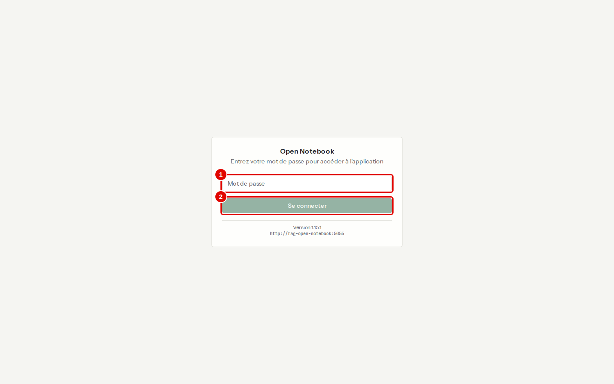
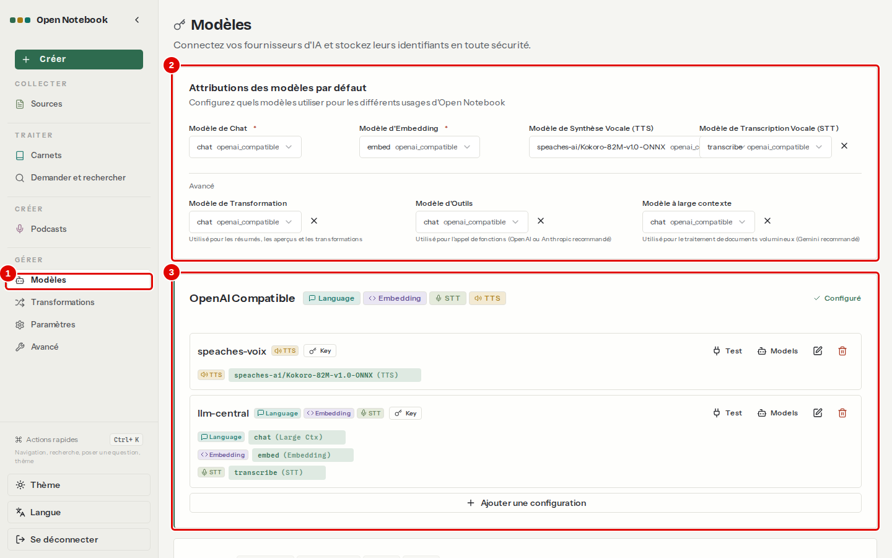

# 02. Installer Open Notebook

> Ce chapitre apprend à installer Open Notebook sous Windows 11 avec WSL2, à le démarrer, à l'arrêter et à le désinstaller.
> **Point de départ** : un terminal Ubuntu (WSL2) ouvert dans le dossier personnel, Docker Desktop lancé.
> **Durée** : environ 15 minutes la première fois (téléchargement des images), moins d'une minute ensuite. **Avant** : chapitre [01](01-decouvrir-open-notebook.md).

**Risque réseau.** Le fichier d'installation fourni par le projet ouvre l'application à tout le réseau, sans mot de passe. L'installation décrite ici la limite à la machine (`127.0.0.1`) et active un mot de passe : ne pas lancer le fichier officiel tel quel.

## Ce qu'il faut savoir

Open Notebook tourne dans deux [conteneurs](../../glossaire.md) Docker : l'application elle-même (interface, API et tâches de fond) et sa base de données. Il ne contient aucun modèle d'IA : il les demande au **service LLM central**, un service de modèles partagé par toutes les applications de la série, installé et démarré à part (dépôt LLM-Service). L'installation consiste donc à lancer les deux conteneurs, puis à leur indiquer l'adresse et la clé du service central. Un script fait tout cela en une commande ; il peut être relancé sans risque, il ne refait que ce qui manque.

## Préparer la machine

**Étape 0. Récupérer le dépôt**
*Où* : terminal Ubuntu (WSL2), dossier personnel.
Le dépôt contient les scripts d'installation utilisés dans ce manuel. Le copier puis entrer dans son dossier :

```bash
git clone https://github.com/floSa/Open-Notebook-Test-Bench.git
```

```bash
cd Open-Notebook-Test-Bench
```

*Résultat* : le terminal est « à la racine du dépôt » ; toutes les commandes suivantes se lancent depuis ce dossier.

**Étape 1. Vérifier les prérequis**
*Où* : terminal Ubuntu (WSL2).
Il faut, une fois pour toutes : WSL2 avec Ubuntu, Docker Desktop réglé sur le moteur WSL2 avec l'intégration de la distribution activée, et le dépôt placé dans le dossier personnel de WSL (`~/…`, pas sous `/mnt/c`). La commande suivante fait le point sur la machine (processeur, mémoire, disque, carte graphique, Docker, service central) :

```bash
outils/communs/diagnostic.sh
```

*Résultat* : le diagnostic s'affiche et un fichier daté est écrit dans `outils/resultats/machine/`.

**Étape 2. Vérifier que le service LLM central répond**
*Où* : même terminal.
Le service central doit tourner avant Open Notebook. Il s'installe à part, depuis son propre dépôt, https://github.com/floSa/LLM-Service, dont le fichier README sert de mode d'emploi (par exemple `git clone https://github.com/floSa/LLM-Service.git ~/mes_projets/Projet-IA/LLM-Service`) ; ce manuel suppose qu'il est installé dans `~/mes_projets/Projet-IA/LLM-Service` (chemin à adapter s'il est ailleurs). Sa clé se range dans le fichier `.env` à la racine du dépôt Open-Notebook-Test-Bench (le dossier de l'étape 0, pas celui de LLM-Service) : y lancer `cp .env.example .env`, puis y recopier, sur la ligne `LLM_CENTRAL_KEY=`, la valeur de `LITELLM_MASTER_KEY` du fichier `.env` du dépôt LLM-Service (`~/mes_projets/Projet-IA/LLM-Service/.env`). Ce fichier n'est jamais publié. La commande suivante liste les modèles du service, puis fait un essai réel de chacun :

```bash
outils/communs/llm_central_sante.sh --essai
```

*Résultat* : la liste commence par les quatre noms fixes `chat`, `embed`, `rerank` et `transcribe`, puis chaque essai affiche sa réponse (« Bonjour ! », « dimensions : 1024 », deux scores, la transcription du message vocal). Si le service ne répond pas, le démarrer :

```bash
~/mes_projets/Projet-IA/LLM-Service/scripts/demarrer.sh
```

Sur une machine sans carte graphique NVIDIA, ajouter `cpu` à la fin de cette commande.

## Installer

**Étape 3. Lancer l'installation**
*Où* : même terminal.

```bash
outils/open-notebook/installer.sh
```

Le script :

1. vérifie le fichier d'installation officiel (copie gardée dans le dépôt, contrôlée par empreinte) ;
2. crée les secrets propres à la machine (mot de passe de l'interface, clé de chiffrement, identifiants de la base) dans `donnees/open-notebook/.env`, et recopie le mot de passe dans `donnees/IDENTIFIANTS-LOCAUX.txt` ;
3. vérifie que le service central répond, démarre le serveur de synthèse vocale (pour les podcasts), puis les deux conteneurs d'Open Notebook ;
4. déclare le service central dans Open Notebook (adresse, clé, modèles `chat`, `embed` et `transcribe`) et la synthèse vocale.

*Résultat* : la fin de l'affichage ressemble à ceci (la première installation dure plus longtemps, le temps de télécharger environ 2,6 Go d'images) :

```text
{"status":"healthy"}
interface : HTTP 307
{"test_connexion": {"provider": "openai_compatible", "success": true, "message": "Connected. 9 models available: chat, embed, rerank (+6 more)"}, …}
modèles enregistrés : [('chat', 'language'), ('speaches-ai/Kokoro-82M-v1.0-ONNX', 'text_to_speech'), ('transcribe', 'speech_to_text'), ('embed', 'embedding')]
rag-open-notebook 127.0.0.1:5055->5055/tcp, 127.0.0.1:8502->8502/tcp
durée : 42 s
```

« HTTP 307 » est normal : l'interface redirige vers la page de connexion. La ligne `127.0.0.1:…` confirme que l'application n'est joignable que depuis la machine.

**Étape 4. Ouvrir l'interface**
*Où* : navigateur Windows, adresse `http://127.0.0.1:8502`.
L'écran de connexion s'affiche. Le mot de passe est dans `donnees/IDENTIFIANTS-LOCAUX.txt` (ligne « Mot de passe »).


*Écran : page de connexion, à la première ouverture.*

| N° | Élément | Rôle |
|---|---|---|
| 1 | Champ du mot de passe | reçoit le mot de passe de `donnees/IDENTIFIANTS-LOCAUX.txt` |
| 2 | « Se connecter » | ouvre l'application |

*Résultat* : après connexion, la page « Carnets » s'affiche (chapitre [03](03-premiers-pas.md)).

**Étape 5. Contrôler le branchement des modèles**
*Où* : menu de gauche › GÉRER › « Modèles ».
La page montre ce que l'installation a déclaré : le fournisseur « OpenAI Compatible » avec la configuration `llm-central`, et les modèles choisis par défaut.


*Écran : Modèles, après l'installation.*

| N° | Élément | Rôle |
|---|---|---|
| 1 | « Modèles » | ouvre la page des modèles |
| 2 | Attributions des modèles par défaut | modèle utilisé pour chaque usage : `chat` pour discuter, `embed` pour la recherche par le sens, `transcribe` pour l'audio |
| 3 | Bloc « OpenAI Compatible » | les deux configurations : `llm-central` (service central) et `speaches-voix` (synthèse vocale) |

*Résultat* : `chat`, `embed` et `transcribe` sont choisis par défaut. Le chapitre [03](03-premiers-pas.md) explique comment faire cette déclaration à la main.

## Démarrer, arrêter, connaître l'état

**Étape 6. Arrêter et redémarrer**
*Où* : terminal Ubuntu, racine du dépôt.

```bash
outils/open-notebook/arreter.sh
```

```bash
outils/open-notebook/demarrer.sh
```

```bash
outils/open-notebook/etat.sh
```

`arreter.sh` arrête les deux conteneurs ; les carnets et les documents restent dans `donnees/open-notebook/`. `arreter.sh --voix` arrête aussi le serveur de synthèse vocale. Aucun de ces scripts n'arrête le service central : il sert d'autres applications. `etat.sh` affiche les conteneurs, leurs ports, l'état de l'API, de l'interface et du service central, et la mémoire prise par l'application.

*Résultat* : après `demarrer.sh`, l'interface répond de nouveau sur `http://127.0.0.1:8502`. Les conteneurs redémarrent aussi tout seuls avec Docker Desktop, sauf s'ils ont été arrêtés à la main.

## Désinstaller

**Étape 7. Tout supprimer**
*Où* : terminal Ubuntu, racine du dépôt.

```bash
outils/communs/nettoyer.sh open-notebook
```

Le script demande une confirmation (taper `oui`), puis supprime les conteneurs, le réseau et le dossier `donnees/open-notebook/` : **tous les carnets, sources et notes sont perdus**. Faire d'abord une sauvegarde si besoin (annexe [A4](../annexes/A4-exploitation.md)). Le service central n'est jamais touché ; les images Docker restent sur le disque.

*Résultat* : `http://127.0.0.1:8502` ne répond plus.

## Bon à savoir

- L'application seule prend environ 0,5 Go de mémoire, et près de 3 Go une fois le module de lecture avancée des documents (Docling) chargé ; les modèles d'IA sont comptés à part, dans le service central (chapitre [01](01-decouvrir-open-notebook.md)).
- Le mot de passe est unique : il n'existe pas de comptes séparés.
- Les versions sont figées : l'application ne se met jamais à jour toute seule. La procédure de mise à jour est en annexe [A4](../annexes/A4-exploitation.md).

## En cas de problème

| Symptôme | Cause | Que faire |
|---|---|---|
| « service LLM central injoignable : démarrer LLM-Service » | le service central ne tourne pas | le démarrer (étape 2), puis relancer l'installation |
| « clé LLM_CENTRAL_KEY absente du .env du dépôt » | fichier `.env` absent ou vide | copier `.env.example` en `.env` et y mettre la clé du service |
| La page ne s'ouvre pas dans le navigateur | conteneurs arrêtés | `outils/open-notebook/demarrer.sh` |
| L'interface redemande le mot de passe | données du site effacées dans le navigateur | se reconnecter |

Autres cas : chapitre [12](12-en-cas-de-probleme.md).

---
*Version décrite : Open Notebook 1.15.1, service LLM central (`chat`, `embed`, `transcribe`), essais du 12 novembre 2026. Détails et preuves : [rapport d'essais](../annexes/A6-rapport-d-essais.md), [exploitation](../annexes/A4-exploitation.md).*
