# 03. Premiers pas

> Ce chapitre apprend à se repérer dans l'écran d'Open Notebook, à régler la langue et le thème, et à déclarer les modèles d'IA du service central.
> **Point de départ** : page « Carnets », juste après la connexion (chapitre [02](02-installer-open-notebook.md), étape 4).
> **Durée** : environ 15 minutes. **Avant** : chapitre [02](02-installer-open-notebook.md).

## Ce qu'il faut savoir

L'écran a deux parties : le **menu de gauche**, toujours visible, et la **page** ouverte à droite. Le menu range les pages en quatre groupes : COLLECTER (les documents), TRAITER (les carnets et la recherche), CRÉER (les podcasts) et GÉRER (les réglages). Avant le premier usage, l'application doit savoir quels **modèles d'IA** utiliser : le script d'installation les a déjà déclarés, mais cette déclaration se fait aussi à la main, page « Modèles », par exemple après une remise à zéro ou pour comprendre ce qui a été fait.

## Se repérer dans l'écran

**Étape 1. Lire le menu de gauche**
*Où* : n'importe quelle page, colonne de gauche.

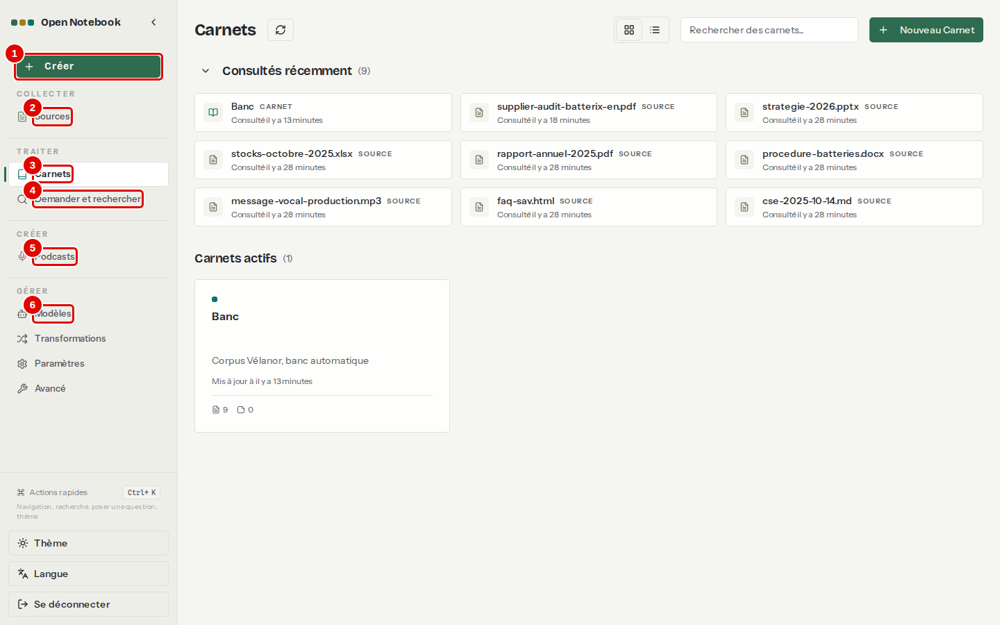
*Écran : Carnets, menu de gauche. La page montre ici des carnets d'essai ; juste après l'installation, elle est vide.*

| N° | Élément | Rôle |
|---|---|---|
| 1 | « Créer » | crée en un clic une source, un carnet ou un podcast (étape 7) |
| 2 | « Sources » | liste de tous les documents ajoutés, tous carnets confondus (chapitre [05](05-ajouter-et-organiser-les-sources.md)) |
| 3 | « Carnets » | liste des carnets ; c'est la page d'accueil |
| 4 | « Demander et rechercher » | recherche et question dans tous les carnets (chapitre [08](08-rechercher-et-demander.md)) |
| 5 | « Podcasts » | épisodes audio et leurs réglages (chapitre [09](09-creer-un-podcast.md)) |
| 6 | « Modèles » | premier lien du groupe GÉRER, avec « Transformations », « Paramètres » et « Avancé » (chapitres [07](07-notes-et-transformations.md) et [10](10-regler-l-application.md)) |

*Résultat* : un clic sur un lien ouvre la page correspondante ; le lien de la page ouverte est surligné. La petite flèche à droite du titre « Open Notebook » replie le menu pour laisser plus de place à la page.

**Étape 2. Lire le bas du menu**
*Où* : bas de la colonne de gauche.

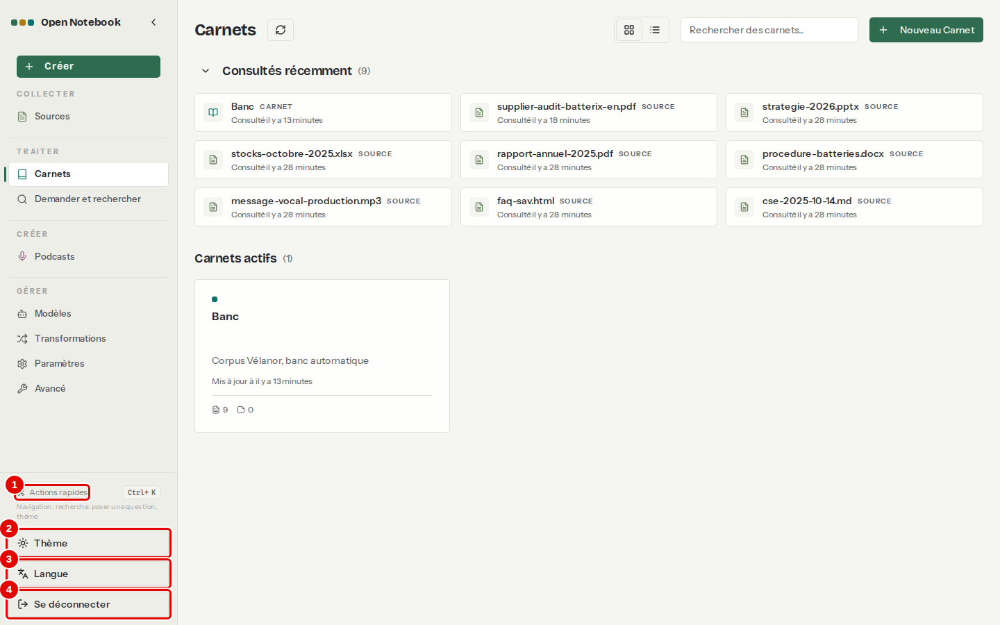
*Écran : Carnets, bas du menu de gauche.*

| N° | Élément | Rôle |
|---|---|---|
| 1 | « Actions rapides » (Ctrl+K) | ouvre une barre de commande au clavier (étape 6) |
| 2 | « Thème » | choisit des couleurs claires ou sombres (étape 5) |
| 3 | « Langue » | change la langue de l'interface (étape 4) |
| 4 | « Se déconnecter » | ferme la session ; le mot de passe sera redemandé |

**Étape 3. Lire la page Carnets**
*Où* : menu de gauche › « Carnets ».

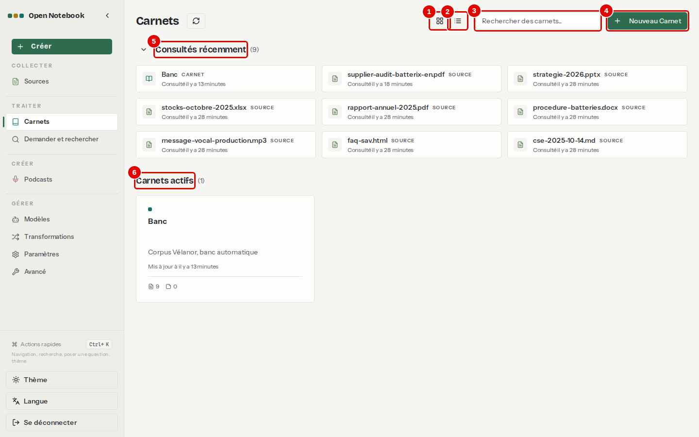
*Écran : Carnets.*

| N° | Élément | Rôle |
|---|---|---|
| 1 | « Vue en mosaïque » | affiche les carnets en cartes |
| 2 | « Vue en liste » | affiche les carnets en lignes, plus compactes |
| 3 | « Rechercher des carnets... » | filtre les carnets par leur nom |
| 4 | « Nouveau Carnet » | crée un carnet (chapitre [04](04-premiere-question.md)) |
| 5 | « Consultés récemment » | derniers carnets et documents ouverts ; un clic sur le titre replie la liste |
| 6 | « Carnets actifs » | carnets non archivés ; chaque carte indique le nombre de sources et de notes |

## Régler la langue et le thème

**Étape 4. Choisir la langue**
*Où* : bas du menu › « Langue ».
L'interface suit d'abord la langue du navigateur : si celui-ci est en anglais, le bouton s'appelle « Language » (et « Theme » pour le thème). Le menu propose quatorze langues ; cliquer sur « Français » (pastille 1).

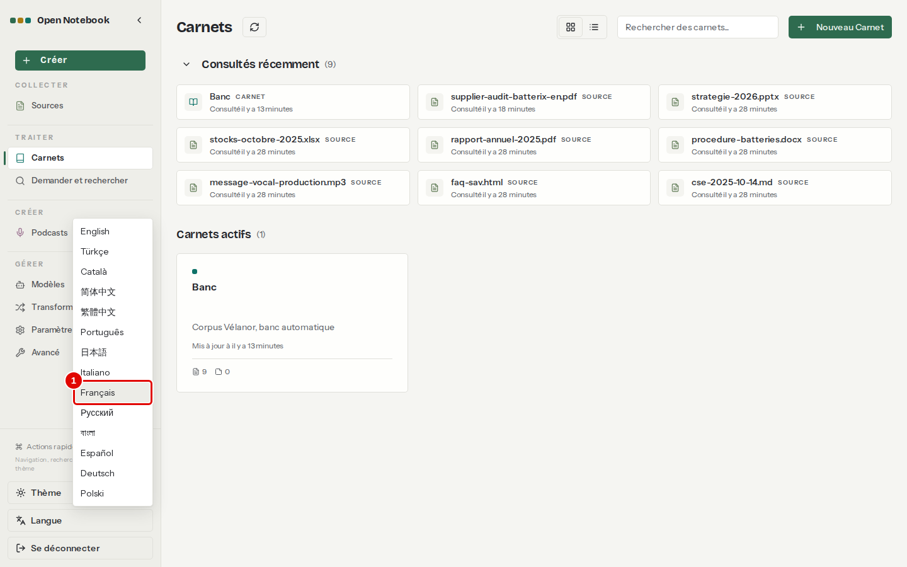
*Écran : Carnets, menu « Langue » ouvert.*

| N° | Élément | Rôle |
|---|---|---|
| 1 | « Français » | passe toute l'interface en français ; ce manuel cite les libellés français |

*Résultat* : les libellés de l'interface passent en français. Certains textes restent en anglais, comme « Back to Sources » ou « Models » : ils ne sont pas traduits dans cette version.

**Étape 5. Choisir le thème**
*Où* : bas du menu › « Thème ».

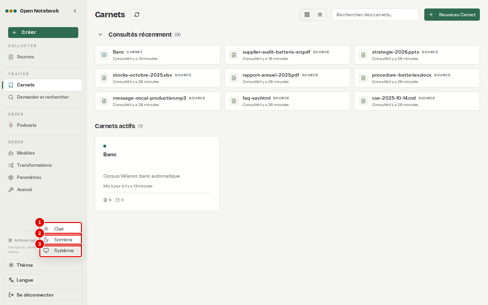
*Écran : Carnets, menu « Thème » ouvert.*

| N° | Élément | Rôle |
|---|---|---|
| 1 | « Clair » | fond clair (celui des captures de ce manuel) |
| 2 | « Sombre » | fond sombre, plus reposant le soir |
| 3 | « Système » | suit le réglage de Windows |

**Étape 6. Utiliser les actions rapides**
*Où* : n'importe quelle page, touches Ctrl+K.
Une barre de commande s'ouvre au milieu de l'écran : taper quelques lettres (le nom d'un carnet, d'une page, ou une question), puis Entrée.

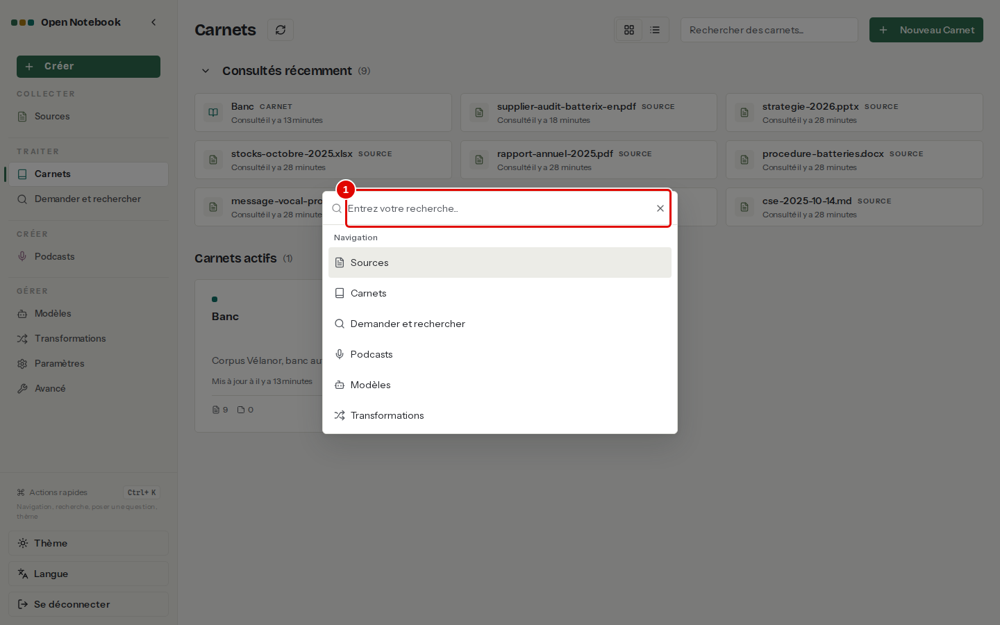
*Écran : fenêtre « Actions rapides ».*

| N° | Élément | Rôle |
|---|---|---|
| 1 | « Entrez votre recherche... » | cherche une page, un carnet ou une source ; propose aussi de poser la question ou de changer de thème |

*Résultat* : Entrée ouvre l'élément choisi ; Échap ferme la fenêtre.

**Étape 7. Créer depuis le bouton « Créer »**
*Où* : menu de gauche › « Créer ».

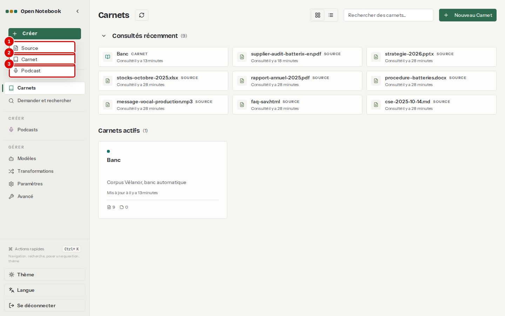
*Écran : Carnets, menu « Créer » ouvert.*

| N° | Élément | Rôle |
|---|---|---|
| 1 | « Source » | ouvre la fenêtre d'ajout d'un document (chapitre [05](05-ajouter-et-organiser-les-sources.md)) |
| 2 | « Carnet » | ouvre la fenêtre de création d'un carnet (chapitre [04](04-premiere-question.md)) |
| 3 | « Podcast » | ouvre la fenêtre de génération d'un épisode (chapitre [09](09-creer-un-podcast.md)) |

## Déclarer les modèles d'IA

**Faut-il faire cette partie ?** Après le script d'installation du chapitre [02](02-installer-open-notebook.md), les modèles sont déjà déclarés : seule l'étape 14 (vérifier) est utile. Les étapes 8 à 13 servent après une remise à zéro, ou si la configuration `llm-central` a été supprimée. Si la configuration `llm-central` existe encore, ne pas refaire ces étapes : elles créeraient une configuration en double.

Open Notebook a besoin d'au moins deux modèles : un **modèle de langage**, qui rédige les réponses, et un **modèle d'embedding**, qui sert à la recherche par le sens. Dans cette installation, tous deux viennent du service LLM central, sous les noms fixes `chat` et `embed` ; le modèle `transcribe` du même service transcrit l'audio. Le service central se déclare comme un fournisseur « OpenAI Compatible », parce qu'il accepte les mêmes requêtes que l'API d'OpenAI. Il faut son adresse et sa clé : l'adresse est `http://llm-central:8080/v1` ; la clé est la valeur de `LLM_CENTRAL_KEY` dans le fichier `.env` à la racine du dépôt.

**Risque.** La clé du service ne doit apparaître ni dans une capture, ni dans un document partagé.

**Étape 8. Ajouter une configuration au fournisseur « OpenAI Compatible »**
*Où* : menu de gauche › GÉRER › « Modèles », bloc « OpenAI Compatible » (faire défiler la page).

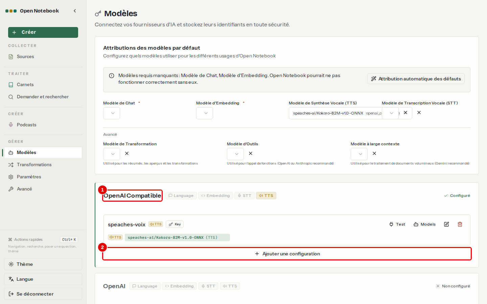
*Écran : Modèles, bloc du fournisseur « OpenAI Compatible ».*

| N° | Élément | Rôle |
|---|---|---|
| 1 | « OpenAI Compatible » | fournisseur qui désigne tout service compatible avec l'API d'OpenAI, dont le service central ; les étiquettes à droite (« Language », « Embedding », « STT », « TTS ») indiquent les usages déjà couverts |
| 2 | « Ajouter une configuration » | ouvre la fenêtre de déclaration d'un service |

*Résultat* : la fenêtre « Ajouter une configuration » s'ouvre.

**Étape 9. Remplir la configuration**
*Où* : fenêtre « Ajouter une configuration ».
Saisir un nom, la clé et l'adresse, puis valider.

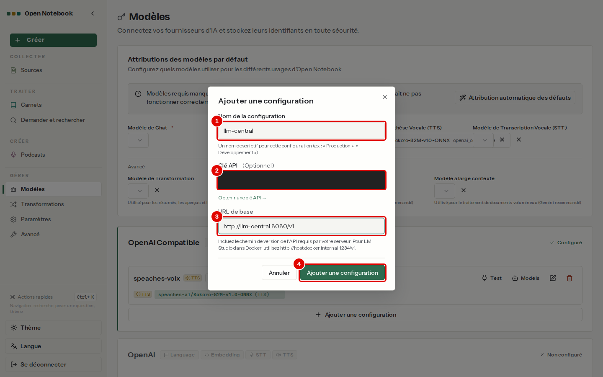
*Écran : fenêtre « Ajouter une configuration » (clé masquée).*

| N° | Élément | Rôle |
|---|---|---|
| 1 | « Nom de la configuration » | nom libre, ici `llm-central` |
| 2 | « Clé API » | clé du service central (`LLM_CENTRAL_KEY` du `.env`) ; « Show » l'affiche, à éviter devant un écran partagé |
| 3 | « URL de base » | `http://llm-central:8080/v1` : adresse du service vue depuis le conteneur d'Open Notebook, avec `/v1` à la fin |
| 4 | « Ajouter une configuration » | enregistre ; la clé est chiffrée dans la base |

*Résultat* : une carte `llm-central` apparaît dans le bloc « OpenAI Compatible ».

**Étape 10. Tester la connexion**
*Où* : carte `llm-central` du bloc « OpenAI Compatible ».

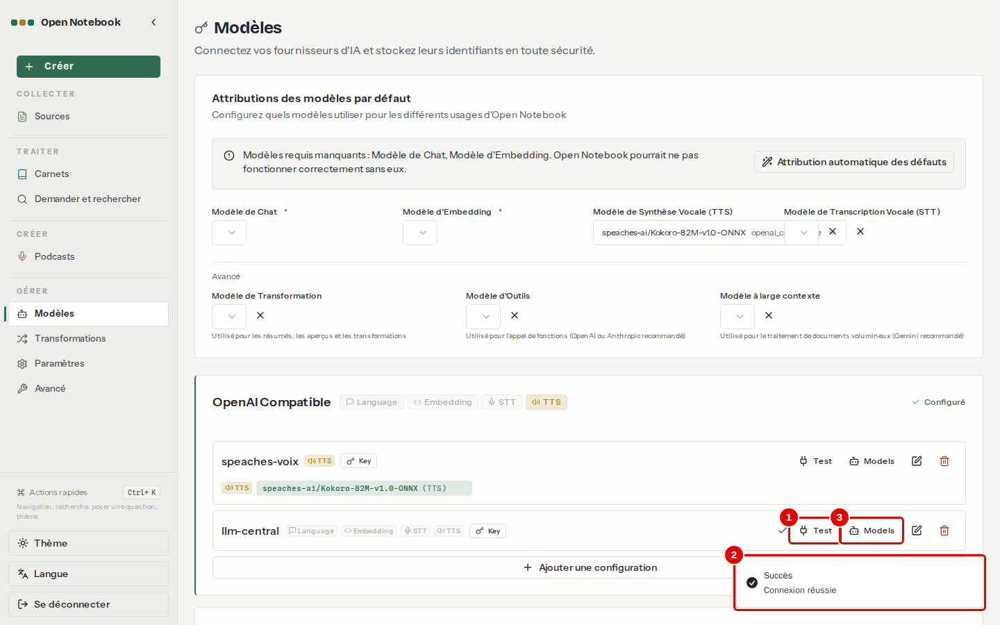
*Écran : Modèles, carte `llm-central`, après « Test ».*

| N° | Élément | Rôle |
|---|---|---|
| 1 | « Test » | vérifie que l'adresse répond et que la clé est acceptée |
| 2 | Message « Succès, Connexion réussie » | résultat du test ; en cas d'échec, voir le chapitre [12](12-en-cas-de-probleme.md) |
| 3 | « Models » | ouvre la liste des modèles proposés par le service (étape suivante) |

**Étape 11. Ajouter les modèles `chat`, `embed` et `transcribe`**
*Où* : carte `llm-central` › « Models ».
La fenêtre « Découvrir les modèles » liste tous les modèles du service, quel que soit le type choisi. Choisir d'abord le type, cocher seulement le modèle de ce type, puis cliquer sur « Ajouter (1) » ; ne pas utiliser « Ajouter la sélection », qui coche tous les modèles de la liste. Recommencer pour chaque type : « Language » avec `chat`, « Embedding » avec `embed`, « STT » avec `transcribe`. Ne pas choisir les autres noms de la liste (`qwen3.5-4b`, `bge-m3`…) : ce sont les noms réels des modèles, qui peuvent changer ; les noms fixes restent.

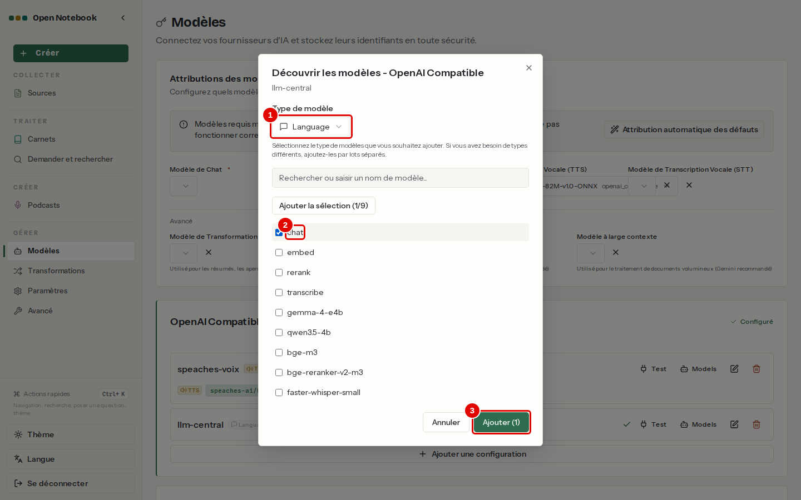
*Écran : fenêtre « Découvrir les modèles », type « Language ».*

| N° | Élément | Rôle |
|---|---|---|
| 1 | « Type de modèle » | usage du modèle : « Language » (réponse), « Embedding » (recherche par le sens), « STT » (transcription), « TTS » (synthèse vocale) |
| 2 | `chat` | modèle de réponse du service central, à cocher |
| 3 | « Ajouter (1) » | ajoute les modèles cochés |

*Résultat* : la carte `llm-central` liste `chat`, `embed` et `transcribe`, chacun avec son type.

**Étape 12. Choisir les modèles par défaut**
*Où* : page « Modèles », haut de la page, cadre « Attributions des modèles par défaut ».
Dans l'ordre : 1) choisir `chat` dans la liste « Modèle de Chat » et `transcribe` dans « Modèle de Transcription Vocale (STT) » ; 2) cliquer sur « Attribution automatique des défauts » (pastille 2), qui remplit les cases restées vides ; 3) si « Modèle d'Embedding » reste vide, passer à l'étape 13. Un bandeau signale tant qu'il manque un modèle obligatoire ; les listes sont visibles sous le bandeau et annotées à l'étape 14.

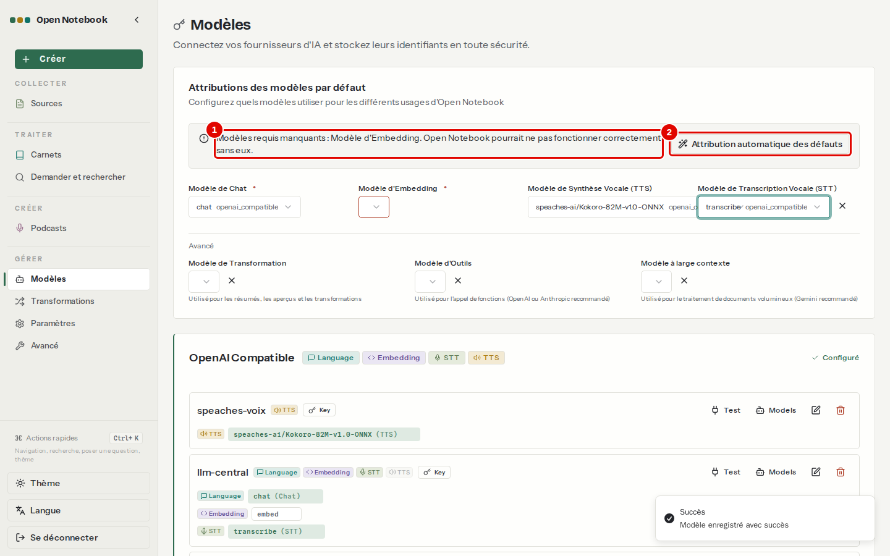
*Écran : Modèles, « Attributions des modèles par défaut », modèle d'embedding manquant.*

| N° | Élément | Rôle |
|---|---|---|
| 1 | « Modèles requis manquants » | liste les modèles obligatoires encore vides |
| 2 | « Attribution automatique des défauts » | remplit les cases vides avec les modèles disponibles |

*Résultat* : un message « Modèle enregistré avec succès » confirme chaque choix. Si le bouton répond « Tous les modèles par défaut sont déjà configurés » alors que la case reste vide, choisir le modèle à la main (étape suivante) : c'est le cas quand l'ancien modèle par défaut a été supprimé.

**Étape 13. Confirmer le modèle d'embedding**
*Où* : même cadre, liste « Modèle d'Embedding », choisir `embed`.
Changer de modèle d'embedding demande une confirmation, parce que les documents déjà analysés l'ont été avec l'ancien modèle.

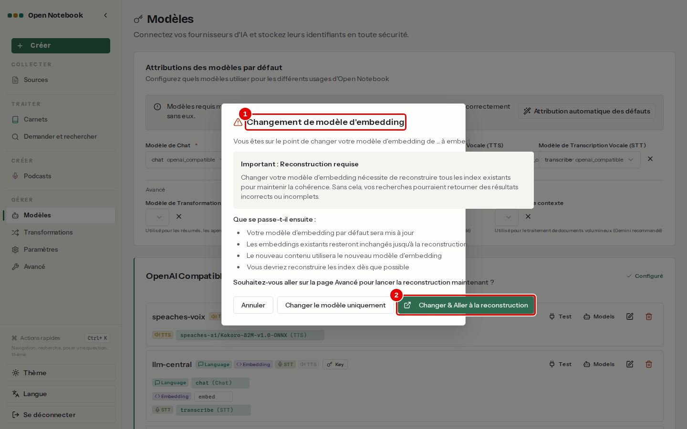
*Écran : fenêtre « Changement de modèle d'embedding ».*

| N° | Élément | Rôle |
|---|---|---|
| 1 | « Changement de modèle d'embedding » | prévient que les index de recherche doivent être reconstruits |
| 2 | « Changer & Aller à la reconstruction » | enregistre le choix et ouvre la page « Avancé », où se lance la reconstruction (chapitre [10](10-regler-l-application.md)) ; « Changer le modèle uniquement » enregistre sans ouvrir cette page |

*Résultat* : la page « Avancé » s'ouvre. Sur une installation sans document, il n'y a rien à reconstruire : revenir sur « Modèles » pour finir les réglages. Si des documents ont déjà été ajoutés, lancer la reconstruction comme au chapitre [10](10-regler-l-application.md), étapes 3 et 4.

**Étape 14. Vérifier les attributions**
*Où* : page « Modèles », cadre « Attributions des modèles par défaut ».
Dans le même cadre, sous le petit titre « Avancé » (à ne pas confondre avec la page « Avancé » du menu), choisir aussi `chat` dans les trois listes « Modèle de Transformation », « Modèle d'Outils » et « Modèle à large contexte » (sous les quatre listes annotées).

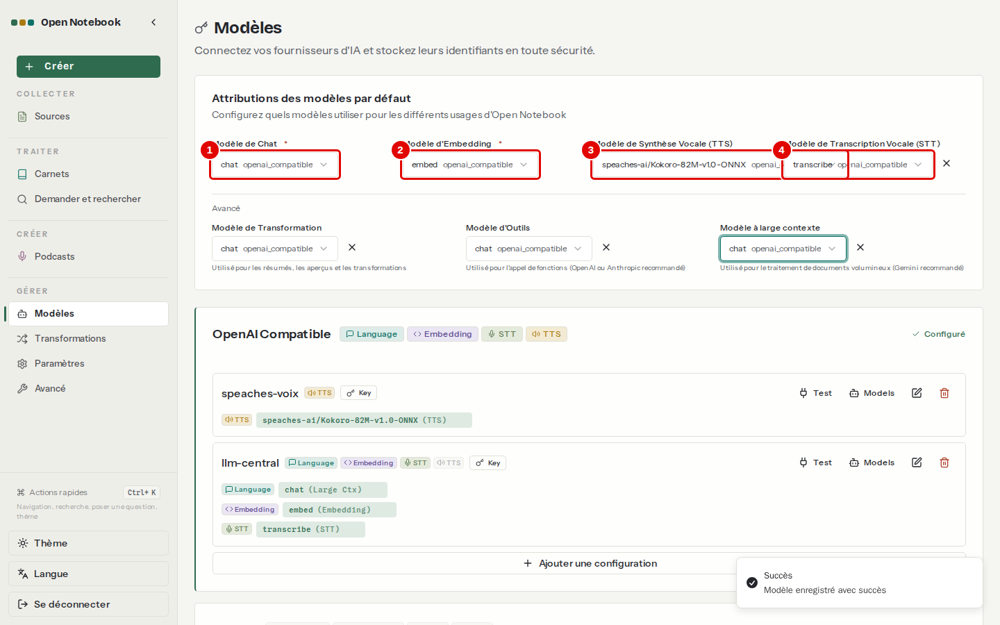
*Écran : Modèles, attributions complètes.*

| N° | Élément | Rôle |
|---|---|---|
| 1 | « Modèle de Chat » | `chat` : rédige les réponses des conversations |
| 2 | « Modèle d'Embedding » | `embed` : calcule les embeddings pour la recherche par le sens |
| 3 | « Modèle de Synthèse Vocale (TTS) » | voix des podcasts ; ici Kokoro, d'un serveur de voix local séparé (chapitre [09](09-creer-un-podcast.md)) |
| 4 | « Modèle de Transcription Vocale (STT) » | `transcribe` : transcrit les sources audio et vidéo |

*Résultat* : le bandeau d'avertissement a disparu ; l'application est prête.

## Bon à savoir

- Le bouton « Se déconnecter » ramène à la page de connexion du chapitre [02](02-installer-open-notebook.md) ; le navigateur garde sinon la session ouverte.
- Le script d'installation refait toute la déclaration des modèles à l'identique : en cas de doute, le relancer (chapitre [02](02-installer-open-notebook.md), étape 3).
- Le modèle `chat` réfléchit avant de répondre ; Open Notebook n'offre pas de réglage pour couper cette réflexion.

## En cas de problème

| Symptôme | Cause | Que faire |
|---|---|---|
| Le test de connexion échoue | adresse ou clé fausse, ou service central arrêté | vérifier l'adresse (avec `/v1`) et la clé ; démarrer le service (chapitre [02](02-installer-open-notebook.md), étape 2) |
| Bandeau « Modèles requis manquants » | modèle de chat ou d'embedding non choisi | étapes 12 et 13 |
| Un modèle est rangé sous le mauvais usage | modèle coché avec le mauvais « Type de modèle » | le supprimer sur la carte (corbeille), puis le rajouter avec le bon type |

Autres cas : chapitre [12](12-en-cas-de-probleme.md).

---
*Version décrite : Open Notebook 1.15.1, service LLM central (`chat`, `embed`, `transcribe`), essais du 12 novembre 2026. Détails et preuves : [rapport d'essais](../annexes/A6-rapport-d-essais.md).*
