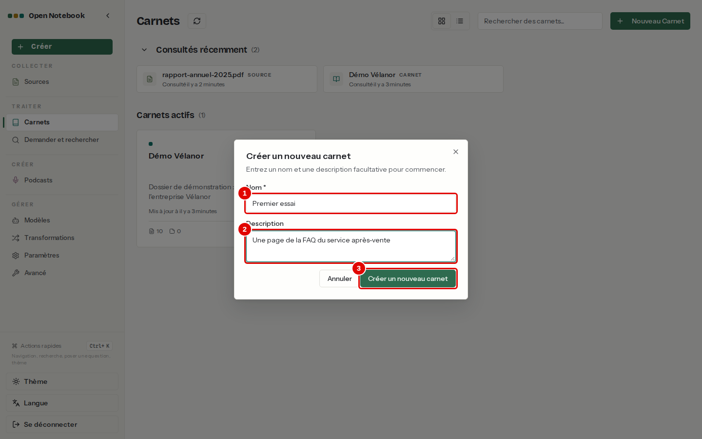
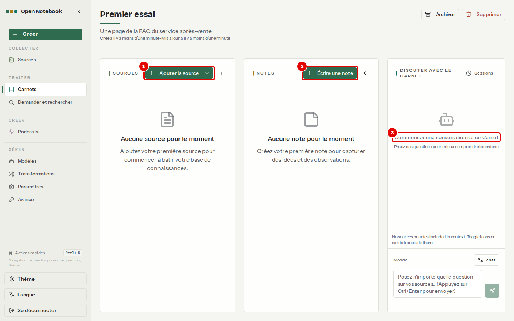
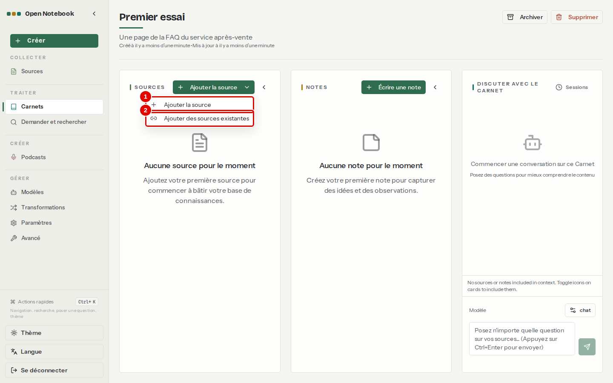
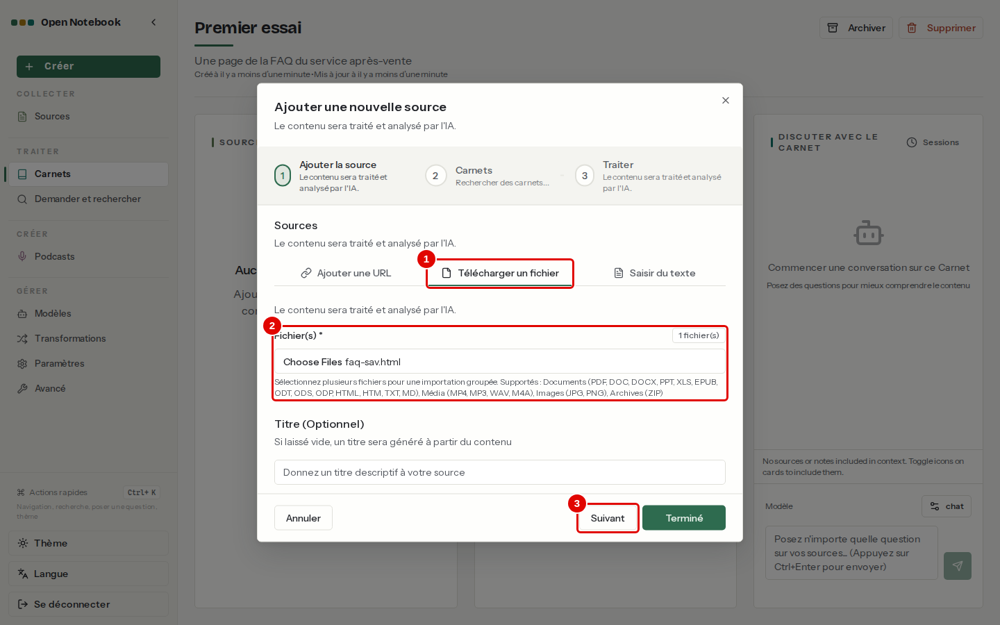
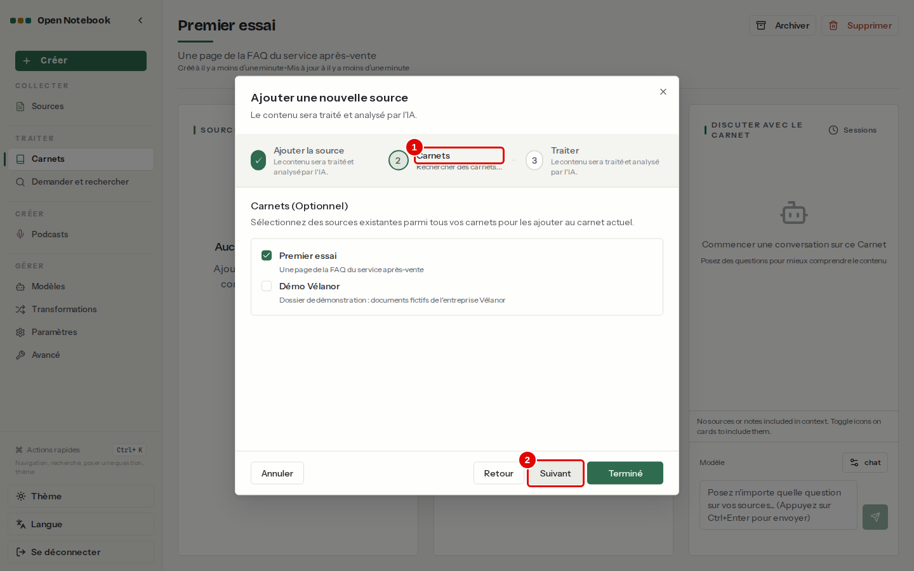
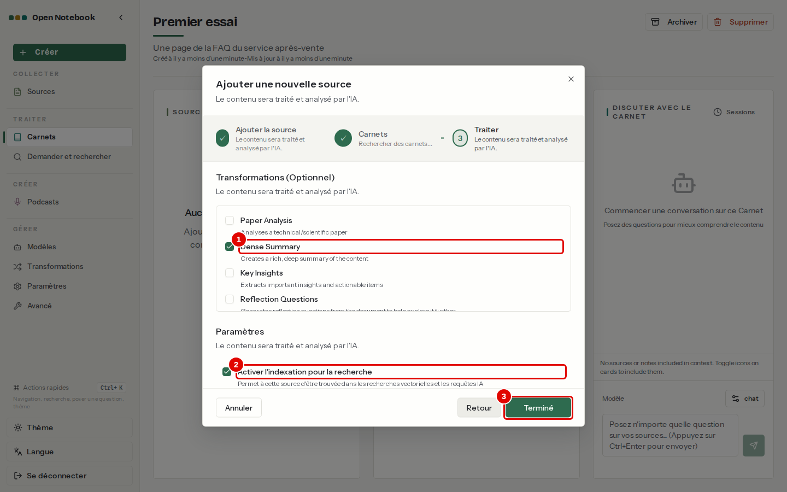
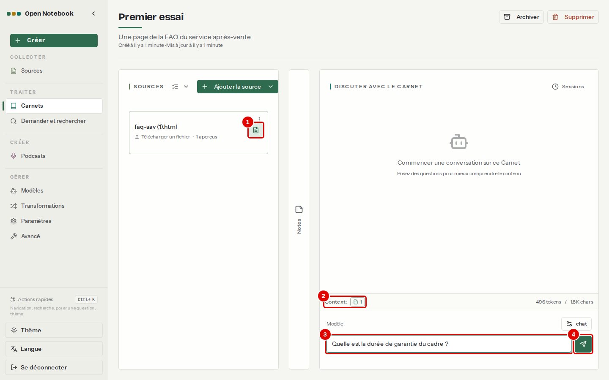
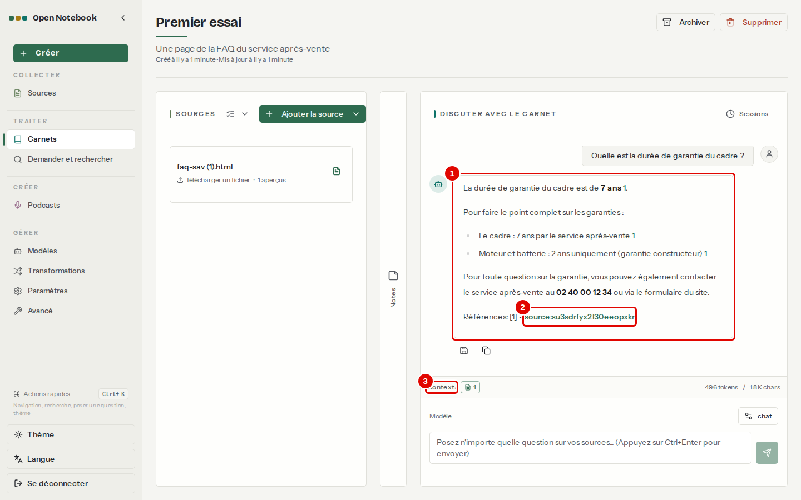
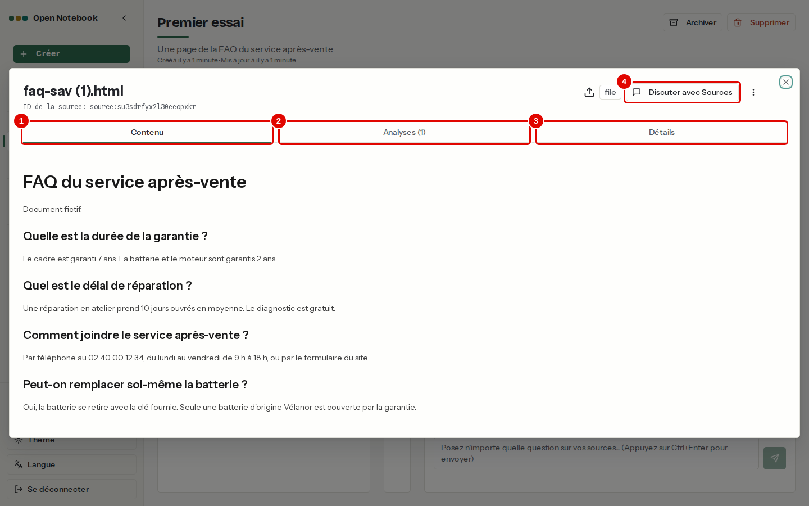

# 04. Première question en dix minutes

> Ce chapitre apprend le parcours le plus court : créer un carnet, y ajouter un document, poser une question et vérifier la réponse grâce à sa citation.
> **Point de départ** : page « Carnets » (menu de gauche › « Carnets »), modèles déclarés (chapitre [03](03-premiers-pas.md)).
> **Durée** : environ 10 minutes. **Avant** : chapitre [03](03-premiers-pas.md).

## Ce qu'il faut savoir

Un **carnet** rassemble les documents d'un même sujet. Quand un document est ajouté, Open Notebook en extrait le texte, le découpe en passages et calcule leurs embeddings pour la recherche ; il peut aussi en produire un résumé automatique (un **aperçu**). Ensuite, chaque question posée dans le carnet est envoyée au modèle `chat` avec les documents choisis ; la réponse se termine par une **citation**, un lien vers le document qui la justifie. L'exemple suit une page de foire aux questions d'un service après-vente fictif (`corpus/documents/faq-sav.html` dans le dépôt).

## Créer un carnet

**Étape 1. Ouvrir la fenêtre de création**
*Où* : menu de gauche › « Carnets ».
Cliquer sur « Nouveau Carnet », en haut à droite (voir la page Carnets au chapitre [03](03-premiers-pas.md), étape 3, pastille 4).

**Étape 2. Nommer le carnet**
*Où* : fenêtre « Créer un nouveau carnet ».

*Écran : fenêtre « Créer un nouveau carnet ».*

| N° | Élément | Rôle |
|---|---|---|
| 1 | « Nom » | nom du carnet, ici « Premier essai » |
| 2 | « Description » | phrase facultative qui rappelle le sujet |
| 3 | « Créer un nouveau carnet » | crée le carnet et l'ouvre |

*Résultat* : la page du carnet s'ouvre, vide.

**Étape 3. Lire la page du carnet**
*Où* : page du carnet « Premier essai ».
La page a trois colonnes : SOURCES (les documents), NOTES (ce qu'on garde) et DISCUTER AVEC LE CARNET (la conversation).

*Écran : page du carnet « Premier essai », sans document.*

| N° | Élément | Rôle |
|---|---|---|
| 1 | « Ajouter la source » | ajoute un document au carnet |
| 2 | « Écrire une note » | écrit une note (chapitre [07](07-notes-et-transformations.md)) ; la flèche à sa droite replie la colonne NOTES |
| 3 | « Commencer une conversation sur ce Carnet » | zone de la conversation, vide tant qu'aucune question n'a été posée |

## Ajouter un document

**Étape 4. Ouvrir l'assistant d'ajout**
*Où* : colonne SOURCES › « Ajouter la source ».

*Écran : carnet « Premier essai », menu « Ajouter la source » ouvert.*

| N° | Élément | Rôle |
|---|---|---|
| 1 | « Ajouter la source » | ajoute un nouveau document (fichier, lien ou texte) |
| 2 | « Ajouter des sources existantes » | rattache à ce carnet un document déjà présent dans un autre carnet (chapitre [05](05-ajouter-et-organiser-les-sources.md)) |

*Résultat* : l'assistant « Ajouter une nouvelle source » s'ouvre ; il a trois étapes, numérotées en haut.

**Étape 5. Choisir le fichier**
*Où* : assistant, étape 1 « Ajouter la source ».
Cliquer sur l'onglet « Télécharger un fichier », puis sur « Choose Files » (zone 2, libellé en anglais) : la fenêtre de l'explorateur de fichiers de Windows s'ouvre ; y choisir `faq-sav.html`. Le fichier est dans le dépôt, côté Linux : dans la barre d'adresse de l'explorateur, taper `\\wsl$\Ubuntu\home\<utilisateur>\Open-Notebook-Test-Bench\corpus\documents` (remplacer `<utilisateur>` par le nom d'utilisateur Ubuntu).

*Écran : assistant « Ajouter une nouvelle source », étape 1, onglet « Télécharger un fichier ».*

| N° | Élément | Rôle |
|---|---|---|
| 1 | « Télécharger un fichier » | ajoute un ou plusieurs fichiers du poste |
| 2 | Zone du fichier | affiche « 1 fichier(s) » une fois le fichier choisi ; la liste des formats acceptés est écrite dessous |
| 3 | « Suivant » | passe à l'étape 2 |

**Étape 6. Vérifier le carnet de destination**
*Où* : assistant, étape 2 « Carnets ».
Le carnet ouvert est déjà choisi ; d'autres carnets peuvent être cochés pour y ranger aussi le document.

*Écran : assistant, étape 2 « Carnets ».*

| N° | Élément | Rôle |
|---|---|---|
| 1 | « Carnets » | liste des carnets où ranger le document |
| 2 | « Suivant » | passe à l'étape 3 |

**Étape 7. Choisir le traitement**
*Où* : assistant, étape 3 « Traiter ».
Laisser les choix proposés, puis cliquer sur « Terminé ».

*Écran : assistant, étape 3 « Traiter ».*

| N° | Élément | Rôle |
|---|---|---|
| 1 | « Dense Summary » | transformation cochée par défaut : le modèle écrit un résumé du document, appelé aperçu |
| 2 | « Activer l'indexation pour la recherche » | calcule les embeddings, pour que le document soit trouvé par la recherche par le sens |
| 3 | « Terminé » | lance le traitement et ferme l'assistant |

*Résultat* : la carte du document apparaît dans la colonne SOURCES, sous le nom du fichier. Si un fichier du même nom a déjà été ajouté dans un autre carnet, un suffixe s'ajoute au nom, par exemple « faq-sav (1).html » sur les captures de ce chapitre ; sur une installation neuve, la carte s'appelle « faq-sav.html ». Le traitement se fait en arrière-plan ; pour cette page courte, il dure quelques secondes. La carte indique alors « 1 aperçus ».

## Poser la question

**Étape 8. Envoyer tout le document au modèle, puis écrire la question**
*Où* : page du carnet, carte du document puis colonne DISCUTER AVEC LE CARNET.
Un nouveau document n'est d'abord envoyé au modèle que par son aperçu (icône d'ampoule). Cliquer une fois sur l'icône à droite de la carte : elle devient une page, ce qui veut dire que le texte entier sera envoyé. Écrire ensuite la question « Quelle est la durée de garantie du cadre ? ».

*Écran : carnet « Premier essai », question écrite, colonne NOTES repliée.*

| N° | Élément | Rôle |
|---|---|---|
| 1 | Icône de la carte | choisit ce qui part au modèle : ampoule = aperçu seul, page = contenu complet ; chaque clic passe au mode suivant (chapitre [06](06-discuter-avec-les-sources.md)) |
| 2 | « Context » | ce qui sera envoyé : nombre de documents, jetons et caractères |
| 3 | Champ de question | la question, en langage courant |
| 4 | Bouton d'envoi | envoie la question ; Ctrl+Entrée fait de même |

*Résultat* : la question s'affiche à droite de la conversation, puis la réponse arrive après quelques secondes.

**Étape 9. Lire la réponse et sa citation**
*Où* : colonne DISCUTER AVEC LE CARNET.

*Écran : carnet « Premier essai », réponse du modèle.*

| N° | Élément | Rôle |
|---|---|---|
| 1 | Réponse | rédigée par le modèle à partir du document : « La durée de garantie du cadre est de 7 ans » |
| 2 | Citation | lien `source:…` sous « Références » ; il désigne le document utilisé |
| 3 | « Context » | taille de ce qui a été envoyé, ici environ 460 jetons |

*Résultat* : la réponse est juste ; les deux icônes sous la réponse l'enregistrent comme note ou la copient (chapitre [07](07-notes-et-transformations.md)).

**Étape 10. Ouvrir la source citée**
*Où* : réponse › lien `source:…`.

*Écran : fenêtre de la source, onglet « Contenu ».*

| N° | Élément | Rôle |
|---|---|---|
| 1 | « Contenu » | texte extrait du document : la phrase « Le cadre est garanti 7 ans » s'y lit |
| 2 | « Analyses » | aperçus produits par les transformations |
| 3 | « Détails » | type, dates, carnets et téléchargement du fichier d'origine |
| 4 | « Discuter avec Sources » | ouvre une conversation sur ce seul document |

*Résultat* : la réponse est vérifiée dans le document. La croix en haut à droite ferme la fenêtre.

## Bon à savoir

- La citation désigne un document entier, pas une page ni une phrase : pour un long document, la vérification demande de chercher le passage dans l'onglet « Contenu ».
- Le modèle cite parfois l'aperçu (`source_insight:…`) au lieu du document ; le lien ouvre alors le résumé. Passer le document en contenu complet (étape 8) rend la citation du document plus fréquente.
- Quand l'information n'est pas dans les documents, le modèle le dit au lieu d'inventer.

## En cas de problème

| Symptôme | Cause | Que faire |
|---|---|---|
| Bouton d'envoi grisé | champ de question vide | écrire la question |
| Réponse « je ne trouve pas d'information » alors que le document la contient | document envoyé par son aperçu seul, ou exclu | cliquer sur l'icône de la carte jusqu'à la page (contenu complet) |
| La carte du document affiche « Échec » | document illisible, par exemple un scan | chapitre [12](12-en-cas-de-probleme.md) |

---
*Version décrite : Open Notebook 1.15.1, service LLM central (`chat`, `embed`), essais du 12 novembre 2026. Détails et preuves : [rapport d'essais](../annexes/A6-rapport-d-essais.md).*
