# 05. Ajouter et organiser ses sources

> Ce chapitre apprend à ajouter des documents de toutes sortes (fichiers, liens, textes), à suivre leur lecture, à consulter une source, et à ranger ou supprimer carnets et sources.
> **Point de départ** : page « Carnets » (menu de gauche › « Carnets »).
> **Durée** : environ 20 minutes, dont quelques minutes d'attente pendant la lecture des documents. **Avant** : chapitre [04](04-premiere-question.md).

**Risque de perte de données.** Supprimer un carnet peut supprimer aussi ses documents : la fenêtre de suppression demande quoi faire de ceux qui n'appartiennent qu'à ce carnet (étape 12).

## Ce qu'il faut savoir

Une **source** est un document ajouté à un carnet. Open Notebook accepte les fichiers bureautiques (PDF, Word, Excel, PowerPoint, OpenDocument, EPUB, HTML, texte, Markdown), l'audio et la vidéo (transcrits par le modèle `transcribe`), les liens web et le texte collé. Chaque ajout passe par trois traitements, faits en arrière-plan l'un après l'autre : extraction du texte, résumé automatique (l'aperçu « Dense Summary »), puis découpage et embeddings pour la recherche. Une même source peut appartenir à plusieurs carnets. Ce chapitre construit le carnet « Démo Vélanor » avec les neuf documents fictifs du dossier `corpus/documents/` du dépôt : un rapport annuel en PDF, un contrat scanné, une procédure Word, une présentation, un classeur Excel, une page web, une note Markdown, un audit en anglais et un message vocal.

## Ajouter plusieurs fichiers d'un coup

**Étape 1. Créer le carnet**
*Où* : menu de gauche › « Créer » › « Carnet ».
La fenêtre est celle du chapitre [04](04-premiere-question.md), étape 2. Nom : « Démo Vélanor » ; description : « Dossier de démonstration : documents fictifs de l'entreprise Vélanor ».

**Étape 2. Choisir les fichiers**
*Où* : page du carnet › colonne SOURCES › « Ajouter la source » › « Ajouter la source », onglet « Télécharger un fichier ».
Dans la fenêtre de l'explorateur de fichiers, ouvrir le dossier `corpus\documents` du dépôt (même chemin qu'au chapitre [04](04-premiere-question.md), étape 5), puis sélectionner les neuf fichiers à la fois (Ctrl+A ou Ctrl+clic).

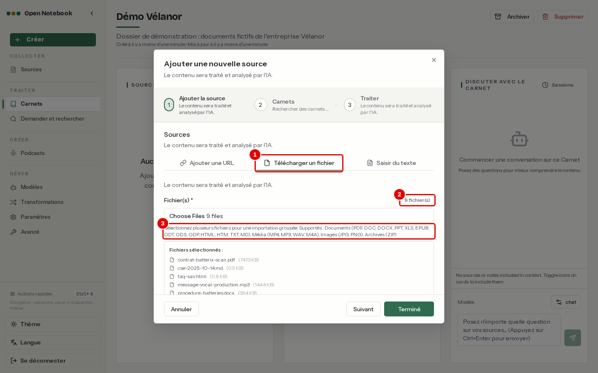
*Écran : assistant « Ajouter une nouvelle source », étape 1, neuf fichiers choisis.*

| N° | Élément | Rôle |
|---|---|---|
| 1 | « Télécharger un fichier » | ajoute un ou plusieurs fichiers du poste |
| 2 | « 9 fichier(s) » | nombre de fichiers retenus |
| 3 | Liste des formats | formats acceptés : documents, médias (MP4, MP3, WAV, M4A), images |

*Résultat* : « Suivant » mène aux étapes « Carnets » et « Traiter », identiques au chapitre [04](04-premiere-question.md) (étapes 6 et 7) ; les laisser telles quelles, puis « Terminé ».

**Étape 3. Suivre le traitement**
*Où* : page du carnet, colonne SOURCES.

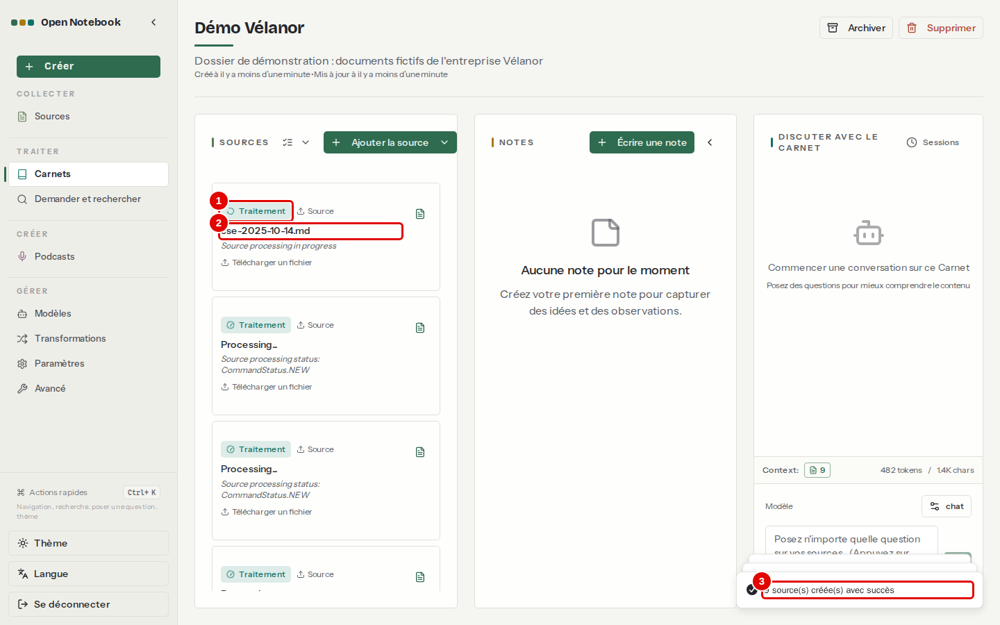
*Écran : carnet « Démo Vélanor », juste après l'ajout.*

| N° | Élément | Rôle |
|---|---|---|
| 1 | « Traitement » | la source attend ou subit son traitement |
| 2 | Titre de la carte | « Processing... » tant que le texte n'est pas extrait, puis le nom du fichier : ici, la première carte porte déjà son nom |
| 3 | « 9 source(s) créée(s) avec succès » | confirmation de l'envoi des fichiers |

*Résultat* : les documents sont traités un par un ; pour ces neuf documents, il faut compter quelques minutes, le résumé automatique de chaque document demandant une réponse du modèle. Le classeur, la page web et la note sont prêts en quelques secondes, le message vocal après sa transcription.

**Étape 4. Repérer une source en échec**
*Où* : colonne SOURCES, carte marquée « Échec » et titrée « Processing... » (c'est le contrat scanné).
Le contrat `contrat-batterix-scan.pdf` est une image de papier scanné : sans reconnaissance de caractères, il n'en sort aucun texte.

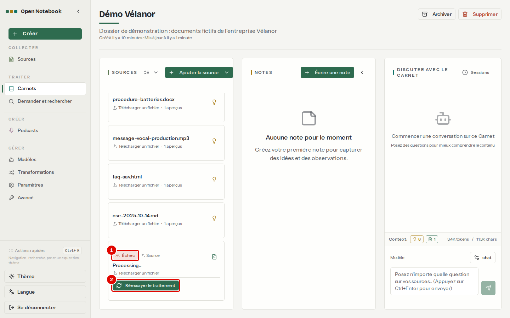
*Écran : carnet « Démo Vélanor », carte du contrat scanné.*

| N° | Élément | Rôle |
|---|---|---|
| 1 | « Échec » | le traitement n'a rien pu extraire |
| 2 | « Réessayer le traitement » | relance le traitement, utile après un changement de réglage (chapitre [10](10-regler-l-application.md)) |

*Résultat* : la source reste dans le carnet, mais le modèle ne connaît pas son contenu ; les questions sur ce contrat reçoivent « je ne trouve pas d'information ». Chapitre [12](12-en-cas-de-probleme.md) pour les remèdes.

## Ajouter un lien ou un texte

**Étape 5. Ajouter une page web**
*Où* : « Ajouter la source » › « Ajouter la source », onglet « Ajouter une URL ».
Exemple à ne pas suivre ici : le carnet « Démo Vélanor » ne contient aucune page ajoutée par son adresse (la page `faq-sav.html` y est entrée comme fichier), et l'essai a été annulé par « Annuler ». Coller une ou plusieurs adresses, une par ligne. Le titre est facultatif : sans titre, il est tiré de la page.

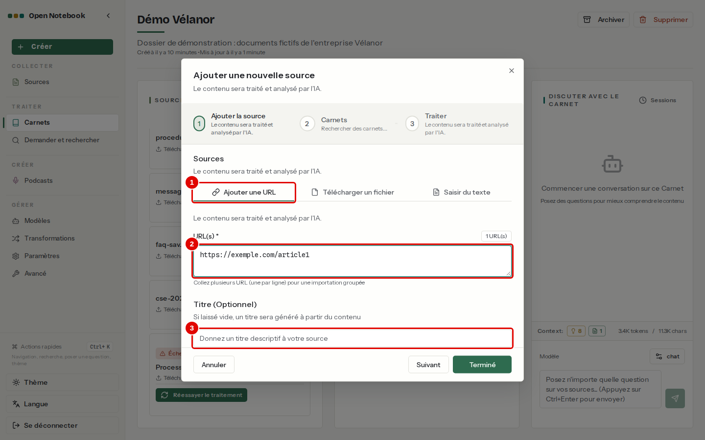
*Écran : assistant, étape 1, onglet « Ajouter une URL ».*

| N° | Élément | Rôle |
|---|---|---|
| 1 | « Ajouter une URL » | ajoute des pages web par leur adresse |
| 2 | « URL(s) » | une adresse par ligne ; plusieurs lignes = import groupé |
| 3 | « Titre (Optionnel) » | titre de la source |

*Résultat* : avec « Suivant » puis « Terminé », la page est téléchargée et traitée comme un document. L'application va chercher la page sur Internet : le poste doit y avoir accès. Dans cette installation, la lecture des pages se fait sans service extérieur (moteur « Simple », chapitre [10](10-regler-l-application.md)).

**Étape 6. Ajouter un texte collé**
*Où* : carnet « Démo Vélanor » › « Ajouter la source » › « Ajouter la source », onglet « Saisir du texte ».
À faire : ce texte devient la dixième source du carnet, comptée dans les chapitres suivants. Utile pour un compte rendu d'appel, un courriel, un extrait copié.

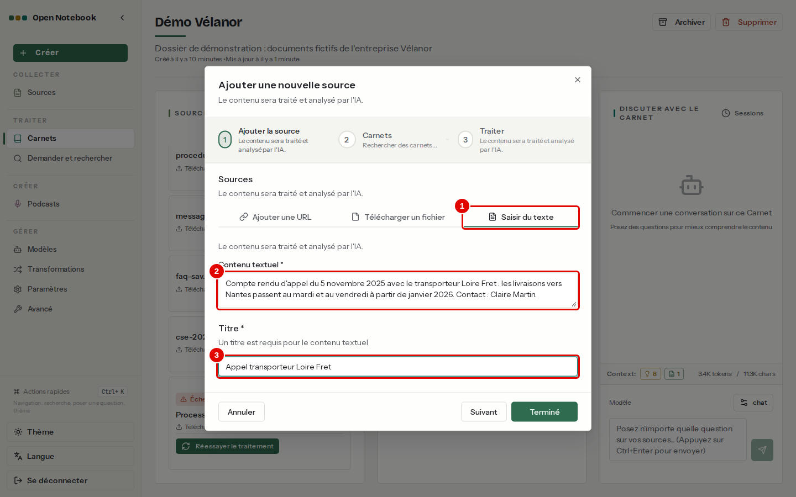
*Écran : assistant, étape 1, onglet « Saisir du texte ».*

| N° | Élément | Rôle |
|---|---|---|
| 1 | « Saisir du texte » | crée une source à partir d'un texte |
| 2 | Zone de texte | le texte à garder |
| 3 | Titre | ici « Appel transporteur Loire Fret » |

*Résultat* : après « Suivant », « Suivant » et « Terminé », la source apparaît dans le carnet, prête en quelques secondes.

## Consulter les sources

**Étape 7. Lister toutes les sources**
*Où* : menu de gauche › COLLECTER › « Sources ».
La page « Toutes les sources » liste les documents de tous les carnets.

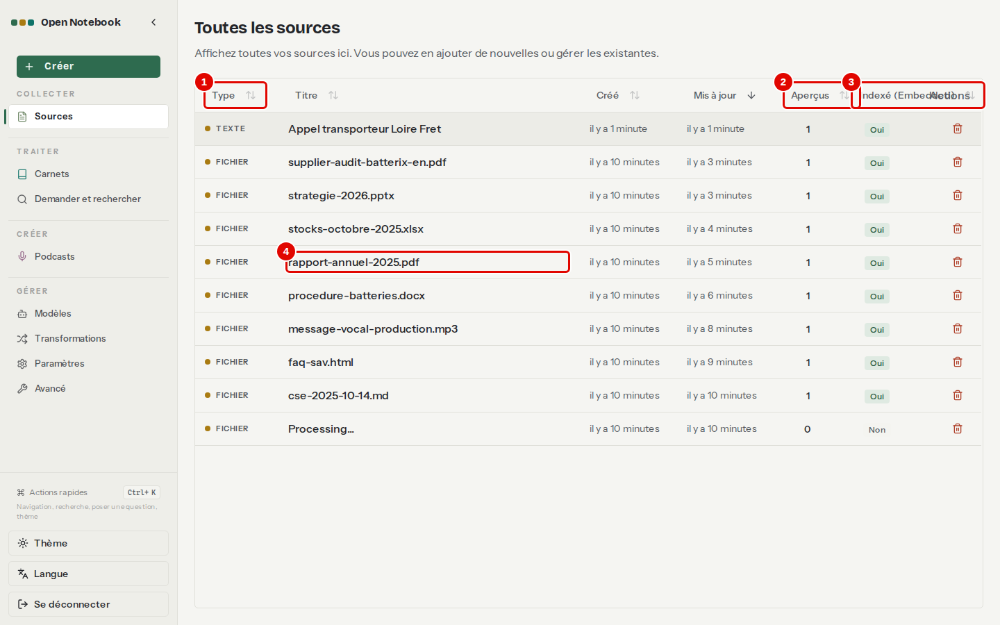
*Écran : Sources.*

| N° | Élément | Rôle |
|---|---|---|
| 1 | « Type » | fichier, lien ou texte ; un clic sur l'en-tête d'une colonne trie la liste |
| 2 | « Aperçus » | nombre d'analyses produites par les transformations |
| 3 | « Indexé (Embedded) » | « Oui » quand la source peut être trouvée par la recherche par le sens |
| 4 | Ligne d'une source | ouvre la page de la source |

**Étape 8. Ouvrir la page d'une source**
*Où* : Sources › clic sur `rapport-annuel-2025.pdf`, onglet « Détails ».
La page d'une source a les onglets « Contenu », « Analyses » et « Détails », et sa propre conversation à droite.

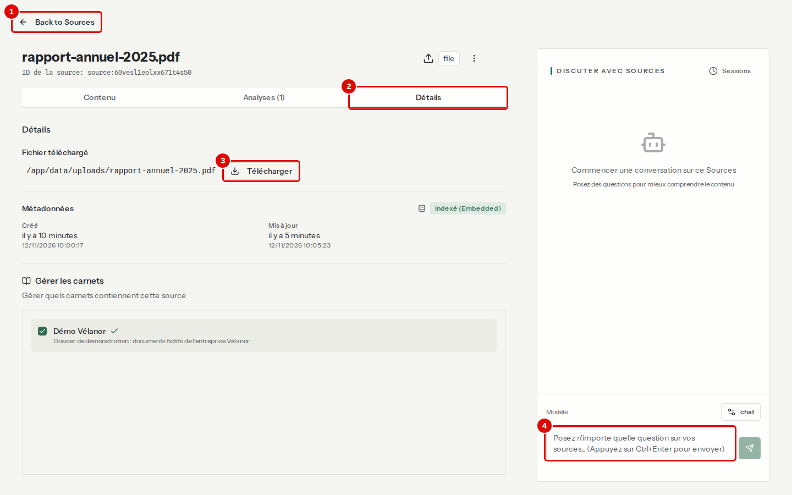
*Écran : page de la source `rapport-annuel-2025.pdf`, onglet « Détails ».*

| N° | Élément | Rôle |
|---|---|---|
| 1 | « Back to Sources » | retour à la liste des sources |
| 2 | « Détails » | type, dates, identifiant, carnets de la source |
| 3 | « Télécharger » | récupère le fichier d'origine |
| 4 | Champ de question | conversation limitée à ce seul document |

## Ranger carnets et sources

**Étape 9. Rattacher une source existante à un autre carnet**
*Où* : page du carnet « Premier essai » (chapitre [04](04-premiere-question.md)) › « Ajouter la source » › « Ajouter des sources existantes ».
Taper quelques lettres du nom, cocher la case de la source, puis « Ajouter la sélection ». Les aperçus (« Dense Summary ») apparaissent aussi dans la liste. Le document n'est pas copié : la même source appartient aux deux carnets.

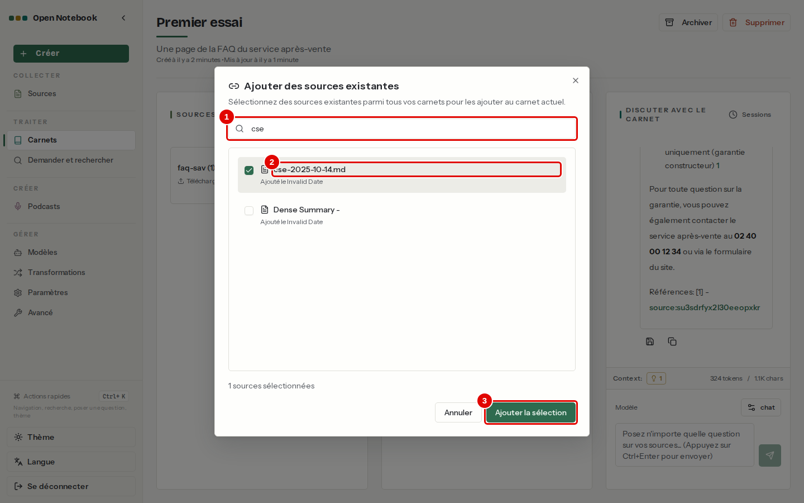
*Écran : fenêtre d'ajout de sources existantes.*

| N° | Élément | Rôle |
|---|---|---|
| 1 | Recherche | filtre les sources par leur nom |
| 2 | `cse-2025-10-14.md` | source cochée |
| 3 | « Ajouter la sélection » | rattache les sources cochées au carnet |

**Étape 10. Retirer ou supprimer une source**
*Où* : carnet « Premier essai », carte `cse-2025-10-14.md` › menu à trois points (visible au survol de la carte).
Choisir ici « Retirer du carnet » : la source quitte « Premier essai » et reste dans « Démo Vélanor ». Ne pas choisir « Supprimer la source », qui l'enlèverait aussi de « Démo Vélanor ».

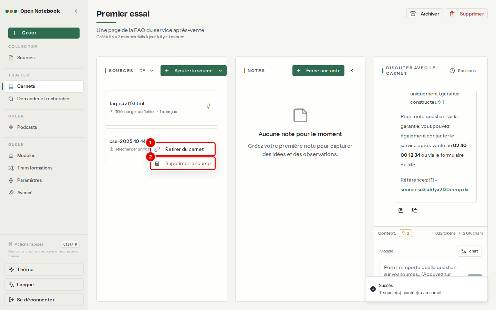
*Écran : carnet « Premier essai », menu d'une source.*

| N° | Élément | Rôle |
|---|---|---|
| 1 | « Retirer du carnet » | enlève la source de ce carnet seulement ; elle reste dans les autres |
| 2 | « Supprimer la source » | supprime la source partout, définitivement |

**Étape 11. Archiver un carnet**
*Où* : page du carnet « Premier essai », en haut à droite › « Archiver ».
Le carnet quitte la liste des carnets actifs sans rien perdre ; il se retrouve en bas de la page « Carnets ».

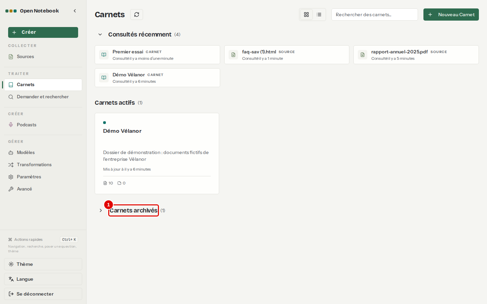
*Écran : Carnets, après l'archivage de « Premier essai ».*

| N° | Élément | Rôle |
|---|---|---|
| 1 | « Carnets archivés » | liste repliée des carnets archivés ; un clic la déplie, un clic sur un carnet le rouvre |

**Étape 12. Supprimer un carnet**
*Où* : page du carnet « Premier essai » (Carnets › « Carnets archivés » › clic sur « Premier essai »), en haut à droite › « Supprimer ».
Dans la fenêtre, cocher « Supprimer les sources exclusives » (pastille 1 ; la capture montre l'autre option, cochée par défaut), puis cliquer sur « Supprimer » (pastille 3).

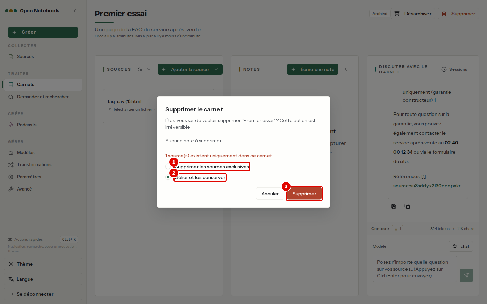
*Écran : fenêtre « Supprimer le carnet ».*

| N° | Élément | Rôle |
|---|---|---|
| 1 | « Supprimer les sources exclusives » | supprime aussi les sources qui n'appartiennent qu'à ce carnet ; à choisir ici, puisque « Premier essai » n'était qu'un exercice |
| 2 | « Délier et les conserver » | garde ces sources, visibles dans la page « Sources » |
| 3 | « Supprimer » | confirme ; l'action est irréversible |

*Résultat* : le carnet « Premier essai » disparaît de la liste.

## Bon à savoir

- Le traitement se fait une source à la fois : un gros lot prend du temps, mais l'application reste utilisable pendant ce temps.
- Un document déjà présent sous le même nom de fichier est enregistré avec un suffixe, par exemple « faq-sav (1).html » ; lors d'un ajout groupé, ce suffixe apparaît dans le titre de la source.
- Les tableaux des documents Word et PDF sont bien lus grâce au module Docling, activé dans cette installation (chapitre [10](10-regler-l-application.md)).

## En cas de problème

| Symptôme | Cause | Que faire |
|---|---|---|
| Carte « Échec » sur un PDF | document scanné, sans texte | chapitre [12](12-en-cas-de-probleme.md) |
| Carte restée longtemps sur « Traitement » | d'autres documents passent avant ; ou tâche bloquée | attendre ; sinon chapitre [12](12-en-cas-de-probleme.md) |
| Source absente des recherches | ajoutée sans indexation | cocher « Activer l'indexation pour la recherche » à l'ajout, ou reconstruire les index (chapitre [10](10-regler-l-application.md)) |

---
*Version décrite : Open Notebook 1.15.1, service LLM central, essais du 12 novembre 2026. Détails et preuves : [fonctionnement interne](../annexes/A5-fonctionnement-interne.md), [rapport d'essais](../annexes/A6-rapport-d-essais.md).*
