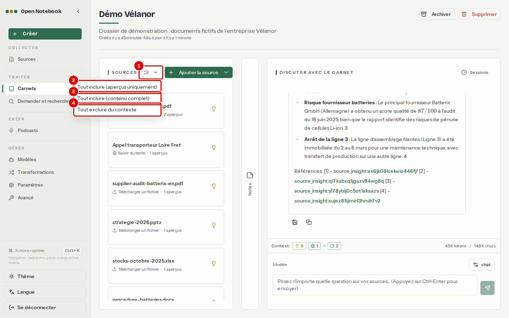
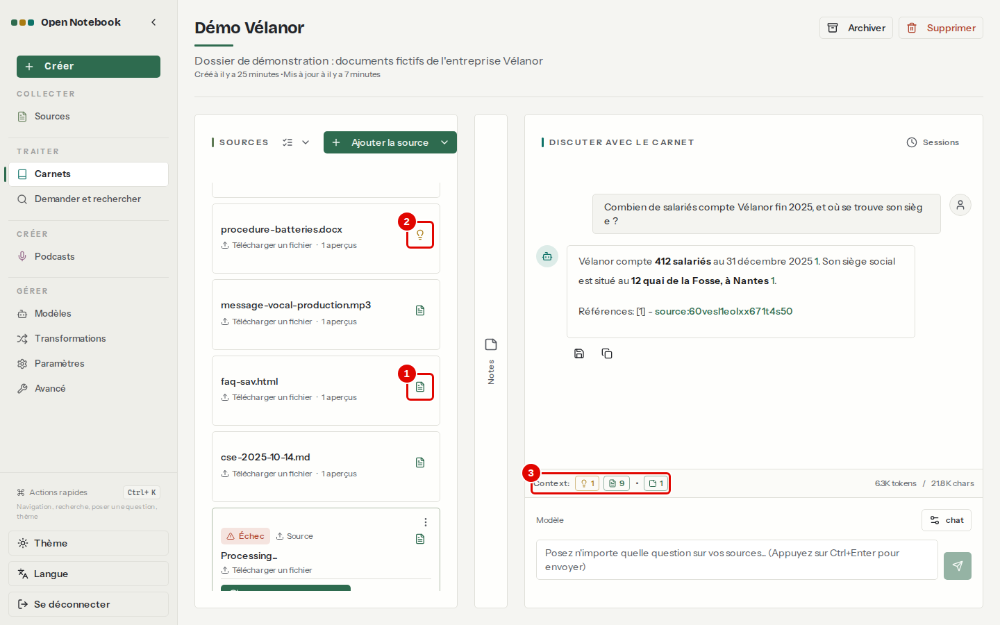
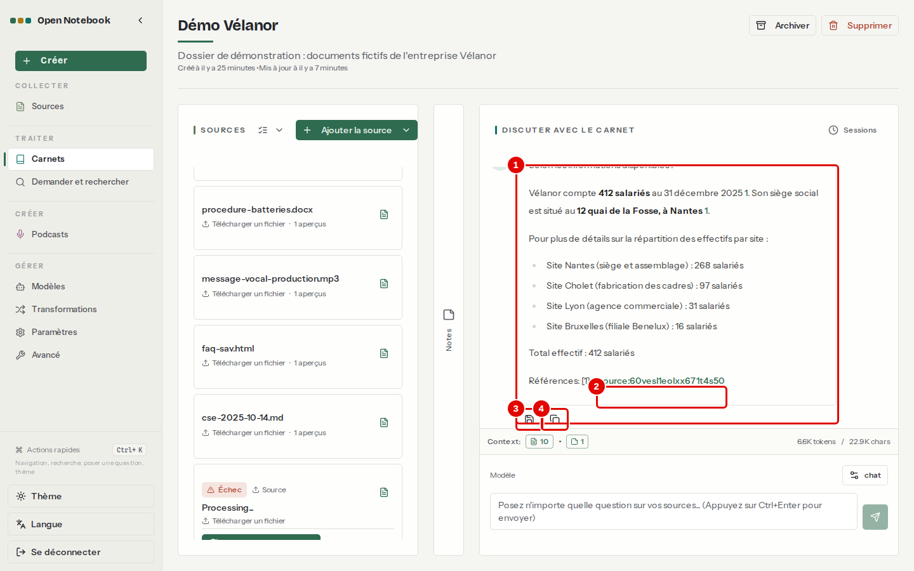
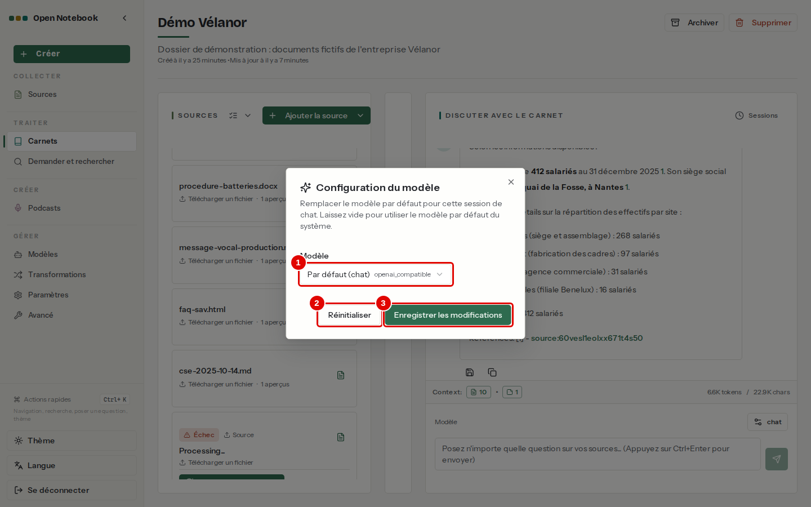
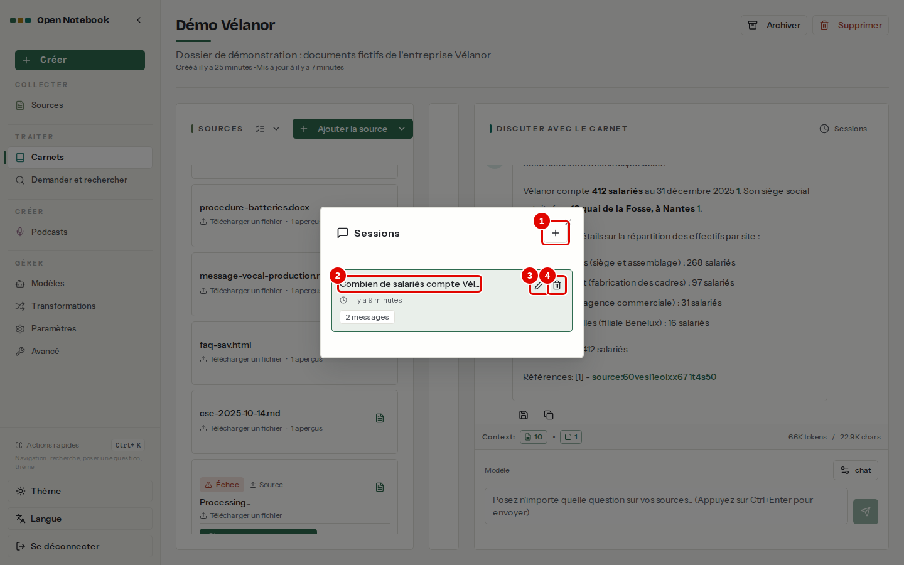

# 06. Discuter avec ses sources

> Ce chapitre apprend à choisir ce qui est envoyé au modèle, à lire les citations, à gérer plusieurs conversations dans un carnet et à changer de modèle pour une conversation.
> **Point de départ** : page du carnet « Démo Vélanor » (chapitre [05](05-ajouter-et-organiser-les-sources.md)).
> **Durée** : environ 15 minutes. **Avant** : chapitres [04](04-premiere-question.md) et [05](05-ajouter-et-organiser-les-sources.md).

## Ce qu'il faut savoir

La conversation d'un carnet ne cherche pas les passages utiles : elle envoie au modèle, à chaque question, **tout ce qui est choisi** dans le carnet. Chaque source a pour cela un **mode de contexte** : « aperçus » (seul le résumé automatique part), « contenu complet » (le texte entier part) ou exclue (rien ne part). Plus on envoie de texte, plus la réponse est complète, mais plus elle est lente ; et chaque question est limitée à 16 384 jetons, soit environ quinze pages, réflexion du modèle et réponse comprises. Le bas de la colonne de conversation affiche à tout moment la taille de ce qui partira. Pour interroger beaucoup de documents à la fois, la recherche « Demander » est plus adaptée (chapitre [08](08-rechercher-et-demander.md)).

Les captures de ce chapitre ont été prises après le chapitre [07](07-notes-et-transformations.md) : le compteur « Context » y compte aussi deux notes, absentes à ce stade de la lecture.

## Choisir ce qui part au modèle

**Étape 1. Régler toutes les sources d'un coup**
*Où* : page du carnet › colonne SOURCES › icône en forme de liste cochée, avec une petite flèche, juste à droite du titre SOURCES (son nom, « Contexte », s'affiche au survol).

*Écran : carnet « Démo Vélanor », menu « Contexte » ouvert.*

| N° | Élément | Rôle |
|---|---|---|
| 1 | « Contexte » | icône qui ouvre ce menu |
| 2 | « Tout inclure (aperçus uniquement) » | envoie le résumé de chaque source : léger, mais les détails manquent |
| 3 | « Tout inclure (contenu complet) » | envoie le texte entier de chaque source : réponses précises |
| 4 | « Tout exclure du contexte » | n'envoie aucune source ; utile avant d'en choisir quelques-unes une par une |

*Résultat* : avec « Tout inclure (contenu complet) », le compteur « Context » indique les dix sources du carnet et environ 6 000 jetons, soit 21 000 caractères.

**Étape 2. Régler une source**
*Où* : icône à droite de la carte d'une source.
Chaque clic fait passer la source au mode suivant, dans cet ordre : contenu complet (icône en forme de page), exclue, aperçus seuls (icône d'ampoule), puis de nouveau contenu complet. Le compteur se met à jour aussitôt.

*Écran : carnet « Démo Vélanor », une source dans chaque mode.*

| N° | Élément | Rôle |
|---|---|---|
| 1 | Icône en forme de page | source envoyée en contenu complet |
| 2 | Œil barré | source exclue : rien ne part |
| 3 | Icône d'ampoule | source envoyée par son seul aperçu (résumé) |
| 4 | « Context » | ce qui partira : ici 1 source en aperçu, 8 sources complètes et 2 notes (chapitre [07](07-notes-et-transformations.md)), environ 6 300 jetons |

*Résultat* : un nouveau clic sur l'icône remet la source dans le cycle.

## Poser une question et lire la réponse

**Étape 3. Poser la question**
*Où* : colonne DISCUTER AVEC LE CARNET, champ de question.
Remettre d'abord toutes les sources en contenu complet (étape 1). Écrire « Combien de salariés compte Vélanor fin 2025, et où se trouve son siège ? », puis Ctrl+Entrée.

*Écran : carnet « Démo Vélanor », réponse du modèle.*

| N° | Élément | Rôle |
|---|---|---|
| 1 | Réponse | rédigée à partir des sources, avec les valeurs en gras |
| 2 | Citation | lien vers le document utilisé ; un clic l'ouvre (chapitre [04](04-premiere-question.md), étape 10) |
| 3 | Enregistrer en note | garde la réponse dans la colonne NOTES (chapitre [07](07-notes-et-transformations.md)) |
| 4 | Copier | copie la réponse dans le presse-papiers |

*Résultat* : la réponse arrive en quelques secondes ; le modèle réfléchit d'abord, sans afficher cette réflexion.

## Choisir le modèle d'une conversation

**Étape 4. Changer de modèle pour cette conversation**
*Où* : bas de la colonne de conversation › bouton du modèle (`chat`).

*Écran : fenêtre « Configuration du modèle ».*

| N° | Élément | Rôle |
|---|---|---|
| 1 | « Modèle » | modèle de cette conversation ; « Par défaut (chat) » reprend celui de la page Modèles |
| 2 | « Réinitialiser » | revient au modèle par défaut |
| 3 | « Enregistrer les modifications » | applique le choix à cette conversation seulement |

*Résultat* : seuls les modèles de langage déclarés page « Modèles » sont proposés ; ici, `chat`.

## Garder plusieurs conversations

**Étape 5. Ouvrir la liste des conversations**
*Où* : colonne DISCUTER AVEC LE CARNET › « Sessions ».
Une **session** est une conversation : chaque carnet peut en garder plusieurs, chacune avec son historique. Séparer les sujets garde les historiques courts, donc les réponses rapides.

*Écran : fenêtre « Sessions ».*

| N° | Élément | Rôle |
|---|---|---|
| 1 | Bouton « + » | affiche un champ de titre ; « Créer » crée la session et l'ouvre, vide (chapitre [11](11-cas-pratiques.md), étape 1) |
| 2 | Session | une conversation, nommée d'après le début de sa première question ; un clic la rouvre avec son historique |
| 3 | Crayon | renomme la session |
| 4 | Corbeille | supprime la session |

*Résultat* : la première question posée dans un carnet crée une session toute seule. Le chapitre [11](11-cas-pratiques.md) utilise une session par cas pratique.

## Bon à savoir

- L'historique d'une conversation est renvoyé au modèle à chaque question : une longue conversation finit par dépasser les 16 384 jetons. Ouvrir une nouvelle session repart de zéro.
- La citation désigne un document, pas une page : pour un long rapport, retrouver le passage demande de lire l'onglet « Contenu » de la source.
- Une source en échec (document scanné) reste visible ; le modèle connaît son titre mais pas son contenu, et le dit.

## En cas de problème

| Symptôme | Cause | Que faire |
|---|---|---|
| « Je ne trouve pas d'information » alors que le document la contient | source en aperçus ou exclue | passer la source en contenu complet (étape 2) |
| Message d'erreur à l'envoi, conversation sans réponse | contexte trop long pour le modèle | moins de sources en contenu complet, ou nouvelle session ; chapitre [12](12-en-cas-de-probleme.md) |
| Citation affichée comme du texte, sans lien | le modèle a écrit le nom du fichier au lieu de l'identifiant | ouvrir la source à la main |

---
*Version décrite : Open Notebook 1.15.1, service LLM central (`chat`), essais du 12 novembre 2026. Détails et preuves : [évaluation](../annexes/A1-qualite-et-performances.md), [rapport d'essais](../annexes/A6-rapport-d-essais.md).*
