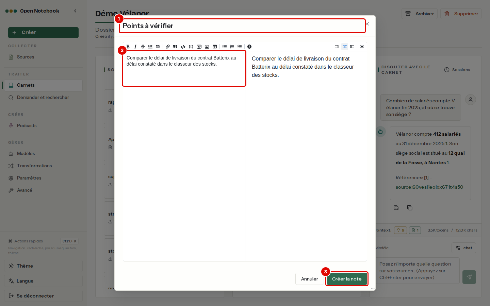
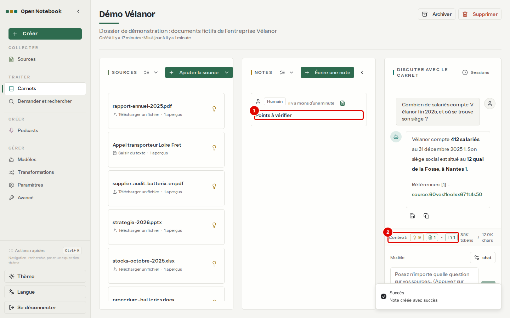
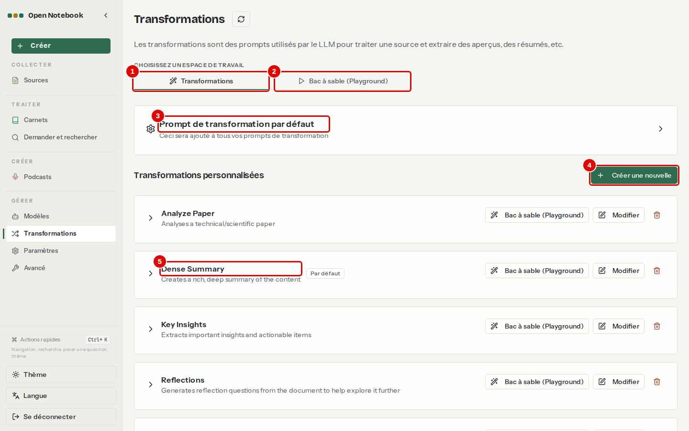
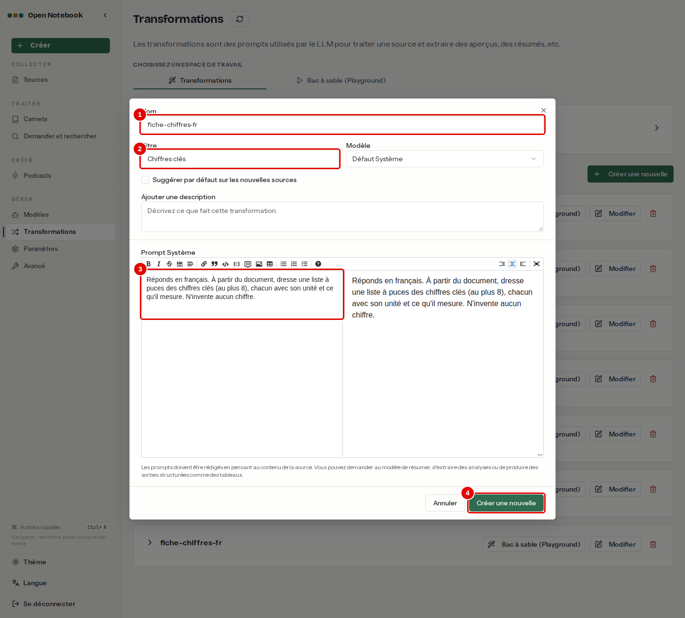
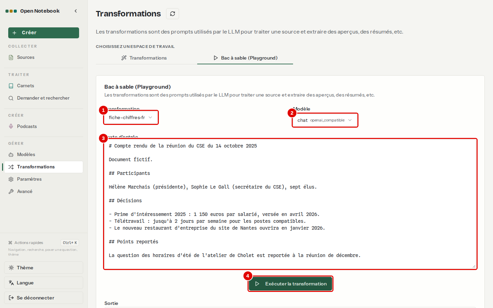
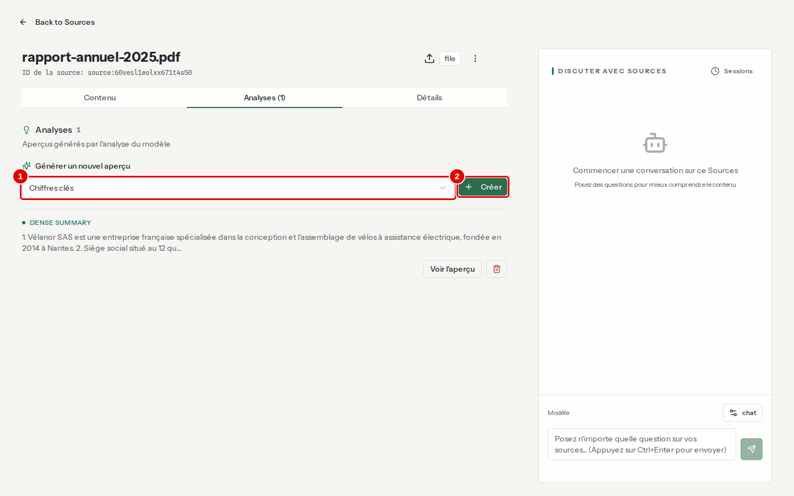
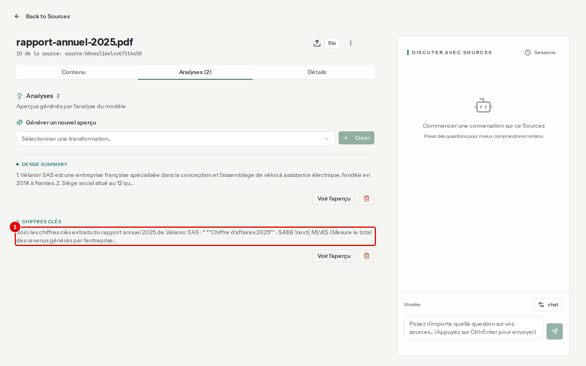

# 07. Prendre des notes et transformer les sources

> Ce chapitre apprend à écrire et garder des notes dans un carnet, à utiliser les transformations fournies, à créer sa propre transformation, à l'essayer, puis à l'appliquer à un document.
> **Point de départ** : page du carnet « Démo Vélanor » (chapitre [05](05-ajouter-et-organiser-les-sources.md)).
> **Durée** : environ 15 minutes. **Avant** : chapitre [06](06-discuter-avec-les-sources.md).

## Ce qu'il faut savoir

Une **note** est un texte gardé dans un carnet : écrite à la main, ou réponse du modèle enregistrée d'un clic (chapitre [06](06-discuter-avec-les-sources.md), étape 3). Les notes partent au modèle avec les sources, et la recherche les trouve. Une **transformation** est une consigne réutilisable que le modèle applique à un document : résumer, lister les points clés, faire une table des matières… Son résultat s'appelle une **analyse** et se range dans l'onglet « Analyses » de la source ; l'interface dit aussi **aperçu** (« 1 aperçus » sur une carte, « Générer un nouvel aperçu ») : les deux mots désignent la même chose, et le résumé automatique « Dense Summary » d'un nouveau document est l'une de ces analyses. Six transformations sont fournies, avec des consignes en anglais ; « Dense Summary » s'applique d'office à chaque nouveau document.

## Écrire une note

**Étape 1. Écrire la note**
*Où* : page du carnet › colonne NOTES › « Écrire une note » (déplier la colonne si elle est repliée).
Cliquer sur « Note sans titre » pour donner un titre, écrire le texte, puis « Créer la note ».

*Écran : fenêtre « Créer une note ».*

| N° | Élément | Rôle |
|---|---|---|
| 1 | Titre | ici « Points à vérifier » ; un clic sur « Note sans titre » le rend modifiable |
| 2 | Texte de la note | éditeur avec barre de mise en forme (gras, italique, listes, liens, tableaux…) |
| 3 | « Créer la note » | enregistre la note dans le carnet |

**Étape 2. Retrouver la note**
*Où* : colonne NOTES du carnet.

*Écran : carnet « Démo Vélanor », colonne NOTES.*

| N° | Élément | Rôle |
|---|---|---|
| 1 | Carte de la note | titre et date ; un clic rouvre la note pour la modifier |
| 2 | « Context » | les notes comptent dans ce qui part au modèle |

## Utiliser et créer des transformations

**Étape 3. Lire la page Transformations**
*Où* : menu de gauche › GÉRER › « Transformations ».

*Écran : Transformations, onglet « Transformations ».*

| N° | Élément | Rôle |
|---|---|---|
| 1 | « Transformations » | liste des transformations |
| 2 | « Bac à sable (Playground) » | essai d'une transformation sur un texte collé (étape 5) |
| 3 | « Prompt de transformation par défaut » | consigne ajoutée à toutes les transformations, par exemple « Réponds en français » |
| 4 | « Créer une nouvelle » | crée une transformation (étape 4) |
| 5 | « Dense Summary » | transformation fournie, appliquée d'office aux nouveaux documents ; « Modifier » change sa consigne |

**Étape 4. Créer une transformation en français**
*Où* : Transformations › « Créer une nouvelle ».
Une consigne courte, en français, avec un format de sortie imposé, convient mieux à un petit modèle qu'une consigne fournie en anglais.

*Écran : fenêtre « Créer une nouvelle ».*

| N° | Élément | Rôle |
|---|---|---|
| 1 | « Nom » | identifiant court, ici `fiche-chiffres-fr` |
| 2 | « Titre » | titre des analyses produites, ici « Chiffres clés » |
| 3 | « Prompt Système » | la consigne : « Réponds en français. À partir du document, dresse une liste à puces des chiffres clés (au plus 8), chacun avec son unité et ce qu'il mesure. N'invente aucun chiffre. » |
| 4 | « Créer une nouvelle » | enregistre la transformation |

*Résultat* : la transformation apparaît dans la liste et dans le bac à sable sous son nom, `fiche-chiffres-fr` ; ses analyses portent son titre, « Chiffres clés ». La case « Suggérer par défaut sur les nouvelles sources » de la même fenêtre la cocherait d'office dans l'assistant d'ajout.

**Étape 5. Essayer la transformation dans le bac à sable**
*Où* : Transformations › onglet « Bac à sable (Playground) ».
Choisir la transformation et le modèle, coller un texte, puis « Exécuter la transformation ». Pour l'exemple, ouvrir `corpus/documents/cse-2025-10-14.md` du dépôt dans un éditeur de texte, tout copier, puis coller dans « Texte d'entrée ». Le résultat s'affiche sous « Sortie », en bas de la page ; rien n'est enregistré.

*Écran : Transformations, onglet « Bac à sable (Playground) ».*

| N° | Élément | Rôle |
|---|---|---|
| 1 | « Transformation » | la consigne à essayer |
| 2 | « Modèle » | modèle utilisé, ici `chat` |
| 3 | « Texte d'entrée » | texte d'essai, ici le compte rendu du CSE du corpus |
| 4 | « Exécuter la transformation » | lance l'essai |

*Résultat* : sur ce compte rendu, la sortie liste « 1 150 euros par salarié » (prime d'intéressement), « 2 jours/semaine » (télétravail) et « 7 (élus) ».

**Étape 6. Appliquer la transformation à un document**
*Où* : page de la source `rapport-annuel-2025.pdf` (menu « Sources », clic sur la ligne) › onglet « Analyses ».
Choisir « Chiffres clés » sous « Générer un nouvel aperçu », puis « Créer ».

*Écran : page de la source, onglet « Analyses ».*

| N° | Élément | Rôle |
|---|---|---|
| 1 | « Sélectionner une transformation... » | la transformation à appliquer |
| 2 | « Créer » | lance la transformation en arrière-plan |

**Étape 7. Lire l'analyse produite**
*Où* : même onglet, après quelques secondes.

*Écran : page de la source, onglet « Analyses (2) ».*

| N° | Élément | Rôle |
|---|---|---|
| 1 | Analyse « Chiffres clés » | début du résultat ; « Voir l'aperçu » l'ouvre en entier, la corbeille la supprime |

*Résultat* : les chiffres sont justes (chiffre d'affaires 2025 : 48,6 M€…), mais le modèle les a écrits en notation mathématique (`$48,6 \text{ M}\€$`). Pour une forme plus simple, préciser « en texte simple, sans notation mathématique » dans la consigne ou dans le « Prompt de transformation par défaut » (effet de cette précision non mesuré dans ce manuel).

## Bon à savoir

- Une analyse part au modèle quand la source est en mode « aperçus » (chapitre [06](06-discuter-avec-les-sources.md)) : de bonnes analyses permettent d'envoyer moins de texte.
- Les transformations fournies ont des consignes en anglais : leurs analyses sortent parfois en anglais. Une copie en français, créée comme à l'étape 4, évite ce mélange.

## En cas de problème

| Symptôme | Cause | Que faire |
|---|---|---|
| Résultat en notation mathématique (`$…$`, `\text{…}`) | habitude du petit modèle | préciser le format attendu dans la consigne |
| « Exécuter la transformation » reste grisé | transformation ou modèle non choisi | choisir les deux listes |
| Transformation impossible sur une source | source sans texte (document scanné) | chapitre [12](12-en-cas-de-probleme.md) |

---
*Version décrite : Open Notebook 1.15.1, service LLM central (`chat`), essais du 12 novembre 2026. Détails et preuves : [rapport d'essais](../annexes/A6-rapport-d-essais.md).*
