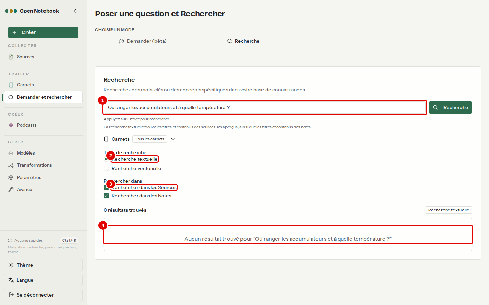
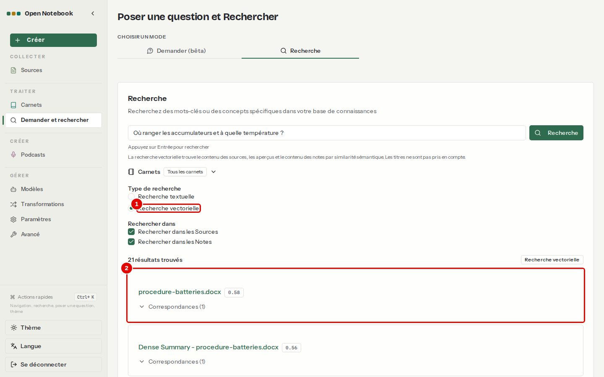
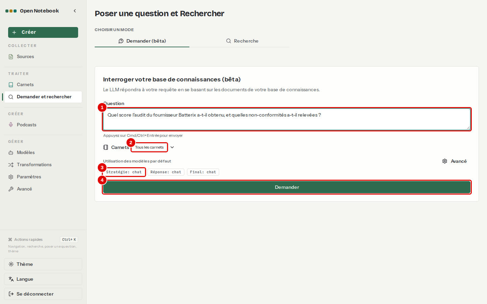
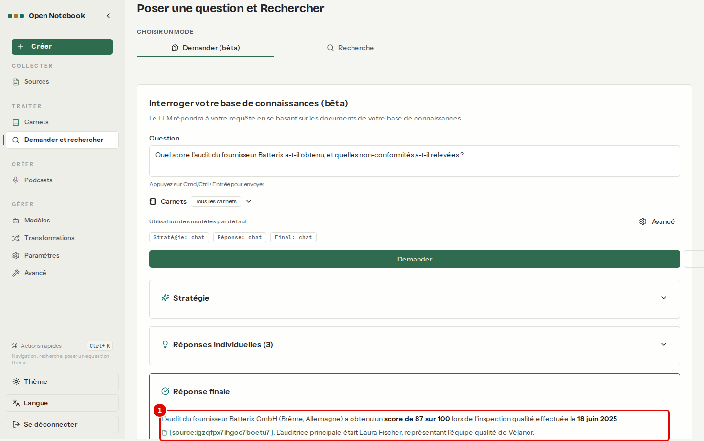

# 08. Rechercher et demander

> Ce chapitre apprend à chercher dans tous les carnets, par mots exacts ou par le sens, et à poser une question à l'ensemble des documents avec « Demander ».
> **Point de départ** : menu de gauche › TRAITER › « Demander et rechercher ».
> **Durée** : environ 10 minutes. **Avant** : chapitre [05](05-ajouter-et-organiser-les-sources.md) (documents indexés).

## Ce qu'il faut savoir

La page ouverte par le lien « Demander et rechercher » s'intitule « Poser une question et Rechercher ». Elle travaille sur tous les carnets à la fois (ou sur un seul, au choix). Elle a deux onglets. **Recherche** retrouve des documents et des notes : la *recherche textuelle* cherche les mots exacts, comme un moteur de recherche classique ; la *recherche vectorielle* cherche par le sens, à partir des embeddings, et trouve donc aussi les reformulations et les textes dans une autre langue. **Demander (bêta)** répond à une question : le modèle prépare lui-même quelques recherches par le sens, lit les passages trouvés et rédige une réponse. Contrairement à la conversation d'un carnet, elle n'envoie au modèle que les passages trouvés, ce qui convient aux grands volumes.

## Rechercher

**Étape 1. Chercher par mots exacts**
*Où* : « Demander et rechercher », onglet « Recherche ».
Écrire « Où ranger les accumulateurs et à quelle température ? », laisser « Recherche textuelle », puis Entrée.

*Écran : onglet « Recherche », recherche textuelle.*

| N° | Élément | Rôle |
|---|---|---|
| 1 | Champ de recherche | mots ou question ; Entrée lance la recherche |
| 2 | « Recherche textuelle » | mots exacts dans les titres, contenus, aperçus et notes |
| 3 | « Rechercher dans les Sources » | avec « Rechercher dans les Notes », choisit ce qui est fouillé |
| 4 | « Aucun résultat » | aucun document ne contient ces mots exacts : la procédure parle de « batteries », pas d'« accumulateurs » |

*Résultat* : la recherche textuelle ne sert qu'aux mots exacts : références, noms propres, termes précis.

**Étape 2. Chercher par le sens**
*Où* : même onglet, « Type de recherche » › « Recherche vectorielle », puis Entrée dans le champ.

*Écran : onglet « Recherche », recherche vectorielle.*

| N° | Élément | Rôle |
|---|---|---|
| 1 | « Recherche vectorielle » | recherche par le sens |
| 2 | Premier résultat | document trouvé, avec son score de ressemblance et « Correspondances » (les passages trouvés) |

*Résultat* : la procédure de stockage des batteries arrive en tête, alors qu'aucun mot de la question n'y figure tel quel. Attention : la recherche par le sens renvoie toujours quelque chose, même pour un sujet absent des documents ; lire les scores et les passages avant de conclure.

## Demander

**Étape 3. Poser une question à tous les carnets**
*Où* : onglet « Demander (bêta) ».
Écrire « Quel score l'audit du fournisseur Batterix a-t-il obtenu, et quelles non-conformités a-t-il relevées ? », laisser « Tous les carnets », puis « Demander ».

*Écran : onglet « Demander (bêta) », question écrite.*

| N° | Élément | Rôle |
|---|---|---|
| 1 | « Question » | la question en langage courant ; Ctrl+Entrée l'envoie |
| 2 | « Carnets » | « Tous les carnets », ou un seul |
| 3 | Modèles utilisés | « Stratégie », « Réponse », « Final » : modèle de chaque étape, ici `chat` partout ; « Avancé » permet d'en changer |
| 4 | « Demander » | lance la recherche et la rédaction |

**Étape 4. Lire la réponse**
*Où* : même onglet, sous la question.

*Écran : onglet « Demander (bêta) », réponse.*

| N° | Élément | Rôle |
|---|---|---|
| 1 | Score dans la réponse | « 87 » : la réponse, sous « Réponse finale », donne le score de 87 sur 100, l'étiquetage incomplet des palettes et la protection antistatique manquante, avec ses citations |

*Résultat* : la réponse arrive après plusieurs appels au modèle, plus lentement qu'une question dans un carnet ; elle s'appuie sur les passages trouvés, pas sur des documents entiers.

## Bon à savoir

- Seuls les documents indexés (« Indexé (Embedded) » à « Oui » dans la page « Sources ») sont trouvés par la recherche vectorielle et par « Demander ».
- La recherche textuelle est instantanée ; la recherche vectorielle prend une à quelques secondes (calcul de l'embedding de la question).
- Les notes sont fouillées aussi : une réponse gardée en note peut ressortir dans une recherche.

## En cas de problème

| Symptôme | Cause | Que faire |
|---|---|---|
| « Aucun résultat » sur une question en langage courant | recherche textuelle : mots exacts seulement | passer en « Recherche vectorielle » |
| Résultats sans rapport | aucun passage pertinent, mais la recherche par le sens renvoie toujours quelque chose | lire les scores et les passages |
| Recherche vectorielle vide après un changement de modèle | index à reconstruire | chapitre [10](10-regler-l-application.md), étapes 3 et 4 |

---
*Version décrite : Open Notebook 1.15.1, service LLM central (`chat`, `embed`), essais du 12 novembre 2026. Détails et preuves : [évaluation](../annexes/A1-qualite-et-performances.md), [rapport d'essais](../annexes/A6-rapport-d-essais.md).*
