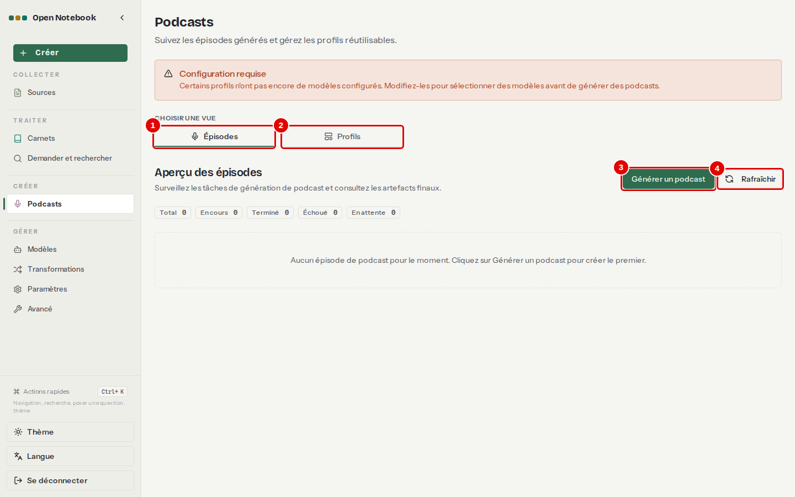
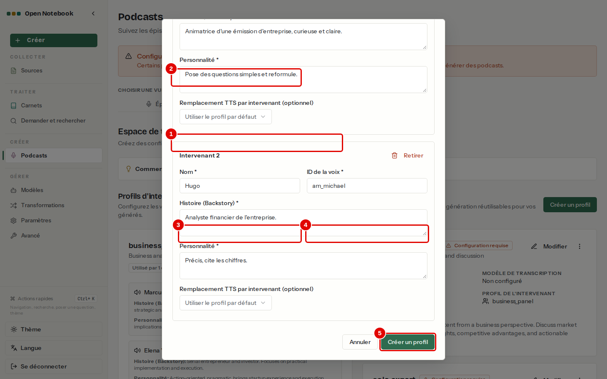
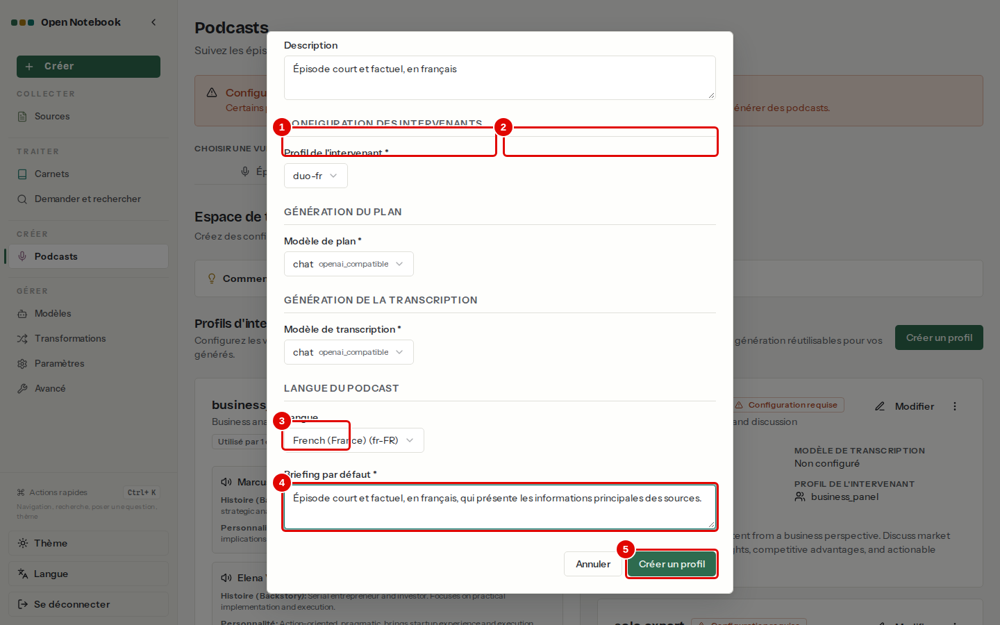
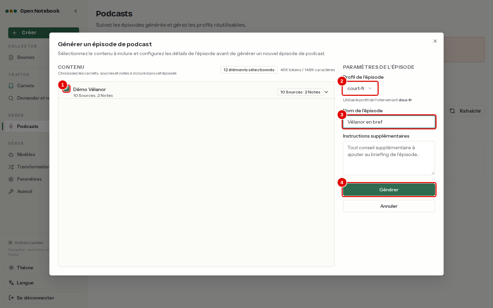
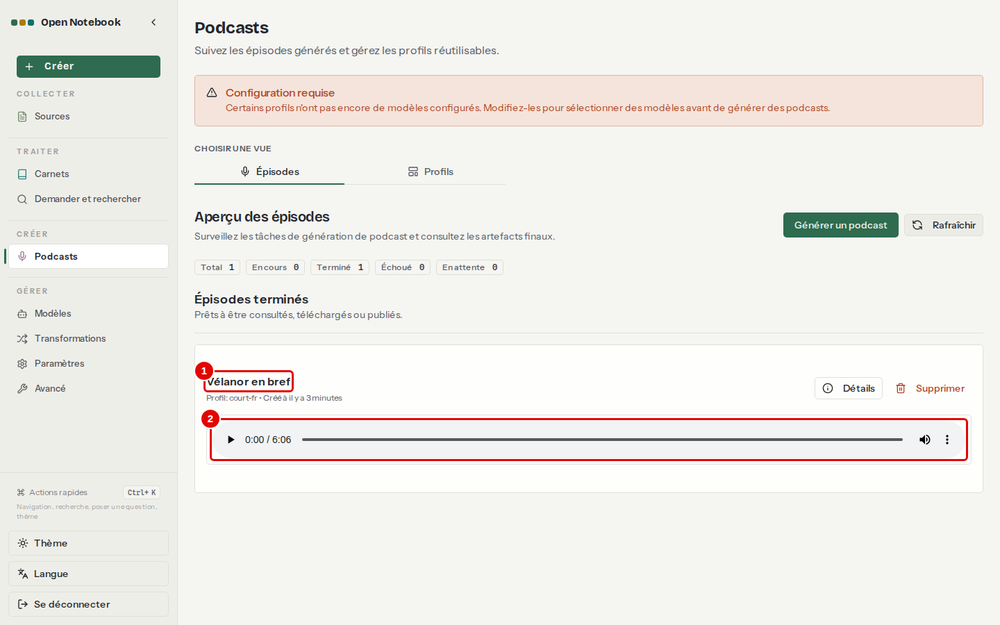

# 09. Créer un podcast

> Ce chapitre apprend à régler les voix et le déroulé d'un podcast, à générer un épisode à partir d'un carnet et à l'écouter.
> **Point de départ** : menu de gauche › CRÉER › « Podcasts ».
> **Durée** : environ 10 minutes de réglages, puis plusieurs minutes de génération. **Avant** : chapitre [05](05-ajouter-et-organiser-les-sources.md) (carnet « Démo Vélanor »).

## Ce qu'il faut savoir

Un **podcast** est un épisode audio où une à quatre voix de synthèse présentent le contenu d'un carnet. Il se fabrique en trois temps, en arrière-plan : le modèle `chat` découpe le contenu en parties (le plan), écrit les répliques de chaque intervenant, puis chaque réplique est lue par un modèle de **synthèse vocale** et les morceaux sont assemblés en un fichier MP3. La synthèse vocale ne vient pas du service central : elle est servie par un petit serveur de voix local (Kokoro), installé avec Open Notebook (chapitre [02](02-installer-open-notebook.md)). Deux réglages se préparent une fois pour toutes : le **profil d'intervenants** (les voix) et le **profil d'épisode** (le déroulé).

**Étape 1. Ouvrir la page Podcasts**
*Où* : menu de gauche › CRÉER › « Podcasts ».

*Écran : Podcasts, onglet « Épisodes ».*

| N° | Élément | Rôle |
|---|---|---|
| 1 | « Épisodes » | épisodes générés ou en cours, avec leur lecteur |
| 2 | « Profils » | réglages des voix et des épisodes |
| 3 | « Générer un podcast » | lance un nouvel épisode (étape 4) |
| 4 | « Rafraîchir » | met à jour l'état des épisodes |

## Régler les voix et le déroulé

**Étape 2. Créer le profil d'intervenants**
*Où* : onglet « Profils » › « Créer un intervenant ».
Choisir le modèle vocal, nommer le profil, puis décrire chaque intervenant ; « Ajouter un intervenant » en ajoute un, jusqu'à quatre. Ici, profil `duo-fr` : Camille (voix `ff_siwis`, animatrice) et Hugo (voix `am_michael`, analyste).

*Écran : fenêtre « Créer un profil d'intervenant ».*

| N° | Élément | Rôle |
|---|---|---|
| 1 | « Modèle vocal » | modèle de synthèse vocale, ici `speaches-ai/Kokoro-82M-v1.0-ONNX` |
| 2 | « Nom du profil » | ici `duo-fr` |
| 3 | « Nom » | nom de l'intervenant, prononcé dans le dialogue |
| 4 | « ID de la voix » | identifiant de la voix dans le serveur de voix : `ff_siwis` est la seule voix française de Kokoro |
| 5 | « Créer un profil » | enregistre le profil |

*Résultat* : le profil apparaît sous « Profils d'intervenants ». Les champs « Histoire (Backstory) » et « Personnalité » de chaque intervenant sont obligatoires : ils orientent le ton des répliques.

**Étape 3. Créer le profil d'épisode**
*Où* : onglet « Profils » › « Créer un profil ».
Ici, profil `court-fr` : trois parties, intervenants `duo-fr`, modèle `chat` pour le plan et pour le texte, langue « French (France) (fr-FR) », et un briefing.

*Écran : fenêtre « Créer un profil d'épisode ».*

| N° | Élément | Rôle |
|---|---|---|
| 1 | « Nom du profil » | ici `court-fr` |
| 2 | « Segments » | nombre de parties de l'épisode ; peu de parties = épisode court |
| 3 | « Profil de l'intervenant » | voix utilisées, ici `duo-fr` |
| 4 | Briefing | consigne générale : « Épisode court et factuel, en français, qui présente les informations principales des sources. » |
| 5 | « Créer un profil » | enregistre le profil |

## Générer et écouter un épisode

**Étape 4. Générer l'épisode**
*Où* : onglet « Épisodes » › « Générer un podcast ».
Cocher le carnet « Démo Vélanor » (toutes ses sources et notes sont alors choisies), choisir le profil `court-fr`, nommer l'épisode, puis « Générer ».

*Écran : fenêtre « Générer un épisode de podcast ».*

| N° | Élément | Rôle |
|---|---|---|
| 1 | Case du carnet « Démo Vélanor » | choisit tout le carnet : « 12 éléments sélectionnés » (sources et notes) ; chaque élément peut aussi être coché à part, en résumé ou en contenu complet |
| 2 | « Profil de l'épisode » | ici `court-fr` |
| 3 | « Nom de l'épisode » | ici « Vélanor en bref » |
| 4 | « Générer » | lance la génération en arrière-plan |

*Résultat* : la fenêtre se ferme ; l'épisode est fabriqué en arrière-plan, en quelques minutes ici.

**Étape 5. Écouter l'épisode**
*Où* : onglet « Épisodes » › « Rafraîchir ».

*Écran : Podcasts, onglet « Épisodes », épisode terminé.*

| N° | Élément | Rôle |
|---|---|---|
| 1 | « Vélanor en bref » | l'épisode, compté dans « Terminé » en haut de la liste |
| 2 | Lecteur audio | lecture de l'épisode dans le navigateur |

*Résultat* : le dialogue, en français, alterne Camille et Hugo et reprend des chiffres justes du carnet (« un chiffre d'affaires total de 48,6 millions d'euros avec une croissance […] de 12,4 % »). Le fichier MP3, d'environ 6 Mo, rangé dans `donnees/open-notebook/notebook_data/podcasts/episodes/` sur le poste. Les compteurs « Total », « En cours », « Terminé », « Échoué » et « En attente » résument l'état des générations.

## Bon à savoir

- La génération passe après les autres tâches de fond (une à la fois dans cette installation) : un épisode lancé pendant l'ajout de documents attend la fin de celui-ci.
- Un épisode ne contient pas de citations : il résume, il ne prouve pas.
- Le bandeau « Configuration requise » de la page Podcasts concerne les profils d'exemple fournis sans modèle de voix ; il n'empêche pas d'utiliser les profils créés ici (chapitre [12](12-en-cas-de-probleme.md), cas 5).

---
*Version décrite : Open Notebook 1.15.1, service LLM central (`chat`), serveur de voix Speaches 0.8.3 (Kokoro), essais du 12 novembre 2026. Détails et preuves : [rapport d'essais](../annexes/A6-rapport-d-essais.md).*
