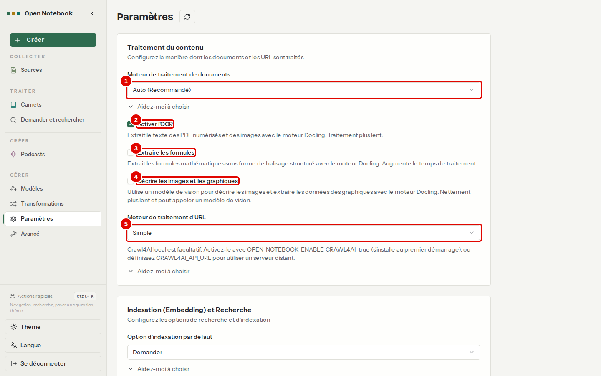
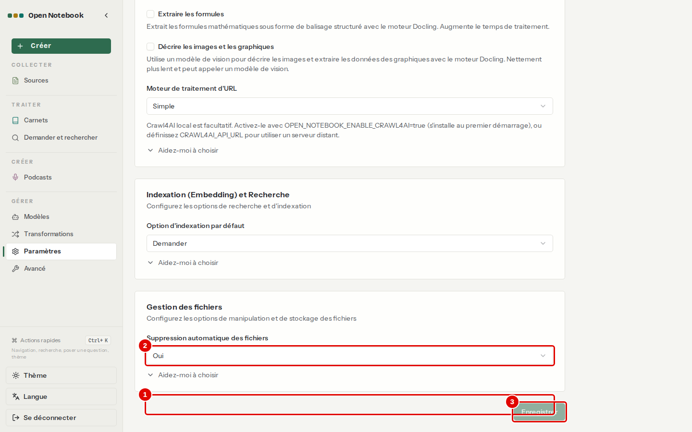
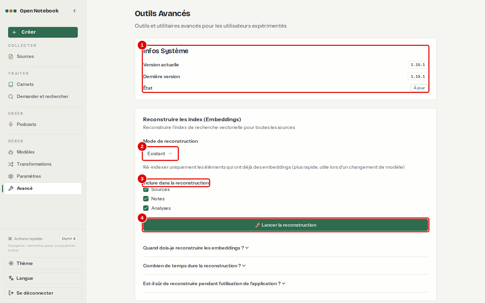
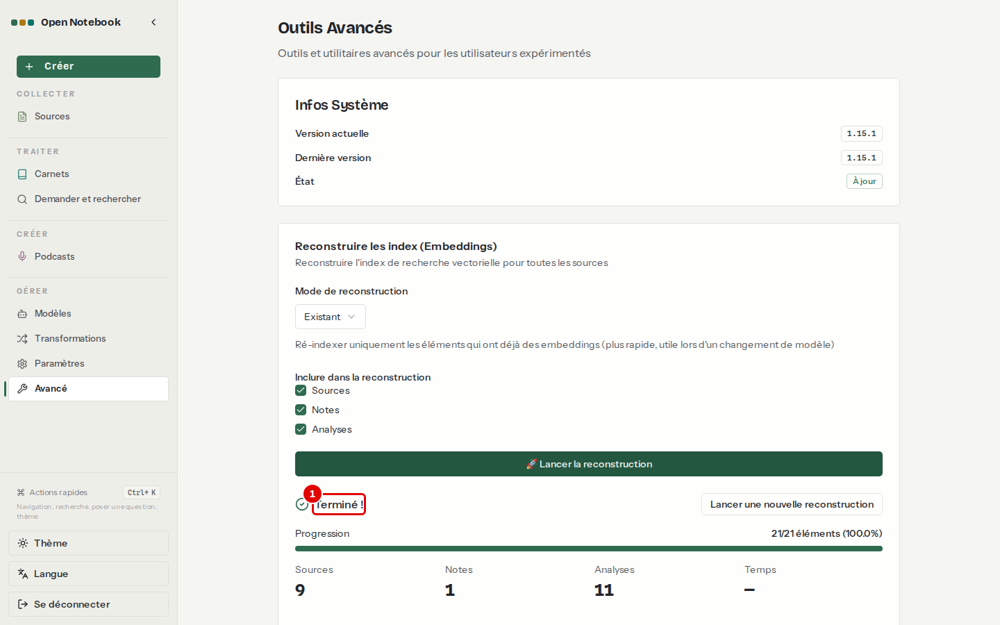

# 10. Régler l'application

> Ce chapitre apprend à régler la lecture des documents, l'indexation pour la recherche et la gestion des fichiers, à connaître la version installée, et à reconstruire les index de recherche.
> **Point de départ** : menu de gauche › GÉRER › « Paramètres ».
> **Durée** : environ 10 minutes, plus la durée de la reconstruction. **Avant** : chapitre [05](05-ajouter-et-organiser-les-sources.md).

## Ce qu'il faut savoir

Les réglages de la page « Paramètres » s'appliquent aux documents ajoutés **après** leur modification : un document déjà lu ne change pas, sauf s'il est retraité (« Réessayer le traitement ») ou ajouté de nouveau. La page « Avancé » donne la version installée et permet de **reconstruire les index**, c'est-à-dire de recalculer les embeddings de tous les documents : indispensable après un changement de modèle d'embedding (chapitre [03](03-premiers-pas.md), étape 13), sinon la recherche par le sens compare des nombres qui ne correspondent plus.

## Régler la lecture des documents

**Étape 1. Choisir le moteur et les options de lecture**
*Où* : menu de gauche › GÉRER › « Paramètres », cadre « Traitement du contenu ».

*Écran : Paramètres, cadre « Traitement du contenu ».*

| N° | Élément | Rôle |
|---|---|---|
| 1 | « Moteur de traitement de documents » | « Auto (Recommandé) » choisit le moteur selon le fichier ; « Docling » lit mieux les tableaux ; « Simple » est le plus rapide |
| 2 | « Activer l'OCR » | lit le texte des PDF scannés et des images avec Docling ; dans la version 1.15.1 installée ici, cette lecture échoue (chapitre [12](12-en-cas-de-probleme.md)) |
| 3 | « Extraire les formules » | garde les formules mathématiques ; traitement plus long |
| 4 | « Décrire les images et les graphiques » | fait décrire les images par un modèle de vision ; nettement plus lent |
| 5 | « Moteur de traitement d'URL » | lecture des pages web ; « Simple » n'appelle aucun service extérieur |

*Résultat* : « Aidez-moi à choisir », sous chaque liste, déplie une explication des choix.

**Étape 2. Régler l'indexation et les fichiers, puis enregistrer**
*Où* : même page, cadres « Indexation (Embedding) et Recherche » et « Gestion des fichiers » (faire défiler).

*Écran : Paramètres, bas de la page.*

| N° | Élément | Rôle |
|---|---|---|
| 1 | « Option d'indexation par défaut » | « Demander » : l'assistant d'ajout propose l'indexation ; « Toujours » ou « Jamais » : sans question |
| 2 | « Suppression automatique des fichiers » | « Oui » : le fichier d'origine peut être effacé une fois le texte extrait |
| 3 | « Enregistrer » | applique les réglages |

*Résultat* : les réglages enregistrés valent pour les documents ajoutés ensuite. Les captures montrent les réglages de cette installation, laissés tels quels.

## Connaître la version et reconstruire les index

**Étape 3. Lire la page Avancé**
*Où* : menu de gauche › GÉRER › « Avancé ».

*Écran : Outils Avancés.*

| N° | Élément | Rôle |
|---|---|---|
| 1 | « Infos Système » | « Version actuelle », « Dernière version » publiée, « État » (« À jour ») |
| 2 | « Mode de reconstruction » | « Existant » : seulement les éléments déjà indexés, le plus rapide après un changement de modèle |
| 3 | « Inclure dans la reconstruction » | « Sources », « Notes », « Analyses » |
| 4 | « Lancer la reconstruction » | démarre le recalcul en arrière-plan |

**Étape 4. Lancer la reconstruction**
*Où* : page « Avancé » › « Lancer la reconstruction ».

*Écran : Outils Avancés, reconstruction lancée.*

| N° | Élément | Rôle |
|---|---|---|
| 1 | État de la reconstruction | progression, puis fin du recalcul |

*Résultat* : les documents sont de nouveau trouvés par la recherche par le sens (chapitre [08](08-rechercher-et-demander.md)). L'application reste utilisable pendant la reconstruction ; les trois questions dépliables en bas de la page en disent plus.

## Bon à savoir

- La « Dernière version » est lue sur GitHub : c'est le seul appel extérieur que l'application fait d'elle-même, et il ne se coupe pas.
- Les réglages techniques (taille des passages, nombre de tâches simultanées, délais) ne sont pas dans l'interface : ils se règlent au démarrage des conteneurs (annexe [A5](../annexes/A5-fonctionnement-interne.md)).

## En cas de problème

| Symptôme | Cause | Que faire |
|---|---|---|
| Recherche par le sens sans résultat pertinent après un changement de modèle | index calculés avec l'ancien modèle | reconstruire les index (étapes 3 et 4) |
| Un réglage n'a pas d'effet sur un document | le document a été lu avant le changement | « Réessayer le traitement » ou ajouter le document de nouveau |

---
*Version décrite : Open Notebook 1.15.1, essais du 12 novembre 2026. Détails et preuves : [fonctionnement interne](../annexes/A5-fonctionnement-interne.md), [rapport d'essais](../annexes/A6-rapport-d-essais.md).*
