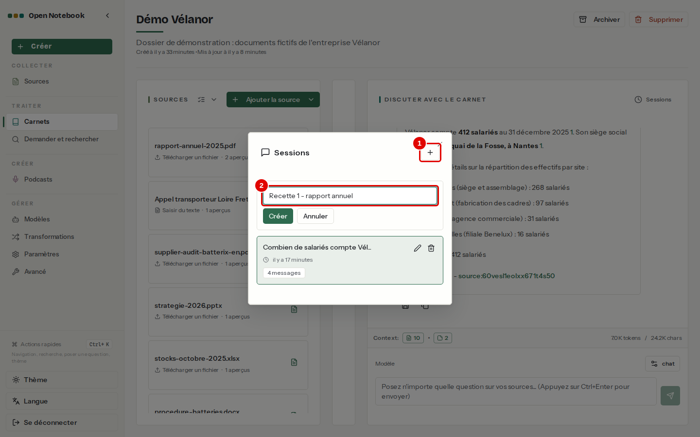
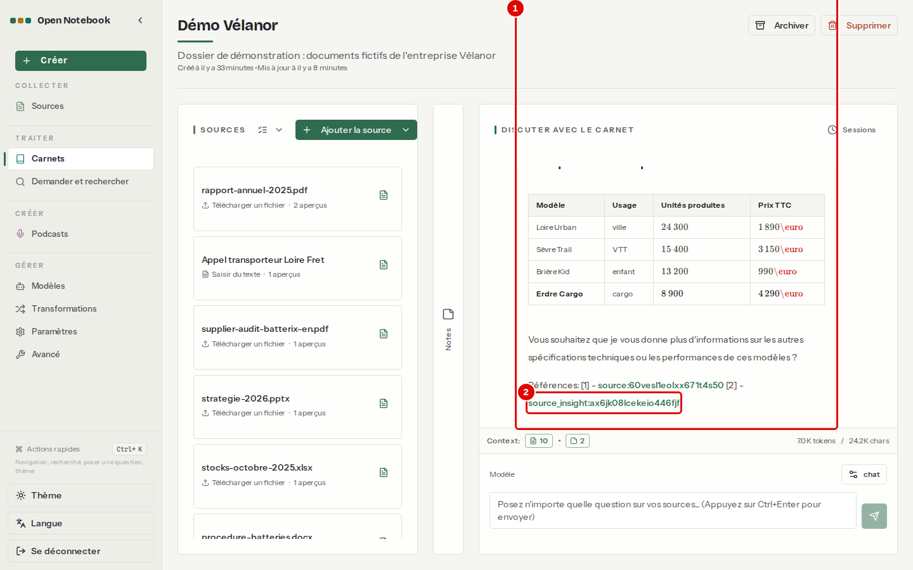
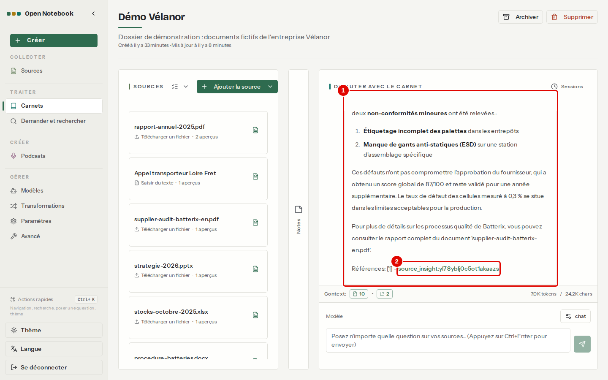
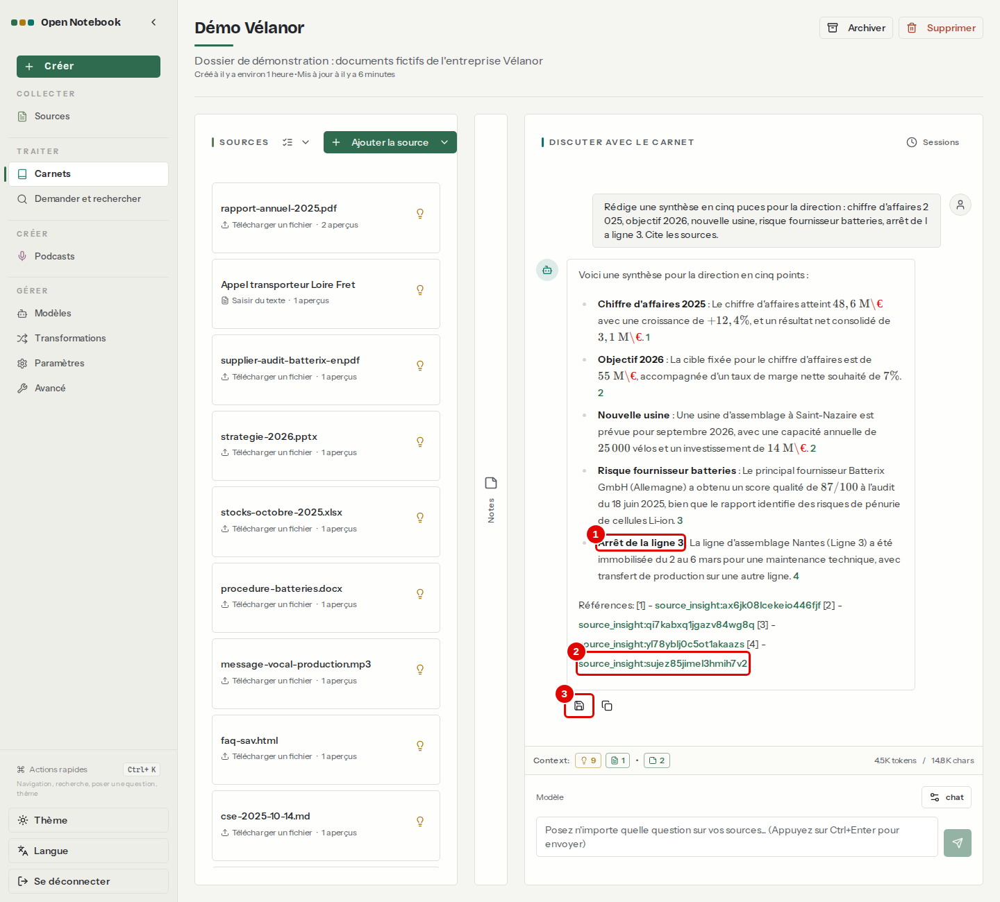
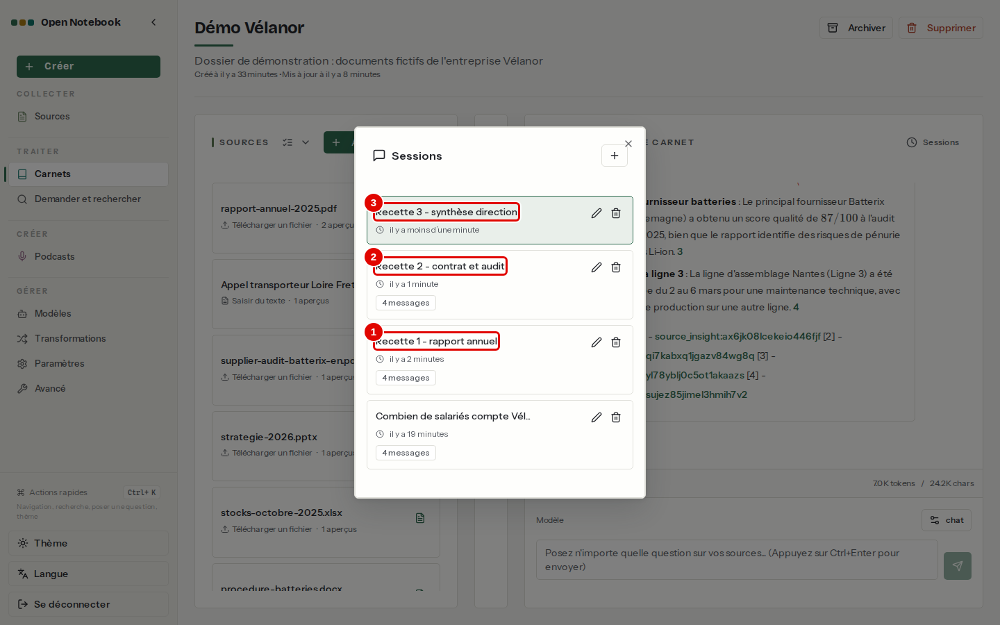

# 11. Cas pratiques

> Ce chapitre déroule trois cas réels de bout en bout sur le dossier fictif de l'entreprise Vélanor, chacun dans sa propre conversation : analyser un rapport annuel, confronter un contrat à la réalité, préparer une synthèse pour la direction.
> **Point de départ** : page du carnet « Démo Vélanor » (chapitre [05](05-ajouter-et-organiser-les-sources.md)), colonne NOTES repliée.
> **Durée** : environ 20 minutes. **Avant** : chapitres [06](06-discuter-avec-les-sources.md) et [07](07-notes-et-transformations.md).

**Risque.** Une réponse citée n'est pas une réponse vérifiée : les chiffres destinés à une décision se relisent dans la source, que la citation permet d'ouvrir.

## Ce qu'il faut savoir

Chaque cas utilise une **session** séparée : l'historique reste court et chaque sujet se retrouve d'un clic. Avant de commencer, toutes les sources du carnet passent en contenu complet (« Contexte » › « Tout inclure (contenu complet) », chapitre [06](06-discuter-avec-les-sources.md), étape 1) : le compteur « Context » indique alors environ 7 000 jetons, un peu plus qu'au chapitre [06](06-discuter-avec-les-sources.md) parce que les notes ajoutées entre-temps partent aussi au modèle. Les mêmes questions posées avec les sources en aperçus seuls ont donné des réponses incomplètes : le trimestre le plus élevé n'était pas trouvé.

**Étape 1. Ouvrir une session pour le cas**
*Où* : colonne DISCUTER AVEC LE CARNET › « Sessions » › bouton « + ».
Donner un titre à la session, puis « Créer ».

*Écran : fenêtre « Sessions », création d'une session.*

| N° | Élément | Rôle |
|---|---|---|
| 1 | Bouton « + » | prépare une nouvelle session |
| 2 | « Saisissez un titre ici... » | titre de la session, ici « Recette 1 - rapport annuel » ; « Créer » la crée et l'ouvre |

## Cas 1 : analyser le rapport annuel

**But** : retrouver en deux questions les chiffres d'activité de l'année.

**Étape 2. Poser les questions**
*Où* : session « Recette 1 - rapport annuel ».
Questions posées : « Quel est le chiffre d'affaires 2025 et quel trimestre a été le plus élevé ? », puis « Quel modèle est le plus vendu et quel est le plus cher ? ».

*Écran : carnet « Démo Vélanor », session « Recette 1 - rapport annuel ».*

| N° | Élément | Rôle |
|---|---|---|
| 1 | Réponse | « Loire Urban » le plus vendu (24 300 unités), « Erdre Cargo » le plus cher (4 290 €) |
| 2 | Citation | renvoi au rapport annuel ou à son aperçu |

*Résultat* : réponses justes : chiffre d'affaires de 48,6 M€, troisième trimestre le plus élevé, puis les deux modèles ; réponses en 13 à 20 secondes.

## Cas 2 : confronter le contrat, les stocks et l'audit

**But** : vérifier si un fournisseur tient ses engagements, à partir de trois documents.

**Étape 3. Poser les questions**
*Où* : nouvelle session « Recette 2 - contrat et audit ».
Questions posées : « Le délai de livraison réellement constaté chez Batterix respecte-t-il le délai prévu par le contrat ? », puis « Quelles non-conformités l'audit de Batterix a-t-il relevées ? ».

*Écran : carnet « Démo Vélanor », session « Recette 2 - contrat et audit ».*

| N° | Élément | Rôle |
|---|---|---|
| 1 | Réponse | deux non-conformités mineures (étiquetage incomplet des palettes, protection antistatique manquante à une station d'assemblage), score de 87 sur 100 |
| 2 | Citation | renvoi à l'audit, document en anglais : la réponse est en français |

*Résultat* : le délai constaté (24 jours, tiré du classeur des stocks) est juste ; le délai prévu au contrat reste inconnu, parce que le contrat est le document scanné non lu (chapitre [12](12-en-cas-de-probleme.md), cas 3). Dans cette réponse, le modèle a cité le nom du fichier (`source:stocks-octobre-2025.xlsx`) au lieu de son identifiant : la citation ne s'ouvre pas d'un clic.

## Cas 3 : préparer une synthèse pour la direction

**But** : obtenir une synthèse courte, la garder en note et la relire contre les sources.

**Étape 4. Demander la synthèse et la garder**
*Où* : nouvelle session « Recette 3 - synthèse direction ».
Question : « Rédige une synthèse en cinq puces pour la direction : chiffre d'affaires 2025, objectif 2026, nouvelle usine, risque fournisseur batteries, arrêt de la ligne 3. Cite les sources. » Puis cliquer sur l'icône d'enregistrement sous la réponse.

*Écran : carnet « Démo Vélanor », session « Recette 3 - synthèse direction », rouverte après coup (le compteur « Context » en bas montre l'état du carnet à ce moment-là, pas celui de la question).*

| N° | Élément | Rôle |
|---|---|---|
| 1 | Réponse | cinq puces, chacune avec sa citation |
| 2 | Citation | renvoi à la source ou à son aperçu |
| 3 | Enregistrer en note | garde la synthèse dans la colonne NOTES |

*Résultat* : la synthèse est en note, sous un titre proposé par le modèle (« Synthèse directionnelle : CA 2025, objectifs 2026, usine Saint-Nazaire et risques fournisseurs »). Les montants sont justes (48,6 M€ en 2025, objectif 55 M€ en 2026) mais écrits en notation mathématique (`$48,6 \text{ M}\€$`) : à remettre en forme avant diffusion.

**Étape 5. Retrouver les trois cas**
*Où* : colonne DISCUTER AVEC LE CARNET › « Sessions ».

*Écran : fenêtre « Sessions ».*

| N° | Élément | Rôle |
|---|---|---|
| 1 | « Recette 1 - rapport annuel » | cas 1, rouvrable avec son historique |
| 2 | « Recette 2 - contrat et audit » | cas 2 |
| 3 | « Recette 3 - synthèse direction » | cas 3 |

## Bon à savoir

- Une question de synthèse demande plus de réflexion au modèle : compter de 15 secondes à une minute.
- Le carnet « Démo Vélanor » est laissé en place avec ces conversations et ses notes, pour être consulté tel quel.

---
*Version décrite : Open Notebook 1.15.1, service LLM central (`chat`), essais du 12 novembre 2026. Détails et preuves : [rapport d'essais](../annexes/A6-rapport-d-essais.md).*
