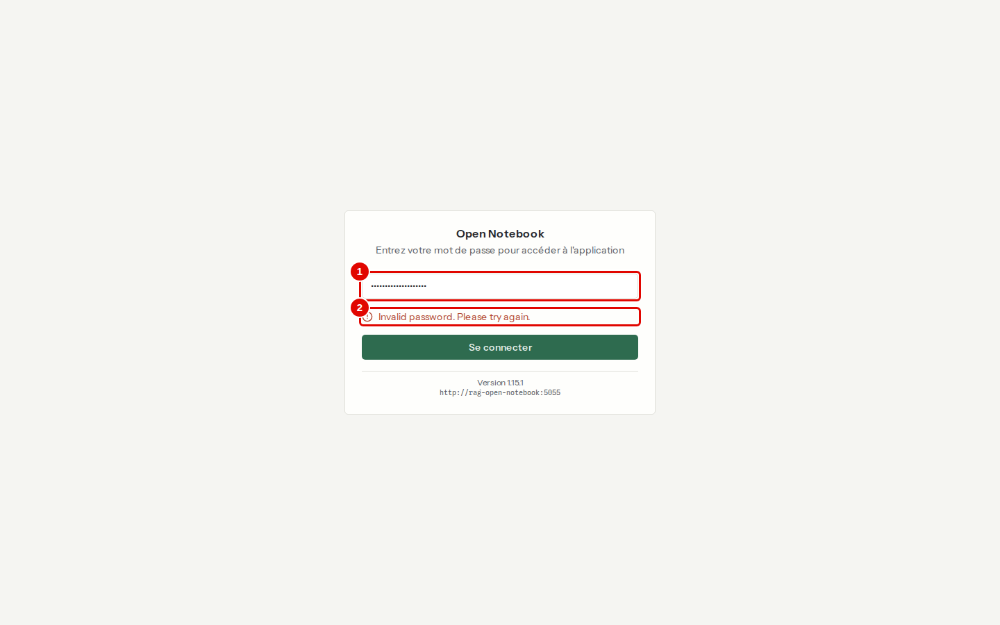
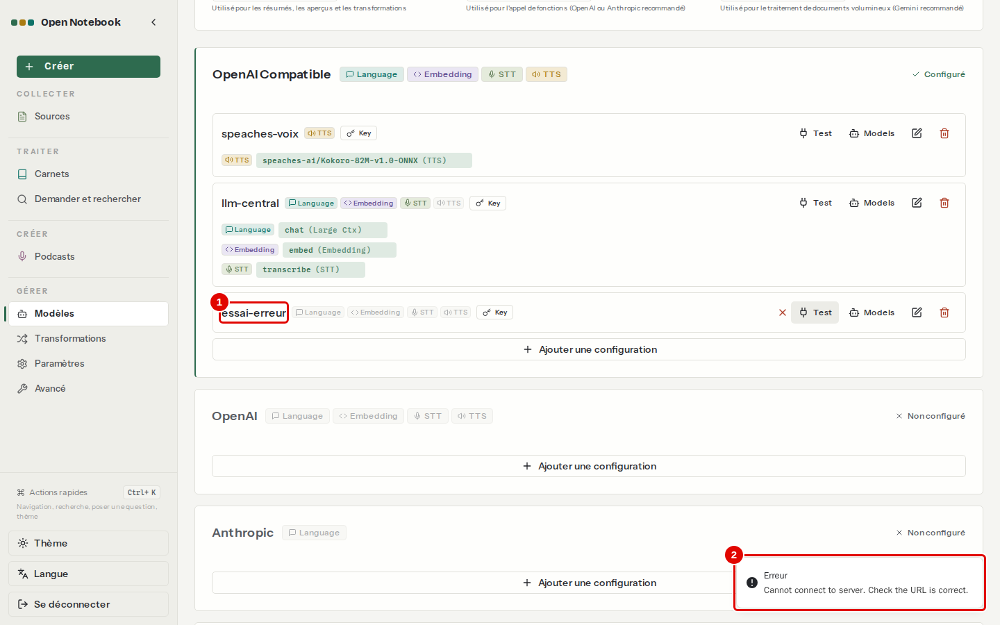
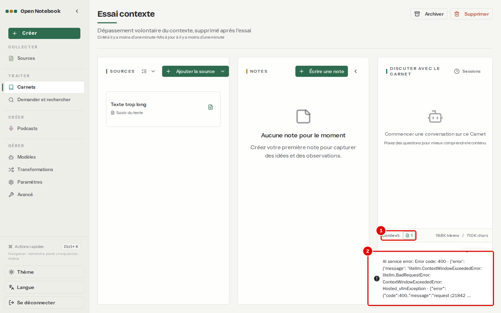
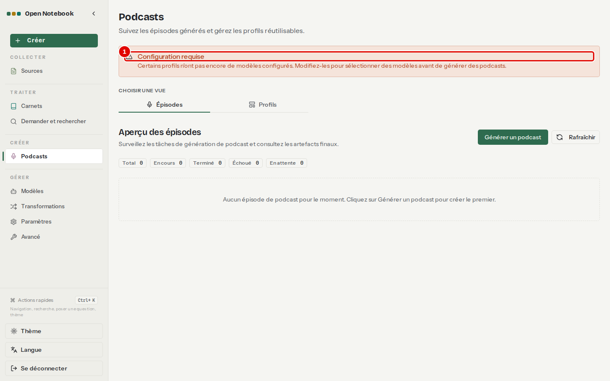

# 12. En cas de problème

> Ce chapitre apprend à reconnaître les erreurs réellement rencontrées pendant les essais, leur cause et leur remède.
> **Point de départ** : l'écran où l'erreur apparaît ; chaque cas indique où le reproduire.
> **Durée** : à la demande. **Avant** : chapitres [02](02-installer-open-notebook.md) à [06](06-discuter-avec-les-sources.md).

## Ce qu'il faut savoir

Les messages d'Open Notebook sont courts, parfois en anglais. Le détail se lit dans le journal de l'application, depuis le terminal Ubuntu : `outils/open-notebook/compose.sh logs --tail 100 open_notebook`. Les cas ci-dessous ont tous été provoqués ou observés pendant les essais.

## Le mot de passe est refusé

**Cas 1. « Invalid password. Please try again. »**
*Où* : page de connexion, `http://127.0.0.1:8502`.

*Écran : page de connexion, après un mauvais mot de passe.*

| N° | Élément | Rôle |
|---|---|---|
| 1 | Champ du mot de passe | à remplir avec la ligne « Mot de passe » de `donnees/IDENTIFIANTS-LOCAUX.txt` |
| 2 | « Invalid password. Please try again. » | le mot de passe ne correspond pas |

*Remède* : recopier le mot de passe sans espace en trop. Il est fixé à l'installation et ne change pas tant que `donnees/open-notebook/.env` est gardé.

## Le service de modèles ne répond pas

**Cas 2. Test de connexion en échec**
*Où* : menu de gauche › « Modèles » › carte d'une configuration › « Test ».
Provoqué ici avec une configuration volontairement fausse (adresse `http://llm-central:9999/v1`), supprimée ensuite.

*Écran : Modèles, test d'une configuration fausse.*

| N° | Élément | Rôle |
|---|---|---|
| 1 | `essai-erreur` | configuration testée |
| 2 | Message « Erreur » | le service ne répond pas à cette adresse, ou refuse la clé |

*Remède* : vérifier l'adresse (`http://llm-central:8080/v1`, avec `/v1`) et la clé (« Modifier » sur la carte) ; vérifier que le service central tourne, depuis le terminal : `outils/communs/llm_central_sante.sh --essai` ; s'il ne répond pas, le démarrer (chapitre [02](02-installer-open-notebook.md), étape 2). Les conversations échouent de la même façon tant que le service est arrêté.

## Un document n'est pas lu

**Cas 3. Carte « Échec », titre « Processing... »**
*Où* : colonne SOURCES d'un carnet (voir la capture du chapitre [05](05-ajouter-et-organiser-les-sources.md), étape 4).
Le contrat scanné du corpus est une image : il ne contient aucun texte, et la reconnaissance de caractères (« Activer l'OCR », chapitre [10](10-regler-l-application.md)) ne fonctionne pas dans cette version. La carte affiche « Échec » et garde le titre provisoire « Processing... ».

*Remède* : passer le PDF dans un logiciel de reconnaissance de caractères avant de l'ajouter, ou coller son texte avec « Saisir du texte ». Tant qu'il n'est pas lu, les questions qui le concernent reçoivent « je ne trouve pas d'information », ou une réponse tirée d'un autre document (par exemple le délai constaté au lieu du délai prévu au contrat).

## La question est trop longue pour le modèle

**Cas 4. Message d'erreur à l'envoi d'une question**
*Où* : conversation d'un carnet dont les sources en contenu complet dépassent la limite du modèle.
Provoqué ici avec un carnet « Essai contexte » contenant un texte d'environ 80 000 caractères (plus de 16 384 jetons), en contenu complet, supprimé ensuite.

*Écran : carnet « Essai contexte », après l'envoi d'une question.*

| N° | Élément | Rôle |
|---|---|---|
| 1 | « Context » | taille de ce qui part au modèle : ici 19,8 K jetons, au-delà de la limite de 16 384 |
| 2 | Message d'erreur | « AI service error: Error code: 400 … ContextWindowExceededError … request (21842 … » : le service refuse la requête, rien n'est tronqué en silence |

*Remède* : envoyer moins de texte (sources en aperçus ou exclues, chapitre [06](06-discuter-avec-les-sources.md)), ouvrir une nouvelle session si l'historique est long, ou passer par « Demander » (chapitre [08](08-rechercher-et-demander.md)), qui n'envoie que les passages trouvés.

## La réponse est incomplète ou fausse

| Symptôme | Cause | Remède |
|---|---|---|
| « Je ne trouve pas d'information » alors que le document la contient | sources en mode aperçus : le résumé ne contient pas le détail (constaté : le trimestre le plus élevé n'est pas trouvé) | « Contexte » › « Tout inclure (contenu complet) », puis vérifier le compteur « Context » avant de poser la question |
| Chiffres écrits en notation mathématique (`$48,6 \text{ M}\euro$`) | habitude du petit modèle `chat` | préciser le format dans la question ou dans la consigne de la transformation |
| La citation ouvre un résumé (« Aperçu de la source ») et pas le document | le modèle a cité l'aperçu (`source_insight:…`) | passer les sources en contenu complet ; ouvrir le document depuis « Sources » |
| Réponse lente (une minute ou plus) | réflexion du modèle sur une question de synthèse | normal avec `chat` ; poser des questions plus précises |

## Les podcasts

**Cas 5. Bandeau « Configuration requise »**
*Où* : menu de gauche › « Podcasts ».

*Écran : Podcasts, bandeau d'avertissement.*

| N° | Élément | Rôle |
|---|---|---|
| 1 | « Configuration requise » | « Certains profils n'ont pas encore de modèles configurés » : les profils d'exemple fournis n'ont pas de modèle de voix |

*Remède* : sans conséquence pour les profils créés au chapitre [09](09-creer-un-podcast.md) ; modifier ou supprimer les profils d'exemple (« business_panel », « solo_expert », « tech_experts ») fait disparaître le bandeau.

## Autres situations

| Symptôme | Cause | Remède |
|---|---|---|
| `http://127.0.0.1:8502` ne répond pas | conteneurs arrêtés | `outils/open-notebook/demarrer.sh` ; `outils/open-notebook/etat.sh` pour l'état |
| Recherche par le sens sans résultat après un changement de modèle | index calculés avec l'ancien modèle | chapitre [10](10-regler-l-application.md), reconstruction des index |
| « Attribution automatique des défauts » répond « Tous les modèles par défaut sont déjà configurés » alors qu'une case est vide | l'ancien modèle par défaut a été supprimé | choisir le modèle à la main (chapitre [03](03-premiers-pas.md), étape 13) |
| Un document ajouté reçoit un nom suivi de « (1) » | un fichier du même nom existe déjà | sans conséquence ; renommer n'est pas nécessaire |

---
*Version décrite : Open Notebook 1.15.1, service LLM central, essais du 12 novembre 2026. Détails et preuves : [exploitation](../annexes/A4-exploitation.md), [rapport d'essais](../annexes/A6-rapport-d-essais.md).*
